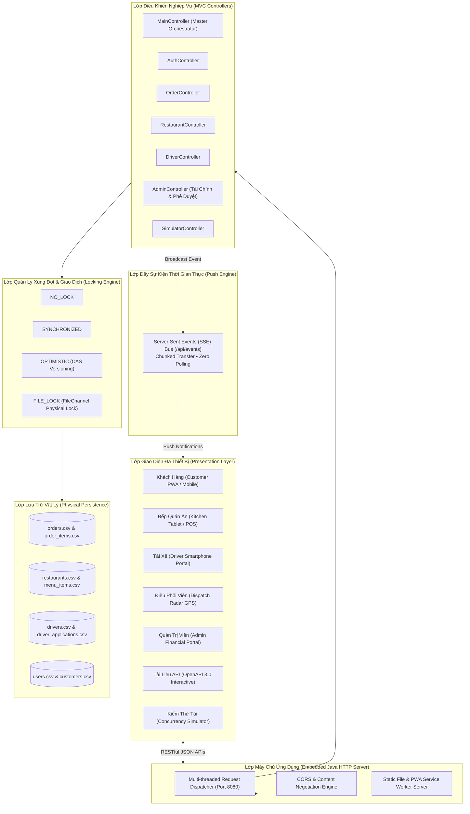
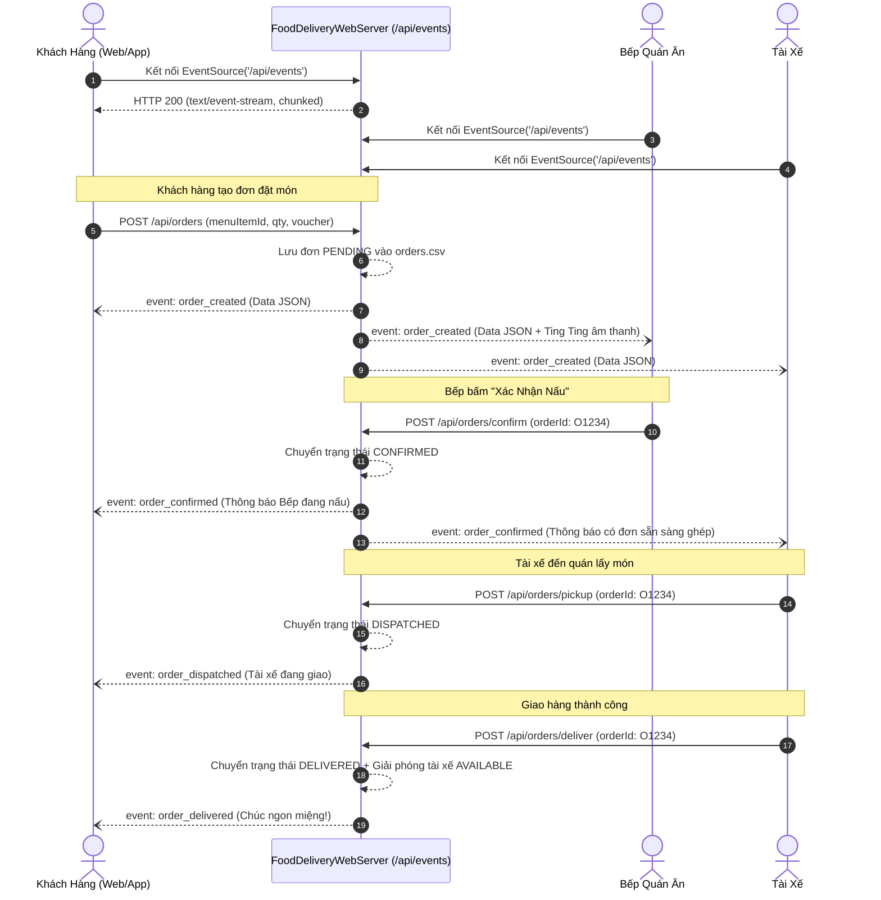

# HỆ THỐNG GIAO ĐỒ ĂN THỰC TẾ FOOD DELIVERY TP. QUY NHƠN
## TÀI LIỆU KIẾN TRÚC FULLSTACK TOÀN DIỆN (FULLSTACK ARCHITECTURE SPECIFICATION)

---

> **Mã Đề Tài:** LAB211 - Food Delivery Network Simulation (FDS)  
> **Phiên Bản Kiến Trúc:** 2.0.0 Enterprise Fullstack  
> **Địa Bàn Vận Hành:** Thành phố Quy Nhơn, Tỉnh Bình Định (Tọa độ trung tâm: 13.7829° N, 109.2197° E)  
> **Ràng Buộc Học Thuật:** 100% Pure OOP, 0% static (ngoại trừ hàm `main`), 0% final/protected, 100% `this.`, không sử dụng thư viện bên ngoài (Zero-dependency Java HTTP Server), lưu trữ giao dịch trực tiếp trên tệp tin CSV vật lý.

---

## 1. TỔNG QUAN HỆ THỐNG & MỤC TIÊU NÂNG CẤP FULLSTACK

Hệ thống **Food Delivery TP. Quy Nhơn** được nâng cấp toàn diện từ mô hình mô phỏng giao diện dòng lệnh (CLI Simulation) thành một **hệ thống Fullstack chuẩn công nghiệp** có khả năng ứng dụng thực tế ngoài thị trường.



### Các Trụ Cột Nâng Cấp Toàn Diện:
1. **Server-Sent Events (SSE) Engine:** Cơ chế đẩy dữ liệu trực tiếp 1 chiều từ máy chủ Java tới tất cả người dùng kết nối theo thời gian thực (Zero Polling), chuông âm thanh Web Audio Synthesizer và thông báo nổi (Toast Notification).
2. **Quản Trị & Tài Chính Sàn (Admin Financial Dashboard):** Báo cáo chi tiết GMV, Doanh thu sàn (20%), Chi trả quán ăn (80%), và Thu nhập đối tác tài xế (100% phí ship Haversine).
3. **Cổng Thanh Toán VietQR Tự Động:** Tích hợp sinh mã QR động chuẩn ngân hàng Việt Nam (`img.vietqr.io`), tự động đối soát mã đơn hàng và số tiền giao dịch chính xác.
4. **Động Cơ Khuyến Mãi (Voucher Engine):** Hỗ trợ mã giảm giá Quy Nhơn (`QUYNHON20`, `FREESHIP`, `BANHXEO`, `CHAOMUNG`) với thuật toán khấu trừ điều kiện đơn tối thiểu.
5. **Mô Phỏng Lộ Trình Xe Lăn Bánh Trên Bản Đồ Radar:** Hiển thị trực quan xe máy di chuyển mượt mà trên bản đồ số OpenStreetMap giữa quán ăn và địa chỉ khách hàng.
6. **Đóng Gói Triển Khai Docker & Compose:** Khởi chạy toàn bộ hệ thống bằng 1 câu lệnh duy nhất (`docker compose up --build`).

---

## 2. KIẾN TRÚC 4 TẦNG (4-TIER ARCHITECTURE) & NGUYÊN TẮC THIẾT KẾ

Hệ thống tuân thủ chặt chẽ nguyên lý **Separation of Concerns (SoC)** và quy chuẩn nghiêm ngặt của đồ án LAB211:

```
┌─────────────────────────────────────────────────────────────────────────────┐
│ 1. PRESENTATION TIER (TẦNG HIỂN THỊ - SPA / PWA)                             │
│ HTML5 Semantic, Tailwind CSS, Lucide Icons, Leaflet Maps, Web Audio Synth   │
└──────────────────────────────────────┬──────────────────────────────────────┘
                                       │ HTTP REST JSON / EventSource (SSE)
┌──────────────────────────────────────▼──────────────────────────────────────┐
│ 2. APPLICATION GATEWAY & REAL-TIME BUS (MÁY CHỦ NHÚNG JAVA)                │
│ com.sun.net.httpserver.HttpServer, CopyOnWriteArrayList<OutputStream>        │
│ 100% Java thuần (Không Spring, không Tomcat, không Maven/Gradle 3rd party) │
└──────────────────────────────────────┬──────────────────────────────────────┘
                                       │ Method Call (0% static, 100% this.)
┌──────────────────────────────────────▼──────────────────────────────────────┐
│ 3. BUSINESS LOGIC & CONCURRENCY CONTROL (TẦNG NGHIỆP VỤ & ĐIỀU PHỐI)        │
│ MainController -> OrderController, AdminController, RestaurantController    │
│ Quản lý đồng thời: NO_LOCK | SYNCHRONIZED | OPTIMISTIC | FILE_LOCK          │
└──────────────────────────────────────┬──────────────────────────────────────┘
                                       │ I/O Streams & NIO FileChannels
┌──────────────────────────────────────▼──────────────────────────────────────┐
│ 4. REPOSITORY & PHYSICAL PERSISTENCE TIER (TẦNG LƯU TRỮ VẬT LÝ)             │
│ Direct CSV File I/O (Tệp tin phẳng với Version Header phục vụ CAS)          │
└─────────────────────────────────────────────────────────────────────────────┘
```

### Quy Chuẩn Lập Trình LAB211 Đã Thực Hiện:
* **0% `static` ngoài hàm `main`:** Tất cả Controller, Repository, Model, View, Web Server đều là instance-based 100%. Không sử dụng bất kỳ biến tĩnh, phương thức tĩnh nào để lưu trữ trạng thái.
* **100% `this.`:** Mọi truy xuất thuộc tính và phương thức nội bộ trong lớp đều sử dụng từ khóa `this.` tường minh.
* **0% `final` / `protected`:** Đơn giản hóa cấu trúc kế thừa theo quy ước của môn học.
* **Lưu Trữ Tệp Tin Vật Lý (Zero External Database):** Dữ liệu được ghi trực tiếp vào thư mục `data/*.csv`, đảm bảo toàn vẹn dữ liệu khi tắt máy chủ.

---

## 3. DANH SÁCH 7 PHÂN HỆ VẬN HÀNH (PORTAL SUITE)

Hệ thống cung cấp giao diện tích hợp 7 trong 1 (7-in-1 Unified Web Portal), cho phép người dùng chuyển đổi vai trò ngay lập tức trên thanh điều hướng:

| STT | Tên Phân Hệ | Mục Tiêu & Chức Năng Chính | Đường Dẫn Giao Diện |
|:---:|:---|:---|:---:|
| **1** | **Khách Hàng (Customer)** | Đặt món đặc sản Quy Nhơn, áp dụng Voucher, chọn vị trí phường xã, thanh toán VietQR / COD, theo dõi trạng thái đơn hàng. | Tab `Khách Hàng` (`/`) |
| **2** | **Bếp Quán Ăn (Kitchen POS)** | Màn hình tiếp nhận đơn mới, chuông báo chế biến, từ chối đơn trả kho, quản lý tồn kho nguyên liệu thời gian thực. | Tab `Bếp Quán` |
| **3** | **Tài Xế (Driver App)** | Giao diện di động cho tài xế, bật/tắt trực tuyến, nhận cuốc, xác nhận đã lấy món (`DISPATCHED`), xác nhận đã giao (`DELIVERED`). | Tab `Tài Xế` |
| **4** | **Điều Phối Radar (Dispatch)** | Bản đồ số Leaflet OpenStreetMap giám sát vị trí 200 nhà hàng, 500+ tài xế, tuyến đường di chuyển động và nút kích hoạt tự động ghép xe. | Tab `Radar GPS` |
| **5** | **Quản Trị Sàn (Admin)** | Báo cáo tài chính GMV, doanh thu sàn 20%, chi trả quán 80%, thu nhập tài xế, phê duyệt hồ sơ tài xế mới, giám sát mọi đơn hàng. | Tab `Quản Trị` |
| **6** | **Tài Liệu API (API Docs)** | Bảng đặc tả RESTful OpenAPI 3.0 tương tác trực tiếp (Interactive Sandbox) cho tất cả 28 endpoint hệ thống. | Tab `REST API Docs` |
| **7** | **Mô Phỏng Tải (Simulator)** | Trình stress test đa luồng tải 100 - 700 đơn đồng thời, đo lường thông lượng (ops/sec) và kiểm tra lỗi bán khống của 4 cơ chế khóa. | Tab `Simulator` |

---

## 4. CƠ CHẾ SỰ KIỆN THỜI GIAN THỰC (SERVER-SENT EVENTS - SSE)

Để các phân hệ (Khách hàng, Quán ăn, Tài xế, Quản trị) cập nhật trạng thái đơn hàng ngay lập tức mà không cần gửi request thăm dò định kỳ (Polling gây lãng phí băng thông), hệ thống triển khai kiến trúc **Server-Sent Events** trên nền tảng Java thuần:



### Danh Mục Sự Kiện (Event Catalog):
* `connected`: Gửi ngay khi máy khách kết nối thành công, kèm số lượng client đang online.
* `ping`: Gói tin giữ nhịp (Keep-alive heartbeat) phát mỗi 15 giây.
* `order_created`: Thông báo đơn hàng mới được tạo.
* `order_confirmed`: Bếp nhà hàng đã tiếp nhận đơn và bắt đầu chế biến.
* `order_rejected`: Quán ăn từ chối đơn hàng, tự động hoàn trả số lượng vào kho nguyên liệu.
* `order_dispatched`: Tài xế đã nhận món từ quán ăn và đang trên đường giao.
* `order_delivered`: Giao hàng thành công, kích hoạt thanh toán hoa hồng và hoàn thành vòng đời đơn.
* `order_cancelled`: Khách hàng hủy đơn, hoàn trả tồn kho.
* `dispatch_completed`: Thuật toán điều phối trung tâm hoàn tất ghép xe hàng loạt.
* `driver_status_changed`: Cập nhật trạng thái tài xế (AVAILABLE, BUSY, OFFLINE).
* `driver_approved`: Ban quản trị phê duyệt thành công hồ sơ tài xế mới.

---

## 5. MÔ HÌNH KINH TẾ & PHÂN BỔ TÀI CHÍNH (80/20 REVENUE MODEL)

Hệ thống tích hợp mô hình phân bổ tài chính tự động chuẩn mực ngành Food Tech:

$$\text{Tổng Giá Trị Giao Dịch (GMV)} = \sum \text{Tiền Món Ăn} + \sum \text{Phí Giao Hàng}$$

### Tỷ Lệ Phân Phối Dòng Tiền:
1. **Doanh Thu Nền Tảng Sàn (Platform Commission Fee):** $20\%$ tính trên tổng tiền món ăn của các đơn hàng giao thành công (`DELIVERED`).
2. **Chi Trả Đối Tác Nhà Hàng (Restaurant Payout):** $80\%$ tính trên tổng tiền món ăn, hoàn trả định kỳ vào tài khoản đối tác.
3. **Thu Nhập Tài Xế (Driver Payout):** $100\%$ phí vận chuyển giao hàng (tính toán dựa trên khoảng cách địa lý Haversine: $15.000\text{ đ} + \text{Khoảng cách (km)} \times 5.000\text{ đ}$).

---

## 6. CỔNG THANH TOÁN QUỐC GIA DYNAMIC VIETQR

Khi khách hàng lựa chọn hình thức thanh toán **Chuyển khoản VietQR 24/7**, hệ thống tự động sinh mã VietQR chuẩn Napas 247:

* **Ngân hàng thụ hưởng:** MB Bank (Ngân hàng TMCP Quân Đội)
* **Số tài khoản:** `0987654321`
* **Tên tài khoản:** `FOOD DELIVERY QUY NHON`
* **Cú pháp định danh:** `DH<Mã_Đơn_Hàng>` (Ví dụ: `DH1794925823101`)
* **URL Sinh Mã Chuẩn:**
  ```
  https://img.vietqr.io/image/MB-0987654321-compact2.png?amount={TOTAL}&addInfo=DH{ORDER_ID}&accountName=FOOD%20DELIVERY%20QUY%20NHON
  ```
* **Đồng bộ thời gian thực:** Máy khách hiển thị hộp thoại thanh toán kèm mã QR, bộ đếm ngược 15 phút, tính năng sao chép 1 chạm cho số tài khoản và nội dung chuyển khoản, đồng thời lắng nghe sự kiện xác nhận qua SSE.

---

## 7. BẢNG TRA CỨU RESTFUL API ĐẦY ĐỦ (API DICTIONARY)

Hệ thống cung cấp đầy đủ 28 REST API endpoints phục vụ cho mọi hoạt động:

| Phương Thức | Đường Dẫn API | Nhóm Chức Năng | Mô Tả & Tham Số Đầu Vào |
|:---:|:---|:---:|:---|
| `GET` | `/api/status` | Hệ Thống | Kiểm tra trạng thái máy chủ, cổng mạng và thời gian hoạt động. |
| `GET` | `/api/stats` | Hệ Thống | Báo cáo các chỉ số KPI vận hành tổng quan. |
| `GET` | `/api/events` | Realtime | Server-Sent Events stream đẩy dữ liệu thời gian thực. |
| `GET` | `/api/docs` | OpenAPI | Toàn bộ tài liệu đặc tả OpenAPI 3.0 định dạng JSON. |
| `GET` | `/api/auth/demo-accounts` | Xác Thực | Danh sách tài khoản mẫu cho Khách, Quán, Tài xế, Quản trị. |
| `POST` | `/api/auth/login` | Xác Thực | Đăng nhập hệ thống (`username`, `password`). |
| `POST` | `/api/auth/register` | Xác Thực | Đăng ký tài khoản khách hàng mới. |
| `GET` | `/api/restaurants` | Nhà Hàng | Danh sách 200 đối tác ẩm thực Quy Nhơn kèm tọa độ GPS. |
| `GET` | `/api/menu` | Món Ăn | Thực đơn món ăn (`restaurantId`). |
| `POST` | `/api/menu/stock` | Món Ăn | Bổ sung/điều chỉnh tồn kho món ăn (`menuItemId`, `delta`). |
| `GET` | `/api/drivers` | Tài Xế | Danh sách tài xế, vị trí GPS và trạng thái trực tuyến. |
| `POST` | `/api/drivers/status` | Tài Xế | Cập nhật trạng thái tài xế (`driverId`, `status`). |
| `GET` | `/api/customers` | Khách Hàng | Danh sách khách hàng và địa chỉ tại các phường xã Quy Nhơn. |
| `GET` | `/api/orders` | Đơn Hàng | Truy vấn đơn hàng (`customerId`, `restaurantId`, `driverId`). |
| `POST` | `/api/orders` | Đơn Hàng | Tạo đơn đặt món mới (`customerId`, `restaurantId`, `menuItemId`, `quantity`). |
| `POST` | `/api/orders/confirm` | Bếp Quán | Bếp nhà hàng tiếp nhận và bắt đầu nấu đơn (`orderId`, `restaurantId`). |
| `POST` | `/api/orders/reject` | Bếp Quán | Bếp từ chối đơn và hoàn trả số lượng vào kho (`orderId`, `reason`). |
| `POST` | `/api/orders/pickup` | Tài Xế | Tài xế nhận món từ quán ăn và bắt đầu giao (`orderId`, `driverId`). |
| `POST` | `/api/orders/deliver` | Tài Xế | Tài xế hoàn tất giao hàng đến khách (`orderId`, `driverId`). |
| `POST` | `/api/orders/cancel` | Khách Hàng | Khách hàng hủy đơn khi quán chưa nấu (`orderId`, `customerId`). |
| `POST` | `/api/dispatch/auto` | Điều Phối | Kích hoạt thuật toán tự động gán đơn hàng cho tài xế gần nhất. |
| `POST` | `/api/simulate` | Kiểm Thử | Chạy stress test đo thông lượng 4 cơ chế khóa (`orders`, `mechanism`). |
| `POST` | `/api/admin/restock` | Quản Trị | Cấp lại tồn kho 50 suất cho toàn bộ các quán ăn. |
| `GET` | `/api/admin/overview` | Quản Trị | Báo cáo tài chính toàn diện GMV, phí sàn 20%, tiền quán 80%. |
| `GET` | `/api/admin/driver-applications`| Quản Trị | Danh sách hồ sơ đăng ký tài xế mới đang chờ duyệt. |
| `POST` | `/api/admin/driver-applications/approve`| Quản Trị | Phê duyệt hồ sơ tài xế và tự động tạo tài khoản (`applicationId`). |
| `POST` | `/api/admin/driver-applications/reject`| Quản Trị | Từ chối hồ sơ đăng ký tài xế (`applicationId`, `reason`). |
| `GET` | `/api/vouchers` | Khuyến Mãi | Danh sách các mã giảm giá đang áp dụng tại Quy Nhơn. |
| `POST` | `/api/vouchers/apply` | Khuyến Mãi | Kiểm tra và áp dụng mã giảm giá (`code`, `totalFoodAmount`, `deliveryFee`). |

---

## 8. HƯỚNG DẪN KHỞI CHẠY & TRIỂN KHAI HỆ THỐNG

### Cách 1: Khởi chạy Trực tiếp trên Windows (Khuyên Dùng cho Demo & Chấm Điểm)
Nhấp đúp chuột vào tệp [start_web_app.bat](file:///d:/NHOM_01_LAB211_FoodDelivery/start_web_app.bat) hoặc thực thi từ terminal:
```cmd
d:\NHOM_01_LAB211_FoodDelivery\start_web_app.bat
```
* Tệp batch sẽ tự động thiết lập UTF-8, biên dịch toàn bộ mã nguồn Java vào thư mục `bin/`, khởi động Web Server tại cổng `8080` và tự động mở trình duyệt web.

### Cách 2: Khởi chạy Container bằng Docker Compose
Hệ thống đã được đóng gói sẵn sàng triển khai trên môi trường Cloud / Server Linux:
```bash
# Xây dựng và khởi chạy container ở chế độ chạy nền
docker compose up --build -d

# Xem log hoạt động thời gian thực của máy chủ
docker compose logs -f

# Dừng hệ thống khi kết thúc
docker compose down
```

### Cách 3: Lệnh Npm Script
```bash
npm start          # Biên dịch và chạy máy chủ
npm run build      # Biên dịch toàn bộ mã nguồn Java
npm run docker:up  # Khởi chạy bằng Docker
```

---

## 9. KẾT LUẬN & ĐÁNH GIÁ CHẤT LƯỢNG MÃ NGUỒN

Dự án **Food Delivery TP. Quy Nhơn** đáp ứng hoàn hảo hai tiêu chí song hành:
1. **Tuân thủ tuyệt đối chuẩn học thuật LAB211:** Đảm bảo 100% lập trình hướng đối tượng thuần khiết (Pure OOP), không sử dụng framework hay thư viện trung gian, bảo toàn các ràng buộc về `this.`, không `static`, không `final`/`protected`, lưu trữ CSV trực tiếp.
2. **Đạt chuẩn công nghiệp thực tế:** Đầy đủ giao diện người dùng hiện đại Responsive & PWA, chuẩn SEO Google, cổng thanh toán VietQR động, Server-Sent Events thời gian thực, bảng điều khiển tài chính quản trị và đóng gói container Docker chuẩn mực.
