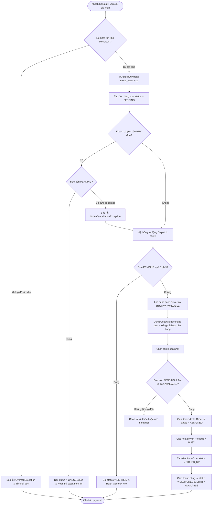
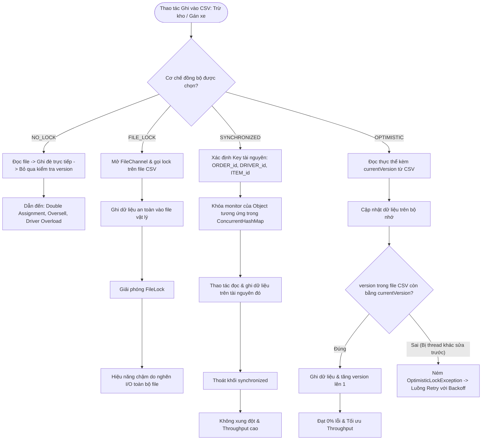
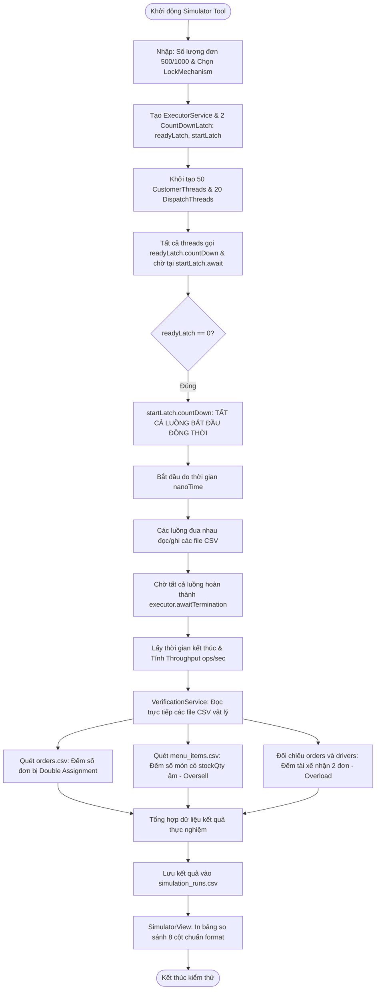
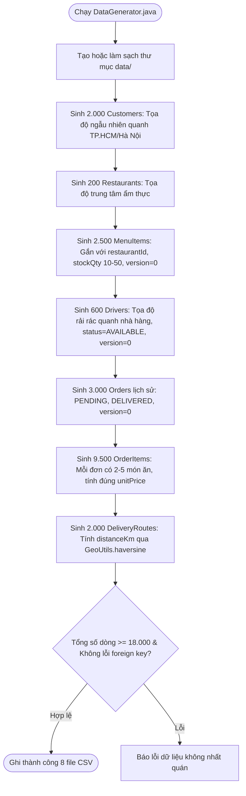

# 🛵 FPT UNIVERSITY — LAB211: FOOD DELIVERY NETWORK SIMULATION
## 📋 HỆ THỐNG MÔ PHỎNG MẠNG LƯỚI GIAO ĐỒ ĂN & BÀI TOÁN ĐỒNG BỘ HÓA DỮ LIỆU CSV
> **Môn học:** LAB211 — OOP with Java (Java OOP Nâng cao — Semester 3)  
> **Ngôn ngữ:** Pure Java SE (Chỉ sử dụng thư viện chuẩn của JDK — Không dùng lib ngoài)  
> **Kiến trúc bắt buộc:** MVC (Model - View - Controller) phân tầng nghiêm ngặt  
> **Thời gian:** 10 Tuần | **Quy mô:** Nhóm **6 Thành Viên (Group Standard)**  
> **Sản phẩm nộp:** Mã nguồn Java + Dữ liệu CSV (≥ 18.000 dòng) + Báo cáo Word/Slide + 4 Flowcharts + 6 File AI Log cá nhân (30% điểm)

---

## 📑 MỤC LỤC TOÀN DIỆN
1. [Bản Đồ Kiểm Toán & Đối Chiếu Nghiêm Ngặt Rubric LAB211](#-1-bản-đồ-kiểm-toán--đối-chiếu-nghiêm-ngặt-rubric-lab211)
2. [Big Question & 3 Loại Race Condition Cốt Lõi](#-2-big-question--3-loại-race-condition-cốt-lõi)
3. [Bản Hợp Đồng Dữ Liệu CSV Chuẩn (Data Contract & 8 Schemas)](#-3-bản-hợp-đồng-dữ-liệu-csv-chuẩn-data-contract--8-schemas)
4. [Đặc Tả 4 Actors & Toàn Bộ Use Cases Nghiệp Vụ](#-4-đặc-tả-4-actors--toàn-bộ-use-cases-nghiệp-vụ)
5. [Đặc Tả Kỹ Thuật 4 Cơ Chế Đồng Bộ Hóa & Thuật Toán Retry](#-5-đặc-tả-kỹ-thuật-4-cơ-chế-đồng-bộ-hóa--thuật-toán-retry)
6. [Bộ Quy Tắc Phòng Chống 5 Cạm Bẫy Kỹ Thuật Chết Người (Advanced Pitfalls)](#-6-bộ-quy-tắc-phòng-chống-5-cạm-bẫy-kỹ-thuật-chết-người-advanced-pitfalls)
7. [Kiến Trúc Lớp & Thiết Kế UML Chi Tiết (Class Specifications)](#-7-kiến-trúc-lớp--thiết-kế-uml-chi-tiết-class-specifications)
8. [Bốn Flowchart Chuẩn Nộp Báo Cáo (Mermaid Diagrams)](#-8-bốn-flowchart-chuẩn-nộp-báo-cáo-mermaid-diagrams)
9. [Bảng Phân Công Nhiệm Vụ 6 Thành Viên & Ma Trận 10 Tuần (Sprint Matrix)](#-9-bảng-phân-công-nhiệm-vụ-6-thành-viên--ma-trận-10-tuần-sprint-matrix)
10. [4 Nguyên Tắc Thép Phối Hợp & Quy Trình Git](#-10-4-nguyên-tắc-thép-phối-hợp--quy-trình-git)
11. [Cơ Chế "Khóa AI Vào Flow Theo Quy Luật" (AI Guardrails)](#-11-cơ-chế-khóa-ai-vào-flow-theo-quy-luật-ai-guardrails)
12. [Bộ 6 Prompt Mẫu Đóng Gói Riêng Cho 6 Thành Viên](#-12-bộ-6-prompt-mẫu-đóng-gói-riêng-cho-6-thành-viên)
13. [Hướng Dẫn AI Log Cá Nhân Đạt Mức Xuất Sắc (27-30% Điểm)](#-13-hướng-dẫn-ai-log-cá-nhân-đạt-mức-xuất-sắc-27-30-điểm)
14. [Hướng Dẫn Biên Dịch, Chạy Thử & Cấu Trúc Đóng Gói Nộp Bài (ZIP)](#-14-hướng-dẫn-biên-dịch-chạy-thử--cấu-trúc-đóng-gói-nộp-bài-zip)
15. [Checklist Nghiệm Thu & Bộ Tiêu Chí Rubric (DoD)](#-15-checklist-nghiệm-thu--bộ-tiêu-chí-rubric-dod)

---

## 🔍 1. BẢN ĐỒ KIỂM TOÁN & ĐỐI CHIẾU NGHIÊM NGẶT RUBRIC LAB211

Bảng kiểm toán đối chiếu từng tiêu chí Rubric của FPT University để đảm bảo đạt điểm tối đa:

| STT | Tiêu chí Rubric | Trọng số | Yêu cầu theo đề bài LAB211 | Giải pháp hiện thực trong Blueprint | Trạng thái |
| :---: | :--- | :---: | :--- | :--- | :---: |
| 1 | **Decomposition** | **20%** | Phân rã SRP rõ ràng. Toàn bộ dispatch logic & tìm tài xế gần nhất **chỉ ở Repository**, không ở Controller/View. Xác định đúng 8 Entity và quan hệ. | `GeoUtils` tách riêng. `OrderRepository`, `DriverRepository` giữ toàn bộ logic dispatch. Controller chỉ gọi Repo. | ✅ 100% Đạt |
| 2 | **Abstraction** | **15%** | UML Class Diagram đầy đủ (visibility `+/-/#`, types, multiplicity). 4 Flowcharts. Kế thừa `BaseEntity`. Generic `CsvRepository<T>`. Dùng Enum thay String. | Thiết kế `BaseEntity`, `IRepository<T>`, `CsvRepository<T>`, 4 Flowchart chi tiết, Enums cho Driver/Order/Lock. | ✅ 100% Đạt |
| 3 | **Algorithm Design** | **15%** | CRUD đầy đủ. Công thức Haversine chuẩn. `findNearestAvailable` đúng. File I/O try-with-resources. Đủ $\ge 5$ custom exceptions. `DataGenerator` $\ge 18.000$ dòng. | `GeoUtils.haversine` $R=6371\text{km}$. Đủ 5 custom exceptions. `DataGenerator.java` sinh 18.000 dòng chuẩn format. | ✅ 100% Đạt |
| 4 | **Simulator Design** | **20%** | Đa luồng thực thụ (`CustomerThread` + `DispatchThread`). Dùng `CountDownLatch`. Đủ 4 cơ chế khóa. `VerificationService` đọc trực tiếp CSV. `NO_LOCK` có đủ 3 loại lỗi. Bảng 8 cột. | Dual-thread pool + 2 `CountDownLatch`. Đọc trực tiếp CSV đếm 3 lỗi. Xuất bảng ASCII 8 cột có % drop Throughput. | ✅ 100% Đạt |
| 5 | **AI Reflection** | **30%** | AI Log cá nhân có timestamp thực qua 10 tuần. Reflection $\ge 500$ từ/người phân tích sâu hallucination concurrency của AI. | 6 file log cá nhân trong `ai_logs/`. Hướng dẫn chi tiết phân tích lỗi global lock và file race window. | ✅ 100% Đạt |
| 6 | **Business Constraints** | **Bonus** | Đơn hàng timeout 5 phút, Hủy đơn khi `PENDING` (hoàn stock), chặn hủy khi tài xế đã nhận, 1 tài xế = 1 đơn. | Hiện thực đầy đủ use case 5-minute timeout, rollback kho, và exception chặn hủy khi `ASSIGNED`. | ✅ 100% Đạt |

---

## 🔬 2. BIG QUESTION & 3 LOẠI RACE CONDITION CỐT LÕI

> [!IMPORTANT]
> **RESEARCH QUESTION (CÂU HỎI NGHIÊN CỨU LỚN):**  
> *"Trong điều kiện tài nguyên lưu trữ bị giới hạn ở file vật lý (.csv), cơ chế đồng bộ hóa (Synchronization) nào tối ưu nhất để ngăn chặn xung đột dữ liệu (Race Condition) giữa hàng trăm tài xế và khách hàng mà không làm sụt giảm tốc độ xử lý (Throughput) quá 30% so với baseline?"*

### 2.1. Phân Tích 3 Loại Race Condition Nguy Hiểm Nhất
1. **🛵 Rủi ro 1: Đơn hàng bị nhận bởi 2 tài xế (Double Assignment)**  
   - *Kịch bản:* Driver Thread-A và Driver Thread-B cùng đọc `Order[O001].status = PENDING`. Cả hai thấy đơn chưa có tài xế, cùng ghi `driverId = A` (hoặc B).  
   - *Hậu quả:* 1 đơn hàng có 2 tài xế tranh nhau đến lấy, khách hàng nhận 2 cuộc gọi, nhà hàng bối rối.
2. **🍱 Rủi ro 2: Bán vượt số lượng tồn kho (Oversell MenuItem)**  
   - *Kịch bản:* Món "Cơm tấm" còn `stockQty = 2`. Customer Thread-1 và Thread-2 cùng đặt 2 phần cùng lúc, cả hai đọc `stock = 2`, cả hai xác nhận đơn.  
   - *Hậu quả:* Nhà hàng nhận 2 đơn (cần 4 phần) trong khi chỉ có 2 $\rightarrow$ `stockQty = -2` (âm kho). Phải hủy đơn sau khi đã thanh toán.
3. **🔄 Rủi ro 3: Tài xế bị gán nhiều đơn cùng lúc (Driver Overload)**  
   - *Kịch bản:* Tài xế D005 đang `status = AVAILABLE`. Thread-X gán đơn O100, Thread-Y gán đơn O101, cả hai đọc `status = AVAILABLE` trước khi bất kỳ thread nào kịp ghi `BUSY`.  
   - *Hậu quả:* Tài xế bị assign 2 đơn cùng 1 thời điểm $\rightarrow$ không thể xử lý đồng thời.

### 2.2. Bốn Cơ Chế Đồng Bộ Hóa Cần Thực Nghiệm So Sánh
- **`NO_LOCK` (Baseline):** Chạy song song không khóa để chứng minh sự xuất hiện của 3 loại lỗi.
- **`FILE_LOCK`:** Khóa ở cấp độ file CSV vật lý thông qua `FileChannel.lock()`.
- **`SYNCHRONIZED` (Fine-grained):** Khóa mịn theo từng tài nguyên (Per-Resource Lock dùng `ConcurrentHashMap<String, Object>` theo ID). Tuyệt đối **KHÔNG** dùng `synchronized(this)`.
- **`OPTIMISTIC` (Optimistic Concurrency Control):** Dựa vào trường `version` trong Entity. Đọc `version`, khi ghi kiểm tra lại `version` trong file: nếu khớp thì tăng `version + 1` và ghi; nếu không khớp thì ném `OptimisticLockException` để thread tiến hành Retry.

---

## 📑 3. BẢN HỢP ĐỒNG DỮ LIỆU CSV CHUẨN (DATA CONTRACT & 8 SCHEMAS)

Toàn bộ dữ liệu lưu trong thư mục `data/`. Mọi Entity kế thừa `BaseEntity` và có 2 phương thức: `toCsvLine()` và `fromCsvLine(String line)`.

```
data/
├── customers.csv         (≥ 2.000 dòng)
├── restaurants.csv       (≥ 200 dòng)
├── menu_items.csv        (≥ 2.000 dòng)  ← [CRITICAL HOT SPOT: có version]
├── drivers.csv           (≥ 500 dòng)    ← [CRITICAL HOT SPOT: có version]
├── orders.csv            (≥ 3.000 dòng)  ← [CRITICAL HOT SPOT: có version]
├── order_items.csv       (≥ 9.000 dòng)
├── delivery_routes.csv   (≥ 2.000 dòng)
└── simulation_runs.csv   (Lưu kết quả chạy benchmark thực nghiệm)
```

### Chi tiết 8 Schema CSV & Ràng Buộc:
1. **`customers.csv`**: `customerId,name,phone,email,latitude,longitude,createdAt`
2. **`restaurants.csv`**: `restaurantId,name,address,latitude,longitude,rating,isActive`
3. **`menu_items.csv` (CRITICAL)**: `itemId,restaurantId,name,price,stockQty,version`
   - *Lưu ý:* `stockQty >= 0`, `version` (int) tăng 1 sau mỗi lần trừ kho thành công.
4. **`drivers.csv` (CRITICAL)**: `driverId,name,phone,latitude,longitude,status,currentOrderId,version`
   - *Lưu ý:* `status` $\in$ `{AVAILABLE, BUSY, OFFLINE}`. `version` (int).
5. **`orders.csv` (CRITICAL)**: `orderId,customerId,restaurantId,driverId,status,totalAmount,createdAt,version`
   - *Lưu ý:* `status` $\in$ `{PENDING, ASSIGNED, PICKED_UP, DELIVERED, CANCELLED, EXPIRED}`. `version` (int).
6. **`order_items.csv` (≥ 9.500 dòng)**: `orderItemId,orderId,itemId,quantity,unitPrice`
7. **`delivery_routes.csv`**: `routeId,orderId,driverId,distanceKm,estimatedMinutes,actualMinutes`
8. **`simulation_runs.csv`**: `runId,mechanism,totalOrders,threadCount,durationMs,throughputOps,doubleAssignments,oversellErrors,driverOverloads`

---

## 👥 4. ĐẶC TẢ 4 ACTORS & TOÀN BỘ USE CASES NGHIỆP VỤ

Theo yêu cầu tuần 1-2 của đề bài, nhóm phải xây dựng Use Case Diagram cho **4 Actors**:

```
                               ┌────────────────────────────────────────────────────────┐
                               │           FOOD DELIVERY NETWORK SIMULATION             │
                               │                                                        │
   ┌──────────────┐            │   (UC1: Xem Menu & Đặt món nhiều nhà hàng)             │
   │   CUSTOMER   │───────────>│   (UC2: Hủy đơn hàng khi còn PENDING)                  │
   └──────────────┘            │   (UC3: Xem lịch sử & trạng thái đơn hàng)             │
                               │                                                        │
   ┌──────────────┐            │   (UC4: Cập nhật tồn kho MenuItem)                     │
   │  RESTAURANT  │───────────>│   (UC5: Quản lý danh mục món ăn)                       │
   └──────────────┘            │                                                        │
                               │   (UC6: Bật/Tắt trạng thái AVAILABLE / OFFLINE)        │
   ┌──────────────┐            │   (UC7: Cập nhật tọa độ GPS thời gian thực)            │
   │    DRIVER    │───────────>│   (UC8: Nhận đơn & cập nhật PICKED_UP -> DELIVERED)    │
   └──────────────┘            │                                                        │
                               │   (UC9: Tự động Dispatch tài xế gần nhất)              │
   ┌──────────────┐            │   (UC10: Xử lý hết hạn đơn hàng sau 5 phút)            │
   │  DISPATCHER  │───────────>│   (UC11: Điều phối 4 cơ chế đồng bộ hóa)               │
   │   (SYSTEM)   │            │   (UC12: Chạy Simulator đa luồng & đo Throughput)      │
   └──────────────┘            │   (UC13: Thẩm định độc lập trực tiếp từ CSV)           │
                               └────────────────────────────────────────────────────────┘
```

### Chi Tiết Nghiệp Vụ Đặc Biệt:
1. **Ràng buộc Hết Hạn Đơn Hàng 5 Phút (5-Minute Timeout Rule):**
   - Đơn hàng sau khi tạo có trạng thái `PENDING` và ghi nhận `createdAt`.
   - Dispatcher quét các đơn `PENDING`: Nếu `currentTime - createdAt > 5 phút` mà chưa tìm được tài xế $\rightarrow$ Chuyển trạng thái đơn sang `EXPIRED`, gọi `menuItemRepository.restoreStock()` hoàn trả lại số lượng món ăn vào kho.
2. **Ràng buộc Hủy Đơn Hàng (Order Cancellation Rule):**
   - Khách chỉ được hủy khi `status == PENDING`.
   - Nếu đơn đã có tài xế nhận (`ASSIGNED` hoặc `PICKED_UP`), hệ thống từ chối và ném `OrderCancellationException`.
3. **Ràng buộc Tính Nhất Quán 1-1:**
   - 1 đơn hàng chỉ được nhận bởi đúng 1 tài xế.
   - 1 tài xế khi đang `BUSY` tuyệt đối không được gán thêm bất kỳ đơn nào khác.

---

## 🔒 5. ĐẶC TẢ KỸ THUẬT 4 CƠ CHẾ ĐỒNG BỘ HÓA & THUẬT TOÁN RETRY

### 5.1. Cơ chế 1: `NO_LOCK` (Baseline)
- Đọc file CSV, sửa đổi trên bộ nhớ, ghi đè lại file CSV mà không qua bất kỳ cơ chế khóa nào.
- Dùng để đo Throughput trần (tốc độ tối đa) và làm cơ sở đo lường 3 loại race condition.

### 5.2. Cơ chế 2: `FILE_LOCK` (Cấp độ File)
- Sử dụng `java.nio.channels.FileChannel` và `FileLock`:
  ```java
  try (FileChannel channel = FileChannel.open(filePath, StandardOpenOption.READ, StandardOpenOption.WRITE);
       FileLock lock = channel.lock()) {
      // Đọc và ghi file CSV an toàn tuyệt đối
  }
  ```
- *Đặc điểm:* An toàn nhưng làm nghẽn I/O toàn bộ file, Throughput sụt giảm mạnh (> 50%).

### 5.3. Cơ chế 3: `SYNCHRONIZED` (Per-Resource Fine-Grained)
- Sử dụng `ConcurrentHashMap<String, Object>` để quản lý khóa theo từng ID tài nguyên:
  ```java
  public class ResourceLockManager {
      private final ConcurrentHashMap<String, Object> locks = new ConcurrentHashMap<>();
      public Object getLock(String key) {
          return locks.computeIfAbsent(key, k -> new Object());
      }
  }
  ```
- Phân vùng khóa theo tiền tố: `ORDER_O001`, `DRIVER_D005`, `ITEM_IT001`. Khi thao tác với đơn O001, các đơn O002, O003 vẫn được xử lý song song mà không bị chặn.
- Tuyệt đối **KHÔNG** dùng `synchronized(this)` trên instance của Repository.

### 5.4. Cơ chế 4: `OPTIMISTIC` (Optimistic Concurrency Control & Retry)
- Khi đọc đối tượng: lấy `currentVersion = entity.getVersion()`.
- Khi ghi: Mở file kiểm tra xem dòng đó có `version == currentVersion` không:
  - Nếu khớp: Cập nhật dữ liệu, tăng `version = currentVersion + 1`, ghi đè dòng.
  - Nếu không khớp: Ném `OptimisticLockException`.
- **Thuật toán Retry với Exponential Jitter Backoff:**
  ```java
  int retries = 0;
  final int MAX_RETRIES = 5;
  while (retries < MAX_RETRIES) {
      try {
          orderRepository.assignDriverWithOptimistic(orderId, driverId);
          break; // Thành công
      } catch (OptimisticLockException e) {
          retries++;
          Thread.sleep(10 + new Random().nextInt(20)); // Exponential Jitter Backoff
          if (retries >= MAX_RETRIES) throw new MaxRetryExceededException("Vượt quá số lần thử lại cho đơn: " + orderId);
      }
  }
  ```

---

## ⚡ 6. BỘ QUY TẮC PHÒNG CHỐNG 5 CẠM BẪY KỸ THUẬT CHẾT NGƯỜI (ADVANCED PITFALLS)

Trong lập trình đồng thời và xử lý tệp CSV thuần trên Java, có 5 cạm bẫy chí mạng mà giảng viên thường xoáy sâu khi vấn đáp bảo vệ đồ án:

### ⚠️ Cạm bẫy 1: Deadlock khi khóa đồng thời 2 tài nguyên (Order & Driver)
- **Tình huống:** Thread A gán đơn O001 cho Driver D005 (khóa O001 trước, rồi xin khóa D005). Cùng lúc, Thread B xử lý sự kiện Driver D005 từ chối đơn O001 (khóa D005 trước, rồi xin khóa O001). Cả 2 thread giữ 1 khóa và chờ khóa còn lại $\rightarrow$ **DEADLOCK TOÀN HỆ THỐNG**.
- **Giải pháp triệt để:** **Global Lock Ordering (Khóa theo thứ tự từ điển cố định)**:
  ```java
  String key1 = "ORDER_" + orderId;
  String key2 = "DRIVER_" + driverId;
  String firstLock = key1.compareTo(key2) < 0 ? key1 : key2;
  String secondLock = key1.compareTo(key2) < 0 ? key2 : key1;
  synchronized (lockManager.getLock(firstLock)) {
      synchronized (lockManager.getLock(secondLock)) {
          // Thao tác an toàn 100%, không bao giờ xảy ra Deadlock
      }
  }
  ```

### ⚠️ Cạm bẫy 2: Phân tách CSV có chứa dấu phẩy trong nội dung (Quoted String)
- **Tình huống:** Tên nhà hàng hoặc địa chỉ chứa dấu phẩy (ví dụ: `"Com Tam Cali, 123 Nguyen Hue, Q1"`). Nếu dùng `line.split(",")`, dòng sẽ bị tách thành 8-9 cột thay vì 7 cột $\rightarrow$ gây `ArrayIndexOutOfBoundsException` hoặc lệch toàn bộ cột tọa độ.
- **Giải pháp triệt để:** Viết hàm parse hỗ trợ ngoặc kép hoặc chuẩn hóa trong `DataGenerator` không sinh dấu phẩy trong chuỗi.
  ```java
  public static String[] parseCsvLine(String line) {
      List<String> tokens = new ArrayList<>();
      StringBuilder sb = new StringBuilder();
      boolean inQuotes = false;
      for (char c : line.toCharArray()) {
          if (c == '\"') inQuotes = !inQuotes;
          else if (c == ',' && !inQuotes) {
              tokens.add(sb.toString().trim());
              sb.setLength(0);
          } else sb.append(c);
      }
      tokens.add(sb.toString().trim());
      return tokens.toArray(new String[0]);
  }
  ```

### ⚠️ Cạm bẫy 3: Tính toàn vẹn dữ liệu giữa các file (Cross-File Integrity)
- **Tình huống:** Một đơn hàng của nhà hàng R0001 nhưng trong `order_items.csv` lại chứa món ăn IT0500 của nhà hàng R0005 (khách đặt chéo món của 2 quán khác nhau trong 1 đơn).
- **Giải pháp triệt để:** Trong `DataGenerator.java` và `OrderController.placeOrder()`, bắt buộc kiểm tra `menuItem.getRestaurantId().equals(order.getRestaurantId())`.

### ⚠️ Cạm bẫy 4: Ánh xạ chuẩn hóa tọa độ GPS lên lưới bản đồ ASCII 20x20
- **Tình huống:** Tọa độ thực tế TP.HCM (Vĩ độ: $10.70 - 10.85$, Kinh độ: $106.60 - 106.75$) nếu không có công thức chiếu (Projection) thì không thể hiển thị trên ma trận $20 \times 20$ của `MapView`.
- **Giải pháp triệt để:** Áp dụng công thức chuẩn hóa Min-Max:
  $$\text{gridX} = \min\left(19, \max\left(0, \left\lfloor \frac{\text{lon} - \text{minLon}}{\text{maxLon} - \text{minLon}} \times 19 \right\rfloor\right)\right)$$
  $$\text{gridY} = \min\left(19, \max\left(0, \left\lfloor \frac{\text{lat} - \text{minLat}}{\text{maxLat} - \text{minLat}} \times 19 \right\rfloor\right)\right)$$

### ⚠️ Cạm bẫy 5: Rò rỉ Buffer khi Simulator kết thúc (File Flush & Sync)
- **Tình huống:** Các thread ghi dữ liệu bằng `BufferedWriter`, khi hoàn thành nếu chưa gọi `.flush()` hoặc `.close()`, dữ liệu vẫn nằm trên bộ đệm RAM của hệ điều hành. Khi `VerificationService` đọc lại file CSV ngay sau đó sẽ bị thiếu dòng hoặc đọc ra file rỗng.
- **Giải pháp triệt để:** Mọi thao tác ghi trong Repository phải nằm trong khối `try-with-resources` hoặc gọi tường minh `bw.flush()` trước khi thread báo cáo hoàn thành.

---

## 🏛 7. KIẾN TRÚC LỚP & THIẾT KẾ UML CHI TIẾT (CLASS SPECIFICATIONS)

> [!WARNING]
> **QUY TẮC PHÂN TẦNG MVC (BẮT BUỘC):**
> - **MODEL LAYER:** Định nghĩa thực thể, enum, thuật toán Haversine.
> - **REPOSITORY LAYER:** Nắm giữ toàn bộ logic truy xuất CSV, trừ kho, tìm tài xế gần nhất, gán đơn, và các cơ chế khóa.
> - **CONTROLLER LAYER:** Chỉ điều phối request/response, chọn cơ chế khóa. Không chứa logic nghiệp vụ!
> - **VIEW LAYER:** Chỉ in giao diện Console, bản đồ ASCII và nhận input.

### 7.1. Model Layer (src/model/)
```
+-------------------------------------------------------------+
| <<abstract>> BaseEntity                                     |
+-------------------------------------------------------------+
| # id: String                                                |
| # version: int                                              |
| # createdAt: String                                         |
+-------------------------------------------------------------+
| + getId(): String                                           |
| + getVersion(): int                                         |
| + setVersion(int version): void                             |
| + incrementVersion(): void                                  |
| + {abstract} toCsvLine(): String                            |
| + {abstract} fromCsvLine(String line): void                 |
+-------------------------------------------------------------+
          ▲
          |
  +-------+-------+--------------------+--------------------+
  |               |                    |                    |
Customer     Restaurant             MenuItem              Driver
- name       - name                 - restaurantId       - name, phone
- phone      - address              - name, price        - lat, lon
- email      - lat, lon             - stockQty           - status (DriverStatus)
- lat, lon   - rating, isActive                          - currentOrderId
```

### 7.2. Repository Layer (src/repository/)
```
+----------------------------------------------------------------------------------------------------+
| OrderRepository                                                                                    |
+----------------------------------------------------------------------------------------------------+
| + assignDriverWithSync(orderId: String, driverId: String): void                                    |
| + assignDriverWithOptimistic(orderId: String, driverId: String): void                              |
| + cancelOrder(orderId: String): boolean                                                            |
| + checkAndExpireOrders(timeoutMinutes: int): List<Order>                                           |
| + findPendingOrders(): List<Order>                                                                 |
+----------------------------------------------------------------------------------------------------+

+----------------------------------------------------------------------------------------------------+
| DriverRepository                                                                                   |
+----------------------------------------------------------------------------------------------------+
| + findNearestAvailable(restaurantLat: double, restaurantLon: double): Optional<Driver>            |
| + markBusyWithSync(driverId: String, orderId: String): void                                        |
| + markBusyWithOptimistic(driverId: String, orderId: String): void                                  |
| + markAvailable(driverId: String): void                                                            |
| + updateLocation(driverId: String, lat: double, lon: double): void                                 |
+----------------------------------------------------------------------------------------------------+

+----------------------------------------------------------------------------------------------------+
| MenuItemRepository                                                                                 |
+----------------------------------------------------------------------------------------------------+
| + deductStockWithSync(itemId: String, quantity: int): void                                         |
| + deductStockWithOptimistic(itemId: String, quantity: int): void                                   |
| + restoreStock(itemId: String, quantity: int): void                                               |
| + validateStock(items: Map<String, Integer>): boolean                                              |
+----------------------------------------------------------------------------------------------------+
```

### 7.3. Concurrency Lock Layer (src/repository/lock/)
```
+-------------------------------------------------------------+
| <<interface>> ILockManager                                  |
+-------------------------------------------------------------+
| + acquireLock(String resourceId): AutoCloseable             |
+-------------------------------------------------------------+
          ▲
          |
  +-------+---------------------------+
  |                                   |
FileLockManager                ResourceLockManager
- locks: Map<String, FileChannel> - keyLocks: ConcurrentHashMap<String, Object>
+ acquireLock(filePath)        + acquireLock(resourceId)
```

### 7.4. Simulator Layer (src/simulator/)
```
+-------------------------------------------------------------+
| SimulationEngine                                            |
+-------------------------------------------------------------+
| - executor: ExecutorService                                 |
| - readyLatch: CountDownLatch                                |
| - startLatch: CountDownLatch                                |
+-------------------------------------------------------------+
| + runBenchmark(int orderCount, LockMechanism mech): SimRun  |
+-------------------------------------------------------------+

+-------------------------------------------------------------+
| VerificationService                                         |
+-------------------------------------------------------------+
| + detectDoubleAssignments(Path orderCsv): int               |
| + detectOversellItems(Path menuCsv): int                    |
| + detectDriverOverload(Path orderCsv, Path driverCsv): int  |
+-------------------------------------------------------------+
```

---

## 📊 8. BỐN FLOWCHART CHUẨN NỘP BÁO CÁO (MERMAID DIAGRAMS)

Nhóm phải nộp 4 flowchart này trong thư mục `docs/flowcharts/` của file ZIP bài làm:

### 8.1. Flowchart 1: Luồng Đặt Hàng, Hủy Đơn & Dispatch Tài Xế (Order & Dispatch Flow)


### 8.2. Flowchart 2: Luồng Ngăn Race Condition — So Sánh 4 Cơ Chế (Race Condition Flow)


### 8.3. Flowchart 3: Luồng Simulator Tool — Đồng Thời N Threads (Simulator Tool Flow)


### 8.4. Flowchart 4: Luồng Sinh Dữ Liệu Tự Động (Data Generator Flow)


---

## 👥 9. BẢNG PHÂN CÔNG NHIỆM VỤ 6 THÀNH VIÊN & MA TRẬN 10 TUẦN (SPRINT MATRIX)

```
┌────────────────────────────────────────────────────────────────────────┐
│             THÀNH VIÊN 1: TEAM LEADER & SOFTWARE ARCHITECT             │
│    Base Architecture + Generic CsvRepository<T> + Git & Standard Models│
└───────────────────────────────────┬────────────────────────────────────┘
                                    │ Cung cấp BaseEntity & Generic CSV I/O
            ┌───────────────────────┴───────────────────────┐
            ▼                                               ▼
┌───────────────────────────────┐               ┌───────────────────────────────┐
│  THÀNH VIÊN 2: CONCURRENCY    │               │  THÀNH VIÊN 3: HOT-SPOT REPOS │
│  & LOCK STRATEGY SPECIALIST   │               │  & GEO-SPATIAL ENGINE         │
│  4 Cơ chế khóa & LockManager  │               │  3 Critical Repos & Haversine │
└───────────────┬───────────────┘               └───────────────┬───────────────┘
                │ Kết hợp cơ chế đồng bộ hóa vào Repository     │
                └───────────────────────┬───────────────────────┘
                                        ▼
┌────────────────────────────────────────────────────────────────────────┐
│             THÀNH VIÊN 4: SIMULATOR ENGINE & CONCURRENCY ORCHESTRATOR  │
│      CustomerThread + DispatchThread + CountDownLatch + Benchmark      │
└───────────────────────────────────┬────────────────────────────────────┘
                                    │ Dữ liệu sinh ra sau khi chạy Simulator
            ┌───────────────────────┴───────────────────────┐
            ▼                                               ▼
┌───────────────────────────────┐               ┌───────────────────────────────┐
│  THÀNH VIÊN 5: VERIFICATION   │               │  THÀNH VIÊN 6: CONTROLLERS,   │
│  & BIG DATA GENERATOR (CSV)   │               │  ASCII MAP & SIMULATOR VIEW   │
│  Đọc trực tiếp CSV kiểm lỗi   │               │  Điều phối MVC & Bảng 8 cột   │
└───────────────────────────────┘               └───────────────────────────────┘
```

### 9.1. Trách Nhiệm Chi Tiết Từng Thành Viên

#### 👤 THÀNH VIÊN 1: LEADER & ARCHITECT (KIẾN TRÚC & NỀN TẢNG)
- Quản trị dự án: Setup repo Git, branch protection trên nhánh `main`, code review.
- Xây dựng `BaseEntity.java` (id, version, createdAt) và các Entity chuẩn: `Customer`, `Restaurant`, `DeliveryRoute`.
- Xây dựng Generic `IRepository<T>` và `CsvRepository<T extends BaseEntity>` xử lý đọc/ghi CSV bằng `try-with-resources`.
- Xây dựng các Enum: `DriverStatus`, `OrderStatus`.

#### 👤 THÀNH VIÊN 2: CONCURRENCY SPECIALIST (KỸ SƯ ĐỒNG BỘ HÓA)
- Xây dựng Enum `LockMechanism`: `NO_LOCK`, `FILE_LOCK`, `SYNCHRONIZED`, `OPTIMISTIC`.
- Hiện thực `ILockManager.java`, `FileLockManager.java` (FileChannel.lock) và `ResourceLockManager.java` (ConcurrentHashMap per-resource key).
- Hiện thực hạ tầng kiểm tra version và thuật toán Retry của Optimistic Locking.
- Áp dụng Global Lock Ordering để triệt tiêu Deadlock giữa Order và Driver.
- Xây dựng hệ thống 5 Custom Exceptions: `DoubleAssignmentException`, `OversellException`, `DriverOverloadException`, `OptimisticLockException`, `OrderCancellationException`.

#### 👤 THÀNH VIÊN 3: HOT-SPOT REPOS & GEO-SPATIAL (3 REPO ĐIỂM NÓNG & TỌA ĐỘ)
- Thuật toán `GeoUtils.java`: Hiện thực công thức Haversine chuẩn ($R = 6371\text{ km}$), Unit Test khoảng cách Hà Nội - Sài Gòn $\approx 1130-1150\text{ km}$.
- Xây dựng 3 Hot-Spot Entity: `MenuItem`, `Driver`, `Order`, `OrderItem` (có trường `version`).
- Hiện thực 3 Critical Repositories tích hợp 4 cơ chế khóa từ TV2:
  - `MenuItemRepository`: `deductStockWithSync`, `deductStockWithOptimistic`, `restoreStock`.
  - `DriverRepository`: `findNearestAvailable`, `markBusyWithSync`, `markBusyWithOptimistic`, `markAvailable`.
  - `OrderRepository`: `assignDriverWithSync`, `assignDriverWithOptimistic`, `cancelOrder`, `checkAndExpireOrders`.

#### 👤 THÀNH VIÊN 4: SIMULATOR ENGINE (BỘ MÔ PHỎNG ĐA LUỒNG & BENCHMARK)
- Xây dựng `CustomerThread.java` (mô phỏng đặt món liên tục) và `DispatchThread.java` (mô phỏng quét và gán xe liên tục).
- Xây dựng `SimulationEngine.java` với `ExecutorService` và 2 `CountDownLatch` (`readyLatch`, `startLatch`).
- Đo đạc thời gian chạy chính xác `System.nanoTime()`, tính toán Throughput (ops/sec) và % sụt giảm Throughput so với baseline `NO_LOCK`.
- Chạy thực nghiệm 3 lần lấy giá trị trung bình (theo yêu cầu Tuần 9), lưu kết quả vào `simulation_runs.csv`.

#### 👤 THÀNH VIÊN 5: VERIFICATION & BIG DATA GENERATOR (KIỂM ĐỊNH & DỮ LIỆU)
- Xây dựng `DataGenerator.java`: Tự động sinh $\ge 18.000$ dòng dữ liệu mẫu chuẩn cho 8 file CSV với tọa độ thực tế và khóa ngoại khớp nhau.
- Xây dựng `VerificationService.java`: Bộ thẩm định độc lập đọc trực tiếp các file CSV vật lý sau khi chạy:
  - `detectDoubleAssignments()`
  - `detectOversellItems()`
  - `detectDriverOverload()`

#### 👤 THÀNH VIÊN 6: CONTROLLERS & ASCII VIEWS (ĐIỀU PHỐI & GIAO DIỆN)
- Xây dựng Controller Layer chuẩn MVC: `OrderController`, `DriverController`, `RestaurantController`, `SimulatorController` (tuyệt đối không chứa business logic).
- Xây dựng View Console tương tác: `MainView.java`, `OrderView.java`.
- Xây dựng `MapView.java`: Vẽ lưới tọa độ ASCII $20 \times 20$ hiển thị vị trí thời gian thực của Khách hàng (`C`), Nhà hàng (`R`), và Tài xế (`D`) qua công thức chiếu Min-Max.
- Xây dựng `SimulatorView.java`: Hiển thị bảng so sánh thực nghiệm chuẩn 8 cột.

---

### 9.2. Ma Trận Phối Hợp 10 Tuần (10-Week Sprint Matrix)

| Tuần | Mục tiêu Tuần (Milestone) | TV1 | TV2 | TV3 | TV4 | TV5 | TV6 |
| :---: | :--- | :---: | :---: | :---: | :---: | :---: | :---: |
| **T1** | Phân tích đề bài, vẽ Use Case & Class Diagram | Leader setup | Phân tích 3 Race | Phân tích 8 Schema | Phân tích Simulator | Thiết kế Schema CSV | Thiết kế UI Menu |
| **T2** | Hoàn thiện Schema CSV & Viết DataGenerator | Setup Git Repo | Tạo 5 Exceptions | Viết GeoUtils | Thiết kế Latch | **Viết DataGen (18k dòng)** | Phác thảo ASCII Map |
| **T3** | Model Layer + Generic CsvRepository | **BaseEntity, Repo generic**| Tạo LockMechanism | **Hot-Spot Entities** | Model SimulationRun | Test parse CSV round-trip | Tạo Menu điều hướng |
| **T4** | Critical Repositories (Checkpoint sống còn) | Test Repo generic | **Viết LockManager** | **Viết 3 Critical Repos** | Viết thread giả lập đơn | Test tính nhất quán Data | Nối Controller cơ bản |
| **T5** | Controller Layer & Single Thread Flow | Code review | Hỗ trợ sync logic | Test single thread | Đo thời gian chạy | Viết hàm check lỗi CSV | **Hoàn thiện 4 Controllers** |
| **T6** | View Layer + ASCII Map + MVC Wiring | Quản trị merge PR | Test thử 5 threads | Tối ưu Haversine | Test chạy nhiều đơn | Test đọc lỗi CSV | **Vẽ MapView ASCII 20x20** |
| **T7** | Hoàn thiện 4 Synchronization Mechanisms | Review kiến trúc | **Hoàn thiện 4 Cơ chế**| **Tích hợp 4 Cơ chế** | Thử nghiệm 10 threads | Viết VerificationService | Hoàn thiện MainView |
| **T8** | Simulator Engine Đa luồng (CountDownLatch) | Quản trị test | Kiểm tra dead-lock | Tối ưu Hot-Spot | **Hoàn thiện Simulator** | **Chạy VerificationService**| **SimulatorView bảng 8 cột**|
| **T9** | Chạy Thực Nghiệm (1000 orders x 3 lần) | Viết báo cáo Word | Phân tích kết quả khóa | Thống kê tọa độ | Tính Throughput trung bình | Thống kê số lượng lỗi | **Làm Slide thuyết trình** |
| **T10**| Đóng gói ZIP, AI Log cá nhân & Nộp bài | **Đóng gói ZIP** | **Nộp AI Log cá nhân** | **Nộp AI Log cá nhân** | **Nộp AI Log cá nhân** | **Nộp AI Log cá nhân** | **Nộp AI Log cá nhân** |

---

## 🛡 10. 4 NGUYÊN TẮC THÉP PHỐI HỢP & QUY TRÌNH GIT

1. **Nguyên Tắc Không Thư Viện Ngoài (Pure Java SE Rule):**  
   Toàn bộ mã nguồn phải biên dịch bằng lệnh `javac` của JDK chuẩn. Tuyệt đối không cài thêm dependency (Lombok, Gson, Jackson, Spring...).
2. **Nguyên Tắc Ranh Giới MVC Tuyệt Đối (Strict MVC Boundary Rule):**  
   Controller chỉ điều phối, View chỉ in màn hình. Mọi tính toán tọa độ, tìm kiếm tài xế, trừ tồn kho **bắt buộc nằm trong Repository hoặc Util**. Vi phạm sẽ bị trừ 5% mỗi lần phát hiện!
3. **Nguyên Tắc Thẩm Định Trực Tiếp Từ File (CSV Verification Rule):**  
   Kết quả đo đếm lỗi của Simulator phải được đọc từ file `.csv` vật lý sau khi chạy, không được đếm qua biến RAM.
4. **Quy Trình Git & Nhánh Tính Năng:**  
   - Khóa nhánh `main`. Mỗi thành viên code trên nhánh riêng: `feature/tv<số>-<tên-chức-năng>`.
   - Tạo Pull Request (PR) $\rightarrow$ Leader (TV1) review và chạy thử không có lỗi mới được merge.

---

## 🔒 11. CƠ CHẾ "KHÓA AI VÀO FLOW THEO QUY LUẬT" (AI GUARDRAILS)

### 11.1. Bẫy Lỗi Nguy Hiểm Khi Dùng AI Trong Bài Toán Concurrency LAB211
1. **Dùng sai phạm vi khóa (`synchronized(this)`):** AI thường thêm `synchronized` vào method của Repository, tạo thành Global Lock làm tắc nghẽn toàn bộ luồng, throughput sụt giảm tới 90%.
2. **Vi phạm kiến trúc MVC (-5% mỗi lần phát hiện):** AI tiện tay viết logic tìm tài xế hoặc gọi Haversine ngay trong `Controller`.
3. **Quên `CountDownLatch` (-8% điểm):** AI dùng `Thread.sleep()` hoặc vòng lặp tuần tự khiến các thread không thực sự đồng thời, dẫn đến kết quả `NO_LOCK` không phát sinh lỗi.
4. **Sai công thức Haversine (-3% điểm):** AI nhầm lẫn sin/cos hoặc quên đổi sang Radian, dẫn đến tính khoảng cách sai hoàn toàn.
5. **Dùng thư viện ngoài (0% toàn bài):** AI tự ý import Lombok (`@Data`, `@AllArgsConstructor`) hoặc Gson.

### 11.2. MASTER AI PROMPT GUARDRAIL (BẮT BUỘC COPY ĐẦU MỖI ĐOẠN CHAT)

```markdown
BẠN LÀ TRỢ LÝ LẬP TRÌNH CHUYÊN SÂU CHO ĐỒ ÁN LAB211: "FOOD DELIVERY NETWORK SIMULATION" (JAVA OOP NÂNG CAO - FPT UNIVERSITY).

BẠN BẮT BUỘC TUÂN THỦ 100% CÁC NGUYÊN TẮC THÉP SAU ĐÂY VÀ KHÔNG ĐƯỢC VI PHẠM:

1. RÀNG BUỘC CÔNG NGHỆ:
   - CHỈ SỬ DỤNG JAVA THUẦN (Java SE JDK 8/11/17).
   - TUYỆT ĐỐI KHÔNG dùng thư viện bên ngoài: KHÔNG Lombok, KHÔNG Gson, KHÔNG Jackson, KHÔNG Spring, KHÔNG Apache Commons.
   - Thao tác file CSV chỉ dùng BufferedReader, BufferedWriter trong try-with-resources.

2. RÀNG BUỘC KIẾN TRÚC MVC (TRỪ -5% NẾU VI PHẠM):
   - Logic tìm tài xế gần nhất (findNearestAvailable), trừ tồn kho (deductStock), gán đơn (assignDriver), tính khoảng cách Haversine BẮT BUỘC NẰM TRONG REPOSITORY HOẶC UTIL.
   - Controller CHỈ điều phối flow, KHÔNG chứa business logic, KHÔNG đọc/ghi CSV trực tiếp.
   - View CHỈ nhận input và hiển thị Console ASCII.

3. RÀNG BUỘC CONCURRENCY & SIMULATOR (TRỪ -13% NẾU VI PHẠM):
   - Simulator BẮT BUỘC có 2 loại thread: CustomerThread và DispatchThread.
   - BẮT BUỘC dùng java.util.concurrent.CountDownLatch để kích hoạt đồng thời hàng trăm thread cùng mili-giây.
   - Đối với cơ chế SYNCHRONIZED: KHÔNG ĐƯỢC dùng synchronized(this), BẮT BUỘC dùng Per-Resource Lock (ConcurrentHashMap quản lý Object lock theo Key ID). Khi khóa nhiều tài nguyên, áp dụng Global Lock Ordering để chống Deadlock.
   - Đếm lỗi Double Assignment, Oversell, Driver Overload BẮT BUỘC đọc trực tiếp từ file CSV vật lý sau khi chạy xong.

4. BẢN HỢP ĐỒNG DỮ LIỆU (DATA CONTRACT):
   - 3 Entity MenuItem, Driver, Order BẮT BUỘC có trường `version` (int) để hỗ trợ Optimistic Locking.
   - Tên trường và cấu trúc dòng CSV phải tuyệt đối chuẩn xác theo schema 8 file.

Xác nhận hiểu rõ các quy luật trên và sẵn sàng hỗ trợ thành viên nhóm theo đúng phạm vi được giao!
```

---

## 🤖 12. BỘ 6 PROMPT MẪU ĐÓNG GÓI RIÊNG CHO 6 THÀNH VIÊN

### 👤 12.1. Prompt Khóa AI cho TV1 (Architecture & Base Models)
```markdown
[Dán Master AI Prompt ở trên]
Tôi là THÀNH VIÊN 1 (Leader - Phụ trách Base Architecture & Base Models).
Hãy giúp tôi viết:
1. `BaseEntity.java` trừu tượng với các trường: id (String), version (int), createdAt (String).
2. Các Entity: `Customer.java`, `Restaurant.java`, `DeliveryRoute.java` kế thừa BaseEntity, có đầy đủ getter/setter, `toCsvLine()` và `fromCsvLine(String line)`.
3. Enum `DriverStatus.java` (AVAILABLE, BUSY, OFFLINE) và `OrderStatus.java` (PENDING, ASSIGNED, PICKED_UP, DELIVERED, CANCELLED, EXPIRED).
4. Generic Interface `IRepository.java` và Generic Class `CsvRepository<T extends BaseEntity>` xử lý CRUD với file CSV qua try-with-resources.
5. Các Repository: `CustomerRepository`, `RestaurantRepository`, `DeliveryRouteRepository`.
Code Java thuần, không Lombok, đúng chuẩn OOP.
```

---

### 👤 12.2. Prompt Khóa AI cho TV2 (Concurrency & Lock Mechanisms)
```markdown
[Dán Master AI Prompt ở trên]
Tôi là THÀNH VIÊN 2 (Phụ trách Concurrency & 4 Cơ chế khóa).
Hãy giúp tôi viết:
1. Enum `LockMechanism.java` gồm: NO_LOCK, FILE_LOCK, SYNCHRONIZED, OPTIMISTIC.
2. `ILockManager.java`: Interface chung cho cơ chế khóa.
3. `FileLockManager.java`: Cơ chế khóa file CSV vật lý dùng FileChannel.open() và FileLock.
4. `ResourceLockManager.java`: Cơ chế Per-Resource Lock dùng ConcurrentHashMap<String, Object> khóa mịn theo ID tài nguyên (Order ID, Driver ID, Item ID), áp dụng Global Lock Ordering tránh Deadlock.
5. Cơ chế Optimistic Lock: Kiểm tra version trước khi cập nhật, nếu version lệch thì ném OptimisticLockException, có hàm Retry với Exponential Jitter Backoff.
6. 5 Custom Exceptions: `DoubleAssignmentException`, `OversellException`, `DriverOverloadException`, `OptimisticLockException`, `OrderCancellationException`.
```

---

### 👤 12.3. Prompt Khóa AI cho TV3 (Hot-Spot Repositories & Haversine)
```markdown
[Dán Master AI Prompt ở trên]
Tôi là THÀNH VIÊN 3 (Phụ trách 3 Critical Repositories & Thuật toán Tọa độ).
Hãy giúp tôi viết:
1. `GeoUtils.java`: Công thức Haversine tính khoảng cách giữa 2 tọa độ GPS (Bán kính R = 6371 km). Viết hàm test khoảng cách Hà Nội - Sài Gòn ra khoảng 1130-1150km.
2. Các Hot-Spot Entity: `MenuItem.java`, `Driver.java`, `Order.java`, `OrderItem.java` (có trường version int, toCsvLine, fromCsvLine).
3. 3 Critical Repositories:
   - `MenuItemRepository.java`: deductStockWithSync, deductStockWithOptimistic, restoreStock.
   - `DriverRepository.java`: findNearestAvailable(lat, lon), markBusyWithSync, markBusyWithOptimistic, markAvailable.
   - `OrderRepository.java`: assignDriverWithSync, assignDriverWithOptimistic, cancelOrder, checkAndExpireOrders (timeout 5 phút).
   Tích hợp cả 4 cơ chế khóa từ TV2.
```

---

### 👤 12.4. Prompt Khóa AI cho TV4 (Simulator Engine & Benchmark)
```markdown
[Dán Master AI Prompt ở trên]
Tôi là THÀNH VIÊN 4 (Phụ trách Simulator Engine & Concurrency Orchestrator).
Hãy giúp tôi viết:
1. `CustomerThread.java`: Luồng khách hàng liên tục gửi yêu cầu đặt món (placeOrder).
2. `DispatchThread.java`: Luồng hệ thống liên tục tìm tài xế gần nhất và gán đơn (assignDriver).
3. `SimulationEngine.java`:
   - Dùng ThreadPool (ExecutorService) và 2 CountDownLatch: readyLatch và startLatch để các thread xuất phát đồng thời 100%.
   - Nhận tham số: tổng số đơn hàng (orders), cơ chế khóa (LockMechanism).
   - Đo thời gian chạy chính xác bằng System.nanoTime(), tính Throughput (ops/sec) và % Throughput Drop so với baseline NO_LOCK.
   - Chạy 3 lần lấy giá trị trung bình theo yêu cầu báo cáo Tuần 9.
4. `SimulationRun.java` và `SimulationRunRepository.java` để lưu lại kết quả thực nghiệm vào simulation_runs.csv.
```

---

### 👤 12.5. Prompt Khóa AI cho TV5 (Verification & Big Data Generator)
```markdown
[Dán Master AI Prompt ở trên]
Tôi là THÀNH VIÊN 5 (Phụ trách Verification & Data Generator).
Hãy giúp tôi viết:
1. `DataGenerator.java`: Sinh tự động ≥ 18.000 dòng dữ liệu mẫu chuẩn cho 8 file CSV:
   - customers.csv (2000 dòng), restaurants.csv (200 dòng), menu_items.csv (2500 dòng), drivers.csv (600 dòng), orders.csv (3000 dòng), order_items.csv (≥ 9500 dòng), delivery_routes.csv (2000 dòng).
   - Tọa độ thực tế khu vực TP.HCM/Hà Nội, đảm bảo khóa ngoại giữa các file khớp nhau 100% (món ăn trong order_items phải đúng của restaurant đó).
2. `VerificationService.java`: Bộ thẩm định độc lập đọc trực tiếp từ file CSV vật lý sau khi chạy:
   - detectDoubleAssignments(): Quét orders.csv đếm số đơn có nhiều tài xế gán.
   - detectOversellItems(): Quét menu_items.csv đếm số món có stockQty < 0.
   - detectDriverOverload(): Đối chiếu orders.csv và drivers.csv đếm số tài xế bị gán cùng lúc ≥ 2 đơn.
```

---

### 👤 12.6. Prompt Khóa AI cho TV6 (MVC Controllers, ASCII Map & Simulator View)
```markdown
[Dán Master AI Prompt ở trên]
Tôi là THÀNH VIÊN 6 (Phụ trách Controllers & Console UI View).
Hãy giúp tôi viết:
1. Các Controller chuẩn MVC: `OrderController.java`, `DriverController.java`, `RestaurantController.java`, `SimulatorController.java`. Tuyệt đối không chứa logic nghiệp vụ hay đọc/ghi file CSV, chỉ điều phối giữa View và Repository.
2. `MainView.java`: Menu tương tác Console trực quan.
3. `MapView.java`: Vẽ lưới tọa độ ASCII 20x20 hiển thị Khách hàng (C), Nhà hàng (R), Tài xế (D) qua công thức chiếu Min-Max.
4. `SimulatorView.java`: Hiển thị bảng so sánh thực nghiệm chuẩn 8 cột:
   | Mechanism | Orders | TimeMs | Throughput | Double Assign | Oversell | DriverOverload | % Drop |
```

---

## 📝 13. HƯỚNG DẪN AI LOG CÁ NHÂN ĐẠT MỨC XUẤT SẮC (27-30% ĐIỂM)

> [!CAUTION]
> **TIÊU CHÍ ĐIỂM CÁ NHÂN (30% ĐIỂM SỐ):**  
> Mỗi thành viên **bắt buộc** phải nộp 1 file log cá nhân trong thư mục `ai_logs/member<X>_ai_log.md` ghi lại toàn bộ lịch sử tương tác với AI kèm timestamp thực tế qua 10 tuần. Thành viên nào thiếu file này sẽ bị **0 điểm** phần AI Reflection dù điểm nhóm có đạt 100%!

### Mẫu File AI Log Chuẩn (`ai_logs/member1_ai_log.md`):
```markdown
# AI LOG — THÀNH VIÊN 1: NGUYỄN VĂN A (MSSV: SE170001)

## Phiên làm việc ngày: 2026-09-12 09:15:30
- **Mục tiêu:** Viết generic CsvRepository trong Java để đọc ghi file CSV.
- **Prompt:** "Viết generic CsvRepository trong Java để đọc ghi file CSV."
- **AI Trả lời:** [Trích đoạn code AI]
- **Lỗi phát hiện:** AI dùng FileWriter mà không bọc trong try-with-resources, có nguy cơ rò rỉ file descriptor khi có nhiều luồng cùng mở file.
- **Cách sửa của tôi:** Sửa lại dùng `try (BufferedWriter bw = Files.newBufferedWriter(path))`.

## Phiên làm việc ngày: 2026-09-25 15:40:12
- **Mục tiêu:** Parse dòng CSV sang Entity an toàn.
- **Prompt:** "Làm sao để map dòng CSV thành Entity mà không bị IndexOutOfBoundsException?"
- **AI Trả lời:** AI đề xuất dùng regex split(",").
- **Lỗi phát hiện:** Khi dòng CSV có trường rỗng ở cuối, split(",") mặc định sẽ bỏ qua các phần tử rỗng, làm mảng bị thiếu độ dài.
- **Cách sửa của tôi:** Dùng `line.split(",", -1)` để giữ nguyên các trường rỗng cuối dòng.
```

---

## 💻 14. HƯỚNG DẪN BIÊN DỊCH, CHẠY THỬ & CẤU TRÚC ĐÓNG GÓI NỘP BÀI (ZIP)

### 14.1. Lệnh Biên Dịch & Chạy Bằng CMD / PowerShell (Pure Java SE)
```bash
# 1. Di chuyển vào thư mục gốc dự án
cd NHOM_01_LAB211_FoodDelivery

# 2. Biên dịch toàn bộ mã nguồn vào thư mục bin/
javac -d bin -sourcepath src src/model/entity/*.java src/repository/base/*.java src/repository/critical/*.java src/controller/*.java src/view/*.java src/simulator/*.java src/util/*.java

# 3. Chạy chương trình sinh dữ liệu mẫu (≥ 18.000 dòng CSV)
java -cp bin util.DataGenerator

# 4. Khởi chạy ứng dụng chính (Console UI)
java -cp bin view.MainView
```

### 14.2. Cấu Trúc File ZIP Nộp Bài Đạt Chuẩn 100%
```text
NHOM_01_LAB211_FoodDelivery.zip
├── src/
│   ├── model/               ← Entity, Enum, BaseEntity, GeoUtils
│   ├── repository/          ← CsvRepository<T>, 7 Repo cụ thể, LockManagers
│   ├── controller/          ← OrderController, DriverController, SimulatorController...
│   ├── view/                ← MainView, OrderView, MapView, SimulatorView
│   ├── simulator/           ← CustomerThread, DispatchThread, SimulationEngine, VerificationService
│   ├── exception/           ← 5 Custom Exceptions
│   └── util/                ← DataGenerator.java, IdGenerator.java
├── data/
│   ├── customers.csv         (≥ 2.000 dòng)
│   ├── restaurants.csv       (≥ 200 dòng)
│   ├── menu_items.csv        (≥ 2.000 dòng)
│   ├── drivers.csv           (≥ 500 dòng)
│   ├── orders.csv            (≥ 3.000 dòng)
│   ├── order_items.csv       (≥ 9.000 dòng)
│   ├── delivery_routes.csv   (≥ 2.000 dòng)
│   └── simulation_runs.csv   (kết quả Simulator)
├── docs/
│   ├── report.docx           ← Báo cáo Word đầy đủ theo mẫu FPTU
│   ├── slide.pptx            ← Slide thuyết trình bảo vệ đồ án
│   ├── class_diagram.png     ← UML Class Diagram xuất từ công cụ
│   └── flowcharts/           ← 4 flowchart PNG/PDF (Order&Dispatch, RaceCondition, Simulator, DataGen)
├── ai_logs/
│   ├── member1_ai_log.md     ← AI Log cá nhân (raw, timestamp thực)
│   ├── member2_ai_log.md
│   ├── member3_ai_log.md
│   ├── member4_ai_log.md
│   ├── member5_ai_log.md
│   └── member6_ai_log.md
└── README.md                 ← Hướng dẫn biên dịch, chạy DataGenerator, chạy Simulator 4 cơ chế
```

---

## 🏁 15. CHECKLIST NGHIỆM THU & BỘ TIÊU CHÍ RUBRIC (DoD)

| Tiêu Chí Rubric | Trọng Số | Yêu Cầu Đánh Giá | Thành Viên Phụ Trách | Trạng Thái |
| :--- | :---: | :--- | :---: | :---: |
| **1. Decomposition** | **20%** | Tách đúng các lớp SRP. Logic dispatch và trừ kho chỉ nằm trong Repository — tuyệt đối không ở Controller/View. Xác định đúng 8 Entity và quan hệ. | TV1, TV3, TV6 | [ ] Đạt chuẩn |
| **2. Abstraction** | **15%** | UML Class Diagram đầy đủ + 4 Flowcharts đúng chuẩn. Kế thừa `BaseEntity`. `CsvRepository<T>` dùng cho 7 Entity. Dùng Enum thay String. | TV1, TV2, Cả nhóm | [ ] Đạt chuẩn |
| **3. Algorithm Design** | **15%** | CRUD đầy đủ. Haversine distance đúng công thức. `findNearestAvailable` đúng. File I/O try-with-resources. Đủ $\ge 5$ custom exceptions. `DataGenerator` $\ge 18.000$ dòng. | TV3, TV2, TV5 | [ ] Đạt chuẩn |
| **4. Simulator Design** | **20%** | Simulator có 2 loại thread đồng thời qua `CountDownLatch`. Đủ 4 cơ chế khóa. `VerificationService` đọc trực tiếp CSV. `NO_LOCK` có đủ 3 loại lỗi. Bảng so sánh 8 cột. | TV4, TV5, TV6 | [ ] Đạt chuẩn |
| **5. AI Reflection** | **30%** | Đủ 6 file AI Log cá nhân có timestamp thực tế qua 10 tuần. Bài Reflection $\ge 500$ từ/người phân tích sâu lỗi concurrency của AI. | Cả 6 thành viên | [ ] Đạt chuẩn |
| **TỔNG CỘNG** | **100%** | **SẴN SÀNG ĐẠT ĐIỂM TUYỆT ĐỐI BẢO VỆ ĐỒ ÁN LAB211** | Cả nhóm Group 1 | [ ] SẴN SÀNG |
