# FULL UML CLASS DIAGRAM SPECIFICATION: FOOD DELIVERY NETWORK SIMULATION (MVC)
**LAB211 — OOP with Java | FPT University**

---

## 1. SƠ ĐỒ LỚP TỔNG QUAN HỆ THỐNG (FULL MERMAID CLASS DIAGRAM)

```mermaid
classDiagram
    %% Base Entity
    class BaseEntity {
        #String id
        #LocalDateTime createdAt
        #LocalDateTime updatedAt
        #long version
        +BaseEntity()
        +BaseEntity(String, LocalDateTime, LocalDateTime, long)
        +getId() String
        +setId(String) void
        +getCreatedAt() LocalDateTime
        +getUpdatedAt() LocalDateTime
        +getVersion() long
        +setVersion(long) void
        +incrementVersion() void
        +toCsvLine()* String
        +fromCsvLine(String)* void
    }

    %% Entity Layer
    class Customer {
        -String name
        -String phone
        -String address
        -double latitude
        -double longitude
        +getName() String
        +getPhone() String
        +getAddress() String
        +getLatitude() double
        +getLongitude() double
        +toCsvLine() String
        +fromCsvLine(String) void
    }

    class Restaurant {
        -String name
        -String address
        -double latitude
        -double longitude
        -double rating
        +getName() String
        +getAddress() String
        +getLatitude() double
        +getLongitude() double
        +getRating() double
        +toCsvLine() String
        +fromCsvLine(String) void
    }

    class MenuItem {
        -String restaurantId
        -String name
        -double price
        -int stockQty
        +getRestaurantId() String
        +getName() String
        +getPrice() double
        +getStockQty() int
        +setStockQty(int) void
        +toCsvLine() String
        +fromCsvLine(String) void
    }

    class Driver {
        -String name
        -String phone
        -DriverStatus status
        -double latitude
        -double longitude
        -String currentOrderId
        +getName() String
        +getStatus() DriverStatus
        +setStatus(DriverStatus) void
        +getCurrentOrderId() String
        +setCurrentOrderId(String) void
        +toCsvLine() String
        +fromCsvLine(String) void
    }

    class Order {
        -String customerId
        -String restaurantId
        -String driverId
        -OrderStatus status
        -double totalAmount
        -double deliveryFee
        +getCustomerId() String
        +getRestaurantId() String
        +getDriverId() String
        +setDriverId(String) void
        +getStatus() OrderStatus
        +setStatus(OrderStatus) void
        +toCsvLine() String
        +fromCsvLine(String) void
    }

    class OrderItem {
        -String orderId
        -String menuItemId
        -int quantity
        -double price
        +getOrderId() String
        +getMenuItemId() String
        +getQuantity() int
        +getPrice() double
        +toCsvLine() String
        +fromCsvLine(String) void
    }

    class DeliveryRoute {
        -String orderId
        -String driverId
        -double distanceKm
        -int estimatedMinutes
        -String routePathJson
        +getDistanceKm() double
        +getEstimatedMinutes() int
        +toCsvLine() String
        +fromCsvLine(String) void
    }

    class SimulationRun {
        -LockMechanism mechanism
        -int totalOrders
        -long durationMs
        -double throughputOpsPerSec
        -int doubleAssignments
        -int oversells
        -int driverOverloads
        -int totalErrors
        +getMechanism() LockMechanism
        +getThroughputOpsPerSec() double
        +getTotalErrors() int
        +toCsvLine() String
        +fromCsvLine(String) void
    }

    class GeoUtils {
        -EARTH_RADIUS_KM double = 6371.0
        +haversineDistance(double, double, double, double)$ double
    }

    %% Repository Layer
    class CsvRepository~T~ {
        #String filePath
        #String header
        -ConcurrentHashMap~String, Object~ keyLocks
        +CsvRepository(String, String)
        +findAll() List~T~
        +findById(String) T
        +save(T) void
        +saveAll(List~T~) void
        +deleteById(String) void
        +getKeyLock(String) Object
        +executeWithFileLock(Runnable) void
        +updateWithOptimisticLock(T, long) void
    }

    class CustomerRepository {
        +CustomerRepository()
    }

    class RestaurantRepository {
        +RestaurantRepository()
    }

    class MenuItemRepository {
        +findByRestaurantId(String) List~MenuItem~
        +deductStock(String, int, LockMechanism) boolean
        -deductStockNoLock(String, int) boolean
        -deductStockSynchronized(String, int) boolean
        -deductStockOptimistic(String, int) boolean
        -deductStockFileLock(String, int) boolean
    }

    class DriverRepository {
        +findNearestAvailable(double, double) Driver
        +markBusy(String, String, LockMechanism) boolean
        -markBusyNoLock(String, String) boolean
        -markBusySynchronized(String, String) boolean
        -markBusyOptimistic(String, String) boolean
        -markBusyFileLock(String, String) boolean
    }

    class OrderRepository {
        +assignDriver(String, String, LockMechanism) boolean
        -assignDriverNoLock(String, String) boolean
        -assignDriverSynchronized(String, String) boolean
        -assignDriverOptimistic(String, String) boolean
        -assignDriverFileLock(String, String) boolean
    }

    class OrderItemRepository {
        +findByOrderId(String) List~OrderItem~
    }

    class DeliveryRouteRepository {
        +DeliveryRouteRepository()
    }

    class SimulationRunRepository {
        +SimulationRunRepository()
    }

    %% Controller Layer
    class OrderController {
        -OrderRepository orderRepository
        -MenuItemRepository menuItemRepository
        -DriverRepository driverRepository
        -RestaurantRepository restaurantRepository
        -OrderItemRepository orderItemRepository
        +placeOrderAndDispatch(String, String, String, int, LockMechanism) Order
        +getAllOrders() List~Order~
    }

    class SimulatorController {
        -OrderRepository orderRepository
        -MenuItemRepository menuItemRepository
        -DriverRepository driverRepository
        -SimulationRunRepository simulationRunRepository
        +runSimulation(int, LockMechanism) SimulationRun
        +detectDoubleAssignments() int
        +detectOversellItems() int
        +detectDriverOverload() int
    }

    %% View Layer
    class MainView {
        -CustomerController customerController
        -RestaurantController restaurantController
        -DriverController driverController
        -OrderController orderController
        -SimulatorController simulatorController
        -MapView mapView
        -SimulatorView simulatorView
        +startMenu() void
    }

    class MapView {
        -ROWS int = 15
        -COLS int = 45
        +renderAsciiMap(List~Customer~, List~Restaurant~, List~Driver~) void
    }

    class SimulatorView {
        +renderComparisonTable(List~SimulationRun~) void
    }

    %% Inheritance Relationships (BaseEntity)
    BaseEntity <|-- Customer
    BaseEntity <|-- Restaurant
    BaseEntity <|-- MenuItem
    BaseEntity <|-- Driver
    BaseEntity <|-- Order
    BaseEntity <|-- OrderItem
    BaseEntity <|-- DeliveryRoute
    BaseEntity <|-- SimulationRun

    %% Repository Generalization
    CsvRepository <|-- CustomerRepository
    CsvRepository <|-- RestaurantRepository
    CsvRepository <|-- MenuItemRepository
    CsvRepository <|-- DriverRepository
    CsvRepository <|-- OrderRepository
    CsvRepository <|-- OrderItemRepository
    CsvRepository <|-- DeliveryRouteRepository
    CsvRepository <|-- SimulationRunRepository

    %% Controller Associations
    OrderController --> OrderRepository
    OrderController --> MenuItemRepository
    OrderController --> DriverRepository
    OrderController --> RestaurantRepository

    SimulatorController --> OrderController
    SimulatorController --> SimulationRunRepository

    %% View Associations
    MainView --> OrderController
    MainView --> SimulatorController
    MainView --> MapView
    MainView --> SimulatorView

    %% Multiplicities
    Restaurant "1" -- "1..*" MenuItem : offers
    Order "1" -- "1..*" OrderItem : contains
    Customer "1" -- "0..*" Order : places
    Driver "1" -- "0..*" Order : delivers
```

---

## 2. PHÂN TÍCH TỔNG QUAN CÁC QUAN HỆ TRONG THIẾT KẾ (CLASS RELATIONSHIPS)

1. **Quan hệ Kế thừa (Inheritance `<|--`):**
   - Tất cả 8 Entity (`Customer`, `Restaurant`, `MenuItem`, `Driver`, `Order`, `OrderItem`, `DeliveryRoute`, `SimulationRun`) đều kế thừa từ `BaseEntity` để dùng chung `id`, `createdAt`, `updatedAt`, `version`.
   - Tất cả 8 Repository cụ thể đều kế thừa từ lớp generic `CsvRepository<T>` để tái sử dụng toàn bộ hàm CRUD đọc/ghi CSV.

2. **Quan hệ Phụ thuộc & Điều phối (Associations `-->`):**
   - **OrderController** chứa tham chiếu tới 4 Repositories chuyên biệt (`OrderRepository`, `MenuItemRepository`, `DriverRepository`, `RestaurantRepository`) để điều phối quy trình đặt hàng.
   - **SimulatorController** chứa tham chiếu tới `OrderController` để kích hoạt giao dịch đa luồng và `SimulationRunRepository` để ghi kết quả benchmark.
   - **MainView** điều phối các Controller và Views (`MapView`, `SimulatorView`).

3. **Quan hệ Bội số (Multiplicity `1..*`):**
   - 1 `Restaurant` có `1..*` `MenuItem`.
   - 1 `Order` chứa `1..*` `OrderItem`.
   - 1 `Customer` thực hiện `0..*` `Order`.
   - 1 `Driver` nhận giao `0..*` `Order`.
