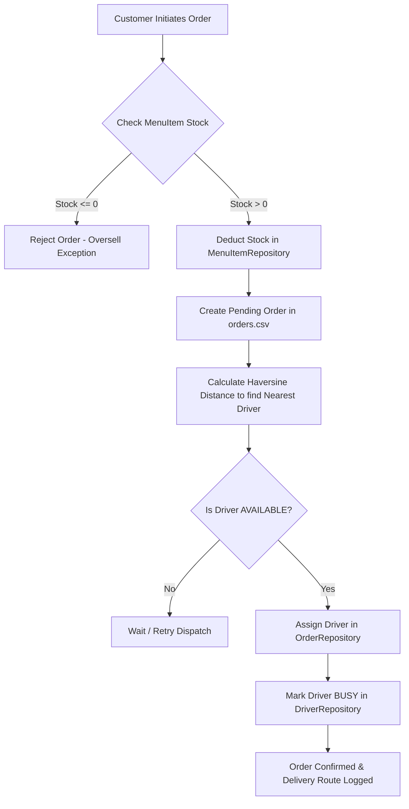
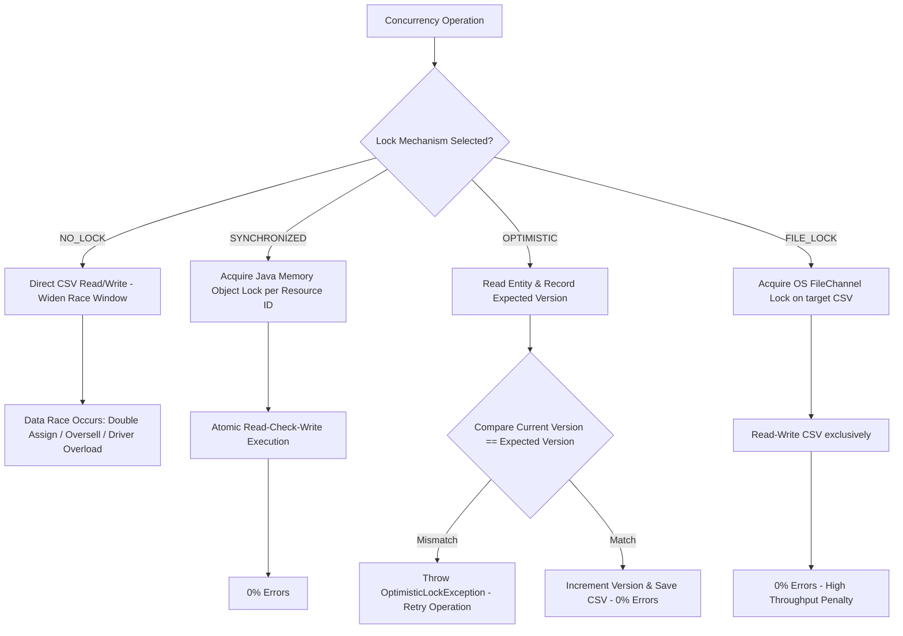
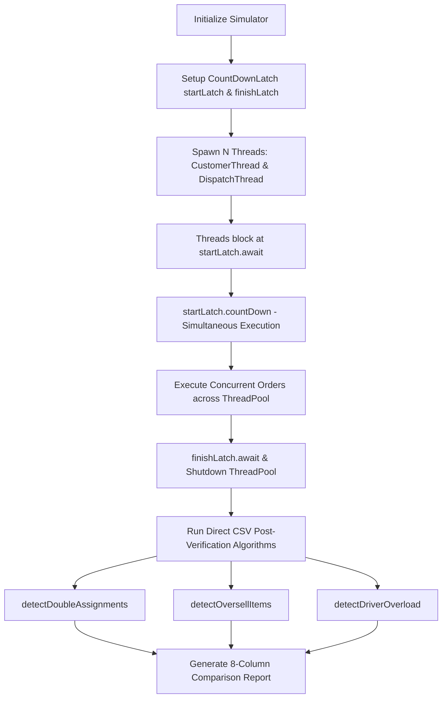

# FLOWCHARTS: FOOD DELIVERY NETWORK SIMULATION WORKFLOWS

## 1. Order & Driver Dispatch Flowchart

---

## 2. Race Condition Prevention Mechanics Flowchart

---

## 3. Simulator & Post-Verification Flowchart

