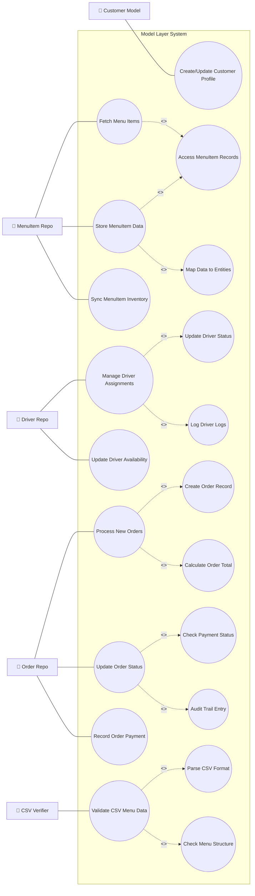

# SƠ ĐỒ VÀ MÔ TẢ USE CASE PHÂN TẦNG MODEL (MODEL LAYER USE CASE)
**LAB211 — OOP with Java | FPT University**

---

## 1. SƠ ĐỒ USE CASE PHẦN MODEL (DARK THEME REFERENCE STYLE)

---

## 2. CHÚ GIẢI CÁC USE CASE TẦNG MODEL & REPOSITORY

1. **Customer Model:** Thực hiện lưu trữ và truy vấn đối tượng `Customer` từ `customers.csv`.
2. **MenuItem Repo:** Xử lý danh mục thực đơn, trừ kho đồng bộ (`stockQty`) và kiểm tra thuộc tính `version++`.
3. **Driver Repo:** Quản lý gán đơn tài xế, chuyển trạng thái `AVAILABLE` <-> `BUSY` và tính khoảng cách mặt cầu Haversine.
4. **Order Repo:** Khởi tạo giao dịch đơn hàng mới, tính tổng tiền/phí giao hàng và quản lý vòng đời đơn (`PENDING -> CONFIRMED -> DELIVERED`).
5. **CSV Verifier:** Quét và hậu kiểm trực tiếp file CSV phát hiện 3 rủi ro Data Race (*Double Assignment*, *Oversell*, *Driver Overload*).
