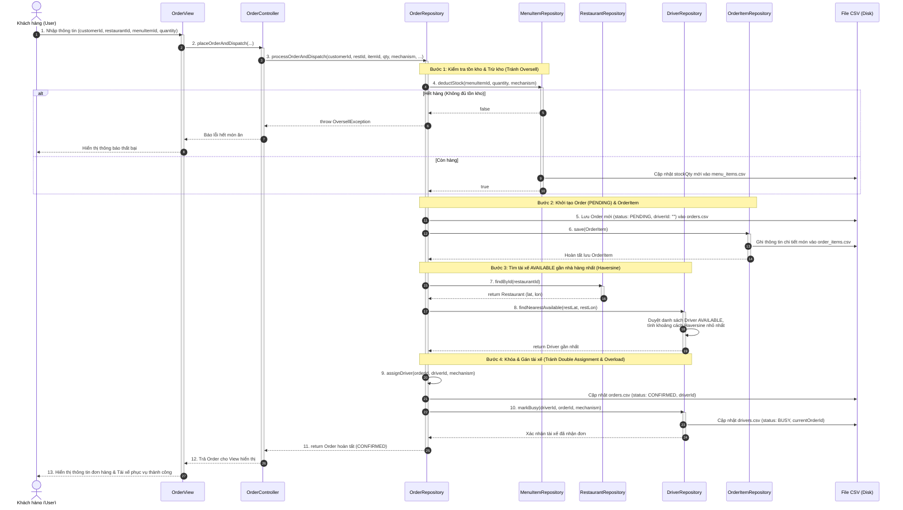
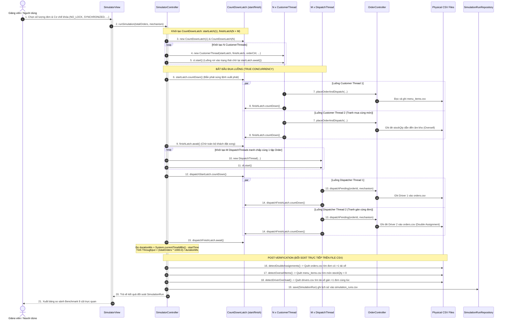

# LƯỢC ĐỒ TUẦN TỰ (SEQUENCE DIAGRAMS) - HỆ THỐNG GIAO ĐỒ ĂN LAB211

Tài liệu này cung cấp 2 biểu đồ tuần tự (Sequence Diagram) chuẩn UML (vẽ bằng Mermaid) thể hiện 2 luồng hoạt động cốt lõi nhất của dự án:
1. **Lược đồ 1:** Luồng Đặt hàng và Điều phối tài xế thực tế (Order & Dispatch Flow).
2. **Lược đồ 2:** Luồng Mô phỏng đồng thời và Đối soát lỗi dữ liệu (Concurrent Simulator & Post-Verification Flow).

---

## 1. SEQUENCE DIAGRAM: LUỒNG ĐẶT HÀNG & ĐIỀU PHỐI TÀI XẾ (ORDER & DISPATCH)

Sơ đồ này thể hiện sự tương tác chuẩn theo mô hình MVC và Generic Repository Pattern:
- `OrderView` chỉ nhận input và hiển thị kết quả.
- `OrderController` điều phối luồng gọi hàm từ `OrderRepository`.
- `OrderRepository` đảm nhiệm toàn bộ nghiệp vụ điều phối (Decomposition: tuyệt đối không rò rỉ `findNearestAvailable` lên View/Controller).
- Các Repository thực hiện trừ kho, tính khoảng cách Haversine, gán tài xế theo cơ chế khóa và lưu trữ xuống file `.csv`.

---

## 2. SEQUENCE DIAGRAM: BỘ MÔ PHỎNG ĐỒNG THỜI & ĐỐI SOÁT CSV (SIMULATOR & POST-VERIFICATION)

Sơ đồ này mô tả cơ chế hoạt động của công cụ Simulator:
- Khởi chạy đồng thời $N$ luồng `CustomerThread` và $M$ luồng `DispatchThread`.
- Kích hoạt đồng thời thực sự qua `CountDownLatch` (`startLatch.countDown()`).
- Thu thập số liệu thời gian thực hiện, Throughput (ops/sec).
- Thực hiện quét đối soát trực tiếp (Post-verification) trên 3 file CSV vật lý để phát hiện các lỗi Race Condition (Double Assignment, Oversell, Driver Overload).

