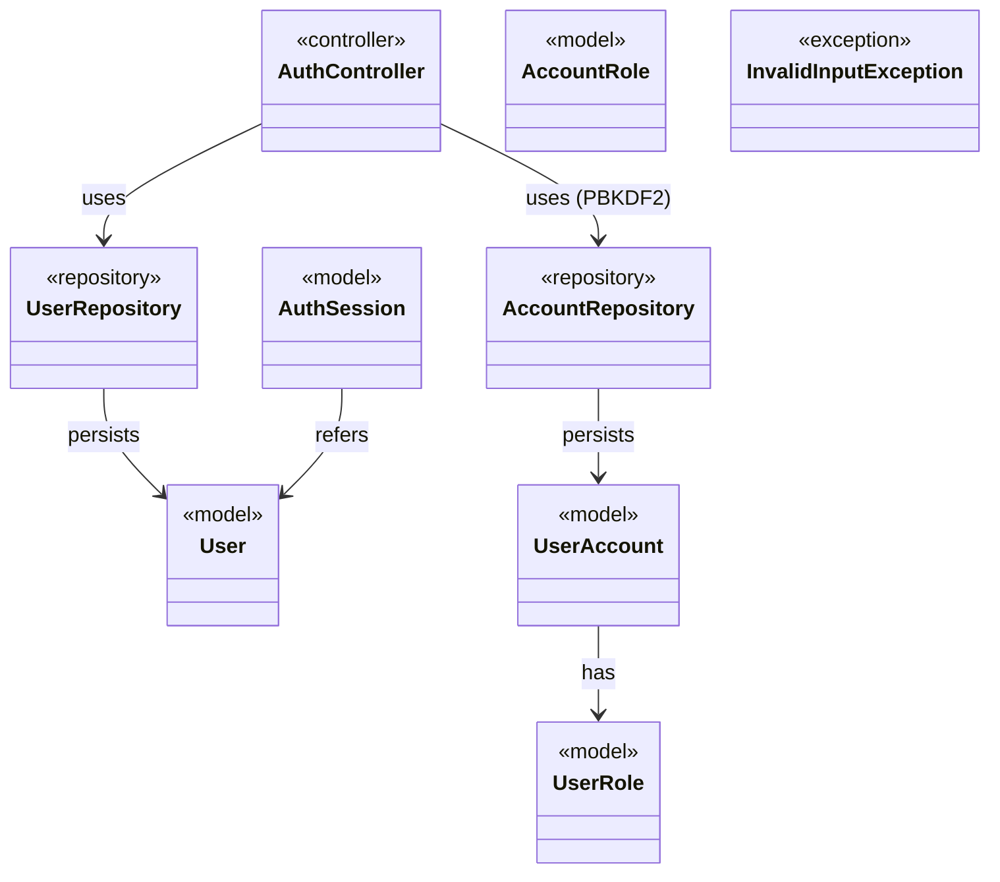
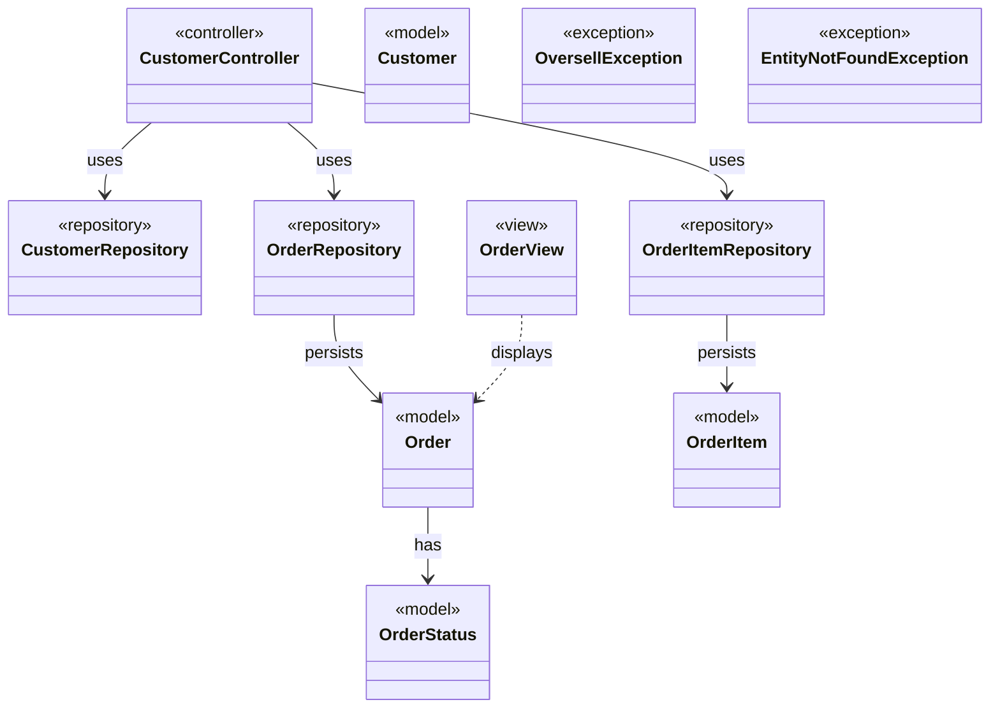
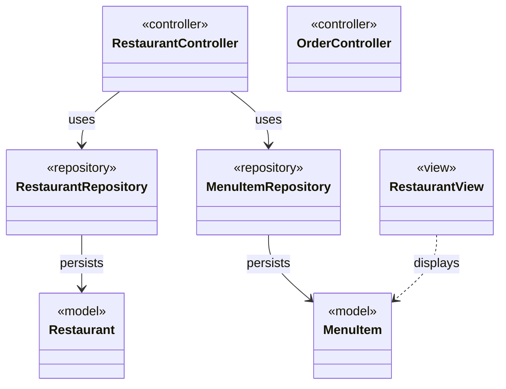
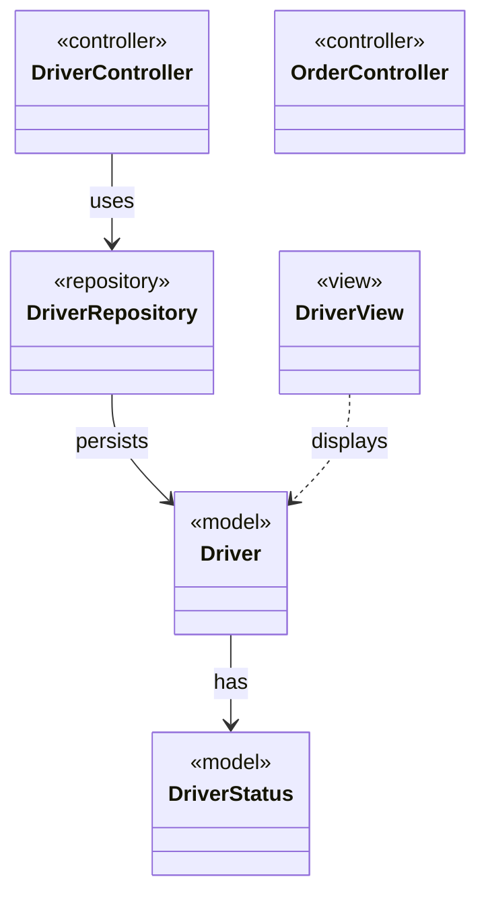
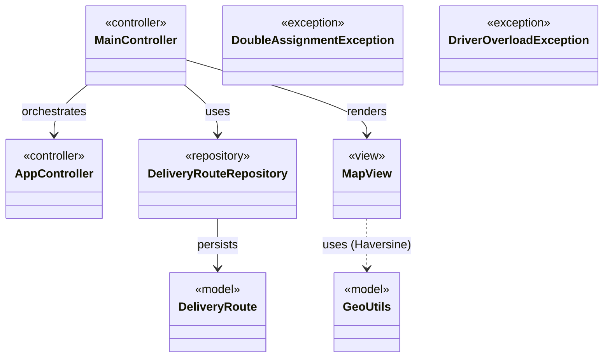
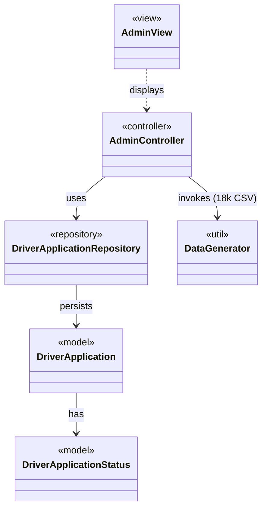
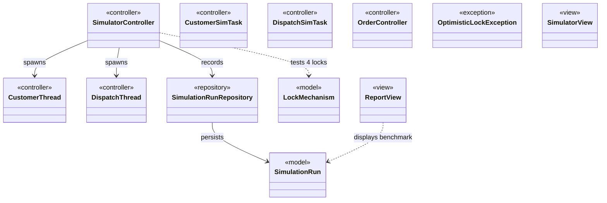

# 🧩 KIẾN TRÚC DIAGRAM THEO 7 PHÂN HỆ CHỨC NĂNG (SUBSYSTEM ARCHITECTURE)

> 🏫 **LAB211 – OOP with Java – FPT University**
> 🍱 **Chủ đề:** Food Delivery Network Simulation (FDS)
> 👥 **Nhóm thực hiện:** Nhóm 01 (Group 1)
> 🎯 **Phương pháp phân chia:** Subsystem-Oriented Architecture (Chia theo Phân hệ chức năng & Ma trận Trách nhiệm WBS)

---

## 📌 1. Tại sao nên chia Diagram theo Phân hệ chức năng?
Thay vì chỉ chia sơ đồ theo các **tầng kỹ thuật ngang** (Model, Repository, Controller, View), việc chia theo **Phân hệ chức năng (Vertical Slices / Subsystems)** mang lại 4 lợi ích vượt trội khi bảo vệ đồ án:

1. **Độc lập và Rõ ràng trách nhiệm:** Mỗi phân hệ gắn liền với 1 thành viên phụ trách cụ thể theo ma trận RACI. Giảng viên chấm đến ai, chỉ cần mở Diagram phân hệ đó ra hỏi.
2. **Trọn vẹn một luồng nghiệp vụ (End-to-End):** Trong mỗi phân hệ, người xem thấy được từ Actor tương tác → Use Cases → Controller điều phối → Repository đọc/ghi → Model dữ liệu → File CSV vật lý.
3. **Bớt rối và Dễ đọc (Decoupled Visual):** Không bị tình trạng hàng chục đường dây đan chéo nhau giữa các phân hệ không liên quan.
4. **Đồng bộ tuyệt đối:** Khớp 100% với danh sách 51 Use Cases và 60 Classes trong mã nguồn Java.

---

## 📋 2. Bảng Tổng hợp 7 Phân hệ Chức năng

| STT | Tên Phân hệ | Thành viên phụ trách | Use Cases | Số Lớp Java | File CSV vật lý |
|:---:|:---|:---|:---:|:---:|:---|
| **1** | **Phân hệ 1: Xác thực & Quản lý Truy cập** *Authentication & Access Management* | **Đỗ Tấn Vũ (QE170159)** (Admin & Security Dev) | `UC01 – UC05` | 9 classes | `data/users.csv` |
| **2** | **Phân hệ 2: Khách hàng & Đặt hàng Quy Nhơn** *Customer Portal & Food Ordering* | **Võ Thảo Nguyên (QE200064)** (Customer Portal Dev) | `UC06 – UC15` | 11 classes | `data/customers.csv, data/orders.csv, data/order_items.csv` |
| **3** | **Phân hệ 3: Quản lý Nhà hàng & Thực đơn** *Restaurant Portal & Menu Management* | **Huỳnh Nguyễn Quốc Huy (QE200031)** (Restaurant Portal Dev) | `UC16 – UC22` | 7 classes | `data/restaurants.csv, data/menu_items.csv` |
| **4** | **Phân hệ 4: Vận hành Tài xế & Giao nhận Đơn** *Driver Delivery & Lifecycle* | **Đào Cao Duy (QE190089)** (Driver Portal Dev) | `UC23 – UC28` | 6 classes | `data/drivers.csv` |
| **5** | **Phân hệ 5: Điều phối Trung tâm & Grid Tọa độ Quy Nhơn** *Central Dispatching & Network Grid* | **Hồ Anh Nhật (QE200301)** (Leader / Central Dispatching) | `UC29 – UC35` | 8 classes | `data/delivery_routes.csv` |
| **6** | **Phân hệ 6: Quản trị Hệ thống Toàn diện & Big Data** *System Administration & Big Data* | **Đỗ Tấn Vũ (QE170159)** (System Administrator) | `UC36 – UC44` | 6 classes | `data/driver_applications.csv` |
| **7** | **Phân hệ 7: Mô phỏng Concurrency & Kiểm định Tương tranh** *Concurrency Stress Simulator & Core Engine* | **Trương Thanh Trà (QE200100)** (Technical Lead / Core Engine (20% ★)) | `UC45 – UC51` | 12 classes | `data/simulation_runs.csv` |

---

## 🔷 Phân hệ 1: Xác thực & Quản lý Truy cập
**Tên tiếng Anh:** `Authentication & Access Management`  
**Thành viên phụ trách:** `Đỗ Tấn Vũ (QE170159)` – *Admin & Security Dev*  
**Phạm vi Use Case:** `UC01 – UC05` | **File CSV liên quan:** `data/users.csv`

> 💬 **Mô tả nghiệp vụ:** Quản lý toàn bộ vòng đời tài khoản người dùng, cơ chế bảo mật tiêu chuẩn ngân hàng PBKDF2 chống tấn công Rainbow table và phân quyền RBAC.

### 📑 Danh sách Use Cases của Phân hệ:
- **`UC01`:** Đăng ký tài khoản Khách hàng mới
- **`UC02`:** Đăng nhập Hệ thống (PBKDF2 with Salt)
- **`UC03`:** Đăng xuất khỏi Phiên làm việc
- **`UC04`:** Xem danh sách Tài khoản mẫu Demo
- **`UC05`:** Nộp hồ sơ đăng ký Làm Tài xế (Chờ duyệt)

### 🏗️ Các Class Java đảm nhiệm trong Phân hệ:
| Tên Lớp Java | Thuộc Tầng | Vai trò trong Phân hệ |
|---|:---:|---|
| `AuthController` | `controller` | Điều phối xác thực, login/logout, check session |
| `UserRepository` | `repository` | Lưu trữ và đọc/ghi users.csv |
| `AccountRepository` | `repository` | Bảo mật PBKDF2WithHmacSHA256, 65.536 iterations |
| `User` | `model` | Thực thể người dùng cơ bản |
| `UserRole` | `model` | Enum: CUSTOMER, RESTAURANT, DRIVER, ADMIN |
| `UserAccount` | `model` | Tài khoản kèm salt và hash |
| `AuthSession` | `model` | Phiên đăng nhập kèm token và thời hạn |
| `AccountRole` | `model` | Enum phân quyền truy cập hệ thống |
| `InvalidInputException` | `exception` | Ngoại lệ khi thông tin đăng nhập/đăng ký sai |

### 📊 Sơ đồ Kiến trúc Phân hệ (Mermaid Class Diagram):

---

## 🔷 Phân hệ 2: Khách hàng & Đặt hàng Quy Nhơn
**Tên tiếng Anh:** `Customer Portal & Food Ordering`  
**Thành viên phụ trách:** `Võ Thảo Nguyên (QE200064)` – *Customer Portal Dev*  
**Phạm vi Use Case:** `UC06 – UC15` | **File CSV liên quan:** `data/customers.csv, data/orders.csv, data/order_items.csv`

> 💬 **Mô tả nghiệp vụ:** Cổng trải nghiệm khách hàng tại Quy Nhơn: duyệt menu, tính cước khoảng cách Haversine chuẩn xác, đặt đơn với kiểm tra tồn kho và cơ chế hoàn stock khi hủy đơn.

### 📑 Danh sách Use Cases của Phân hệ:
- **`UC06`:** Xem danh sách Nhà hàng & Thực đơn
- **`UC07`:** Đặt món & Khởi tạo Đơn hàng
- **`UC08`:** Trừ tồn kho Món ăn tức thời
- **`UC09`:** Tính phí ship theo Haversine GPS Quy Nhơn
- **`UC10`:** Xác thực GPS Cửa hàng & Khách hàng
- **`UC11`:** Xem lịch sử & Chi tiết đơn hàng
- **`UC12`:** Hủy đơn hàng (Khi đang PENDING)
- **`UC13`:** Hoàn trả số lượng Tồn kho (Rollback Stock)
- **`UC14`:** Xem thông tin Tài khoản cá nhân
- **`UC15`:** Kiểm tra Hộp thư Thông báo tài xế & ETA

### 🏗️ Các Class Java đảm nhiệm trong Phân hệ:
| Tên Lớp Java | Thuộc Tầng | Vai trò trong Phân hệ |
|---|:---:|---|
| `CustomerController` | `controller` | Xử lý nghiệp vụ khách hàng xem menu, đặt và hủy đơn |
| `CustomerRepository` | `repository` | Quản lý dữ liệu customers.csv |
| `OrderRepository` | `repository` | Quản lý dữ liệu orders.csv |
| `OrderItemRepository` | `repository` | Quản lý dữ liệu chi tiết món order_items.csv |
| `Customer` | `model` | Thực thể khách hàng kèm tọa độ GPS |
| `Order` | `model` | Thực thể đơn hàng kèm trạng thái, cước phí, version |
| `OrderItem` | `model` | Chi tiết từng món trong đơn |
| `OrderStatus` | `model` | Enum trạng thái: PENDING, ACCEPTED, ASSIGNED... |
| `OrderView` | `view` | Giao diện Console hiển thị giỏ hàng và đơn hàng |
| `OversellException` | `exception` | Ngoại lệ chặn bán quá tồn kho |
| `EntityNotFoundException` | `exception` | Ngoại lệ khi không tìm thấy món/nhà hàng |

### 📊 Sơ đồ Kiến trúc Phân hệ (Mermaid Class Diagram):

---

## 🔷 Phân hệ 3: Quản lý Nhà hàng & Thực đơn
**Tên tiếng Anh:** `Restaurant Portal & Menu Management`  
**Thành viên phụ trách:** `Huỳnh Nguyễn Quốc Huy (QE200031)` – *Restaurant Portal Dev*  
**Phạm vi Use Case:** `UC16 – UC22` | **File CSV liên quan:** `data/restaurants.csv, data/menu_items.csv`

> 💬 **Mô tả nghiệp vụ:** Cổng quản lý nhà hàng: quản lý thực đơn, điều chỉnh giá bán, kiểm soát kho hàng chống Oversell và duyệt đơn kích hoạt trung tâm điều phối.

### 📑 Danh sách Use Cases của Phân hệ:
- **`UC16`:** Xem thực đơn & Tình trạng tồn kho
- **`UC17`:** Cập nhật đơn giá & Bổ sung tồn kho
- **`UC18`:** Xem danh sách Đơn hàng chờ quán
- **`UC19`:** Xác nhận đơn (Accept Order) & Bắt đầu nấu
- **`UC20`:** Kích hoạt tự động Điều phối Tài xế
- **`UC21`:** Từ chối đơn (Reject Order) & Hủy
- **`UC22`:** Thống kê doanh thu Bán của cửa hàng

### 🏗️ Các Class Java đảm nhiệm trong Phân hệ:
| Tên Lớp Java | Thuộc Tầng | Vai trò trong Phân hệ |
|---|:---:|---|
| `RestaurantController` | `controller` | Duyệt đơn, cập nhật menu và số lượng tồn kho |
| `RestaurantRepository` | `repository` | Quản lý file restaurants.csv |
| `MenuItemRepository` | `repository` | Quản lý món ăn menu_items.csv, deduct/restoreStock |
| `Restaurant` | `model` | Thực thể nhà hàng kèm GPS Quy Nhơn |
| `MenuItem` | `model` | Thực thể món ăn kèm đơn giá và số lượng tồn kho |
| `RestaurantView` | `view` | Giao diện Console cho chủ quán ăn |
| `OrderController` | `controller` | Phương thức confirmOrderByRestaurant và rejectOrderByRestaurant |

### 📊 Sơ đồ Kiến trúc Phân hệ (Mermaid Class Diagram):

---

## 🔷 Phân hệ 4: Vận hành Tài xế & Giao nhận Đơn
**Tên tiếng Anh:** `Driver Delivery & Lifecycle`  
**Thành viên phụ trách:** `Đào Cao Duy (QE190089)` – *Driver Portal Dev*  
**Phạm vi Use Case:** `UC23 – UC28` | **File CSV liên quan:** `data/drivers.csv`

> 💬 **Mô tả nghiệp vụ:** Cổng tác nghiệp tài xế: quản lý ca trực, nhận đơn được điều phối, xác nhận nhận món tại quán, giao hàng tận tay khách và tự động chuyển về AVAILABLE.

### 📑 Danh sách Use Cases của Phân hệ:
- **`UC23`:** Xem hồ sơ & Thông tin cá nhân tài xế
- **`UC24`:** Chuyển trạng thái AVAILABLE / OFFLINE
- **`UC25`:** Xem các đơn hàng được phân công
- **`UC26`:** Xác nhận lấy hàng (Khoản PICKED_UP)
- **`UC27`:** Xác nhận hoàn tất Giao hàng (DELIVERED)
- **`UC28`:** Tự động chuyển về Sẵn sàng (AVAILABLE)

### 🏗️ Các Class Java đảm nhiệm trong Phân hệ:
| Tên Lớp Java | Thuộc Tầng | Vai trò trong Phân hệ |
|---|:---:|---|
| `DriverController` | `controller` | Quản lý trạng thái tài xế, nhận đơn, giao hàng |
| `DriverRepository` | `repository` | Quản lý drivers.csv, markBusy, markAvailable |
| `Driver` | `model` | Thực thể tài xế kèm trạng thái, tọa độ GPS di chuyển |
| `DriverStatus` | `model` | Enum: AVAILABLE, BUSY, OFFLINE |
| `DriverView` | `view` | Giao diện Console dành riêng cho tài xế |
| `OrderController` | `controller` | Phương thức markOrderPickedUp và markOrderDelivered |

### 📊 Sơ đồ Kiến trúc Phân hệ (Mermaid Class Diagram):

---

## 🔷 Phân hệ 5: Điều phối Trung tâm & Grid Tọa độ Quy Nhơn
**Tên tiếng Anh:** `Central Dispatching & Network Grid`  
**Thành viên phụ trách:** `Hồ Anh Nhật (QE200301)` – *Leader / Central Dispatching*  
**Phạm vi Use Case:** `UC29 – UC35` | **File CSV liên quan:** `data/delivery_routes.csv`

> 💬 **Mô tả nghiệp vụ:** Bộ não trung tâm của hệ thống: thuật toán gán đơn tự động cho tài xế gần nhất, tính toán thời gian ETA, ngăn chặn Double Assignment và vẽ bản đồ ASCII Grid 16x50.

### 📑 Danh sách Use Cases của Phân hệ:
- **`UC29`:** Xem danh sách đơn Chờ điều phối (ACCEPTED)
- **`UC30`:** Tự động điều phối Tất cả đơn hàng mới
- **`UC31`:** Tìm kiếm tài xế Gần nhất (Haversine Distance)
- **`UC32`:** Tính toán ETA Lấy món & Giao hàng
- **`UC33`:** Gán một đơn & Khóa tài xế (ASSIGNED)
- **`UC34`:** Giám sát trạng thái Toàn đội ngũ tài xế
- **`UC35`:** Hiển thị Bản đồ ASCII Grid Map Quy Nhơn (16x50)

### 🏗️ Các Class Java đảm nhiệm trong Phân hệ:
| Tên Lớp Java | Thuộc Tầng | Vai trò trong Phân hệ |
|---|:---:|---|
| `MainController` | `controller` | Facade MVC Orchestrator điều phối toàn bộ các phân hệ |
| `AppController` | `controller` | Bộ điều khiển khởi động ứng dụng |
| `DeliveryRouteRepository` | `repository` | Lưu trữ lịch sử hành trình delivery_routes.csv |
| `DeliveryRoute` | `model` | Thực thể lộ trình giao hàng kèm cự ly và thời gian |
| `GeoUtils` | `model` | Tính toán khoảng cách Haversine và cước phí chuẩn xác |
| `MapView` | `view` | Vẽ bản đồ ASCII Grid 16x50 hiển thị vị trí quán, khách, xế |
| `DoubleAssignmentException` | `exception` | Ngoại lệ ngăn chặn 2 đơn gán trùng 1 tài xế |
| `DriverOverloadException` | `exception` | Ngoại lệ ngăn chặn tài xế bận bị ép nhận thêm đơn |

### 📊 Sơ đồ Kiến trúc Phân hệ (Mermaid Class Diagram):

---

## 🔷 Phân hệ 6: Quản trị Hệ thống Toàn diện & Big Data
**Tên tiếng Anh:** `System Administration & Big Data`  
**Thành viên phụ trách:** `Đỗ Tấn Vũ (QE170159)` – *System Administrator*  
**Phạm vi Use Case:** `UC36 – UC44` | **File CSV liên quan:** `data/driver_applications.csv`

> 💬 **Mô tả nghiệp vụ:** Cổng quản trị tối cao: duyệt đơn đăng ký đối tác tài xế, quản trị danh mục toàn hệ thống và sinh bộ dữ liệu lớn 18.000 dòng CSV để kiểm thử tải cực hạn.

### 📑 Danh sách Use Cases của Phân hệ:
- **`UC36`:** Phê duyệt hồ sơ & Tự động cấp mã tài xế
- **`UC37`:** Từ chối hồ sơ Đăng ký tài xế
- **`UC38`:** Quản trị Danh bạ Toàn bộ Khách hàng
- **`UC39`:** Quản lý Nhà hàng, Thực đơn & Khớp kho
- **`UC40`:** Quản trị Đội xe & Khóa/Mở tài xế
- **`UC41`:** Quản trị Mạng lưới & Phân quyền Hệ thống
- **`UC42`:** Giám sát toàn bộ Đơn hàng & Lộ trình
- **`UC43`:** Sinh dữ liệu mẫu 18.000 dòng CSV (Test Bench)
- **`UC44`:** Báo cáo Tổng quan & Nghiên cứu Big Question

### 🏗️ Các Class Java đảm nhiệm trong Phân hệ:
| Tên Lớp Java | Thuộc Tầng | Vai trò trong Phân hệ |
|---|:---:|---|
| `AdminController` | `controller` | Quản trị danh bạ, phê duyệt hồ sơ lái xe, sinh dữ liệu |
| `DriverApplicationRepository` | `repository` | Quản lý driver_applications.csv |
| `DriverApplication` | `model` | Hồ sơ đăng ký tài xế mới |
| `DriverApplicationStatus` | `model` | Enum: PENDING, APPROVED, REJECTED |
| `DataGenerator` | `util` | Sinh bộ dữ liệu lớn hơn 18.000 dòng CSV chuẩn |
| `AdminView` | `view` | Giao diện quản trị tối cao của Admin |

### 📊 Sơ đồ Kiến trúc Phân hệ (Mermaid Class Diagram):

---

## 🔷 Phân hệ 7: Mô phỏng Concurrency & Kiểm định Tương tranh
**Tên tiếng Anh:** `Concurrency Stress Simulator & Core Engine`  
**Thành viên phụ trách:** `Trương Thanh Trà (QE200100)` – *Technical Lead / Core Engine (20% ★)*  
**Phạm vi Use Case:** `UC45 – UC51` | **File CSV liên quan:** `data/simulation_runs.csv`

> 💬 **Mô tả nghiệp vụ:** Trọng tâm kỹ thuật quan trọng nhất (20%): Mô phỏng tải cực hạn 700 đơn hàng đồng thời, kiểm định 3 Race Conditions và giải quyết câu hỏi khoa học Big Question với giải pháp Optimistic Locking.

### 📑 Danh sách Use Cases của Phân hệ:
- **`UC45`:** Cấu hình tham số Kiểm thử (threads, orders, mechanism)
- **`UC46`:** Khởi chạy mô phỏng Đa luồng đồng thời
- **`UC47`:** Mô phỏng Đặt hàng (Customer Thread)
- **`UC48`:** Mô phỏng Điều phối (Dispatch Thread)
- **`UC49`:** Tự động phát hiện Lỗi Race Conditions (Oversell, Double Assign)
- **`UC50`:** Đo đạc và So chuẩn 4 Cơ chế Khóa (Benchmark)
- **`UC51`:** Xuất bảng so sánh Hiệu năng & Kết luận Big Question

### 🏗️ Các Class Java đảm nhiệm trong Phân hệ:
| Tên Lớp Java | Thuộc Tầng | Vai trò trong Phân hệ |
|---|:---:|---|
| `SimulatorController` | `controller` | Điều phối bài kiểm tra tương tranh, quản lý threads |
| `CustomerThread` | `controller` | Luồng giả lập khách hàng đặt món và hủy đơn liên tục |
| `DispatchThread` | `controller` | Luồng giả lập điều phối quét đơn tự động |
| `CustomerSimTask` | `controller` | Tác vụ runnable cho khách hàng |
| `DispatchSimTask` | `controller` | Tác vụ runnable cho điều phối |
| `SimulationRunRepository` | `repository` | Lưu trữ kết quả simulation_runs.csv |
| `SimulationRun` | `model` | Kết quả thực nghiệm: throughput, drop rate, conflicts |
| `LockMechanism` | `model` | Enum: NO_LOCK, REENTRANT_LOCK, READ_WRITE_LOCK, OPTIMISTIC_LOCK |
| `OrderController` | `controller` | Quản trị xung đột tương tranh và cơ chế version checking |
| `OptimisticLockException` | `exception` | Ngoại lệ khi phiên bản dữ liệu bị xung đột |
| `SimulatorView` | `view` | Giao diện cấu hình và theo dõi tiến độ benchmark |
| `ReportView` | `view` | Xuất bảng báo cáo so sánh kết quả 4 cơ chế khóa |

### 📊 Sơ đồ Kiến trúc Phân hệ (Mermaid Class Diagram):

---
