# TÀI LIỆU ĐẶC TẢ VÀ SƠ ĐỒ USE CASE TOÀN DIỆN (FOOD DELIVERY SIMULATION SYSTEM - FDS)
**Môn học:** LAB211 — Lập trình Hướng đối tượng với Java | FPT University  
**Phạm vi triển khai:** Hệ thống Đặt & Giao đồ ăn trực tuyến (Thành phố Quy Nhơn)  
**Quy chuẩn thiết kế:** UML 2.5 Academic Monochrome Specification (Đen - Trắng chuẩn đồ án)  

---

## 1. TỔNG QUAN HỆ THỐNG VÀ DANH SÁCH TÁC NHÂN (ACTORS)

| STT | Mã Actor | Tên Tác Nhân | Vai Trò (Role) | Phân Loại | Nhiệm Vụ Trọng Tâm |
| :---: | :--- | :--- | :--- | :---: | :--- |
| 1 | `ACT_CUSTOMER` | **Khách hàng** (Customer) | Người dùng cuối | Human | Tìm kiếm quán ăn Quy Nhơn, đặt món, tính phí ship Haversine, theo dõi đơn và nộp đơn làm tài xế. |
| 2 | `ACT_RESTAURANT` | **Quản lý Nhà hàng** (Restaurant) | Đối tác ẩm thực | Human | Quản lý menu món ăn, cập nhật số lượng tồn kho (stock), duyệt hoặc từ chối đơn hàng, xem doanh thu. |
| 3 | `ACT_DRIVER` | **Tài xế Giao hàng** (Driver) | Đối tác vận chuyển | Human | Bật/tắt trạng thái nhận cuốc, cập nhật GPS, nhận đơn điều phối, xác nhận lấy hàng và giao thành công. |
| 4 | `ACT_ADMIN` | **Quản trị viên** (Administrator) | Điều hành hệ thống | Human | Quản lý tài khoản, duyệt đơn ứng tuyển tài xế, quản lý mạng lưới nhà hàng, kiểm thử mô phỏng đa luồng. |
| 5 | `ACT_DISPATCHER` | **Hệ thống Điều phối** (Dispatcher Engine) | Hệ thống tự động | System | Tự động quét hàng đợi `PENDING`, tính toán khoảng cách Haversine & ETA, ghép nối và khóa tài xế `BUSY`. |
| 6 | `ACT_SIMULATOR` | **Bộ Mô phỏng Đa luồng** (Simulator Engine) | Hệ thống kiểm thử | System | Khởi tạo nhiều luồng đồng thời (Customer/Dispatch Thread), so chuẩn 4 cơ chế khóa và phát hiện Race Conditions. |

---

## 2. BẢNG ĐẶC TẢ CHI TIẾT 49 USE CASES THEO PHÂN HỆ

### Phân hệ 1: Xác thực & Hồ sơ Cá nhân (`SUB1`)
*Tên tiếng Anh:* Authentication & User Profile  

| Mã UC | Tên Use Case | Tác Nhân Chính | Quan Hệ Phụ Thuộc | Mô Tả Nghiệp Vụ Code Triển Khai |
| :---: | :--- | :--- | :---: | :--- |
| **UC01** | Đăng ký tài khoản Khách hàng mới | Khách hàng | ─ | Mã nguồn: `UC01` trong package tương ứng. |
| **UC02** | Đăng nhập hệ thống (Đa vai trò) | Khách hàng | <<include>> UC04 | Mã nguồn: `UC02` trong package tương ứng. |
| **UC03** | Đăng xuất khỏi hệ thống | Khách hàng | ─ | Mã nguồn: `UC03` trong package tương ứng. |
| **UC04** | Xem & cập nhật hồ sơ cá nhân | Hệ thống tự động | UC02 <<include>> UC05 <<extend>> | Mã nguồn: `UC04` trong package tương ứng. |
| **UC05** | Nộp đơn ứng tuyển tài xế giao hàng | Hệ thống tự động | <<extend>> UC04 | Mã nguồn: `UC05` trong package tương ứng. |

### Phân hệ 2: Khách hàng & Đặt hàng Trực tuyến (`SUB2`)
*Tên tiếng Anh:* Customer Ordering & Cart Management  

| Mã UC | Tên Use Case | Tác Nhân Chính | Quan Hệ Phụ Thuộc | Mô Tả Nghiệp Vụ Code Triển Khai |
| :---: | :--- | :--- | :---: | :--- |
| **UC06** | Xem danh sách nhà hàng & menu Quy Nhơn | Khách hàng | UC07 <<extend>> | Mã nguồn: `UC06` trong package tương ứng. |
| **UC08** | Đặt món và tạo đơn hàng mới | Khách hàng | <<include>> UC09 <<include>> UC10 | Mã nguồn: `UC08` trong package tương ứng. |
| **UC12** | Theo dõi trạng thái đơn hàng thời gian thực | Khách hàng | ─ | Mã nguồn: `UC12` trong package tương ứng. |
| **UC13** | Xem lịch sử đơn hàng | Khách hàng | ─ | Mã nguồn: `UC13` trong package tương ứng. |
| **UC14** | Hủy đơn hàng chưa điều phối | Khách hàng | <<include>> UC15 | Mã nguồn: `UC14` trong package tương ứng. |
| **UC07** | Tìm kiếm và lọc món ăn | Hệ thống tự động | <<extend>> UC06 | Mã nguồn: `UC07` trong package tương ứng. |
| **UC09** | Trừ số lượng tồn kho món ăn tức thời | Hệ thống tự động | UC08 <<include>> | Mã nguồn: `UC09` trong package tương ứng. |
| **UC10** | Tính phí giao hàng khoảng cách Haversine | Hệ thống tự động | UC08 <<include>> <<include>> UC11 | Mã nguồn: `UC10` trong package tương ứng. |
| **UC15** | Hoàn trả tồn kho khi đơn bị hủy/từ chối | Hệ thống tự động | UC14 <<include>> | Mã nguồn: `UC15` trong package tương ứng. |
| **UC11** | Xác thực địa chỉ và tọa độ GPS | Hệ thống tự động | UC10 <<include>> | Mã nguồn: `UC11` trong package tương ứng. |

### Phân hệ 3: Quản lý Nhà hàng & Thực đơn Quy Nhơn (`SUB3`)
*Tên tiếng Anh:* Restaurant & Menu Catalog Management  

| Mã UC | Tên Use Case | Tác Nhân Chính | Quan Hệ Phụ Thuộc | Mô Tả Nghiệp Vụ Code Triển Khai |
| :---: | :--- | :--- | :---: | :--- |
| **UC16** | Thêm món ăn mới vào thực đơn | Quản lý Nhà hàng | ─ | Mã nguồn: `UC16` trong package tương ứng. |
| **UC17** | Cập nhật thông tin món và giá bán | Quản lý Nhà hàng | ─ | Mã nguồn: `UC17` trong package tương ứng. |
| **UC18** | Xóa món ăn khỏi thực đơn | Quản lý Nhà hàng | ─ | Mã nguồn: `UC18` trong package tương ứng. |
| **UC19** | Nhập bổ sung số lượng tồn kho | Quản lý Nhà hàng | ─ | Mã nguồn: `UC19` trong package tương ứng. |
| **UC20** | Xem danh sách đơn hàng đến | Quản lý Nhà hàng | UC23 <<extend>> UC24 <<extend>> | Mã nguồn: `UC20` trong package tương ứng. |
| **UC21** | Xác nhận chấp nhận đơn hàng | Quản lý Nhà hàng | <<include>> UC22 | Mã nguồn: `UC21` trong package tương ứng. |
| **UC24** | Xem thống kê doanh thu và báo cáo nhà hàng | Hệ thống tự động | <<extend>> UC20 | Mã nguồn: `UC24` trong package tương ứng. |
| **UC23** | Từ chối tiếp nhận đơn hàng | Hệ thống tự động | <<extend>> UC20 | Mã nguồn: `UC23` trong package tương ứng. |
| **UC22** | Kích hoạt điều phối tự động tài xế | Hệ thống tự động | UC21 <<include>> | Mã nguồn: `UC22` trong package tương ứng. |

### Phân hệ 4: Tài xế & Vận hành Giao nhận Đơn hàng (`SUB4`)
*Tên tiếng Anh:* Driver Delivery & Trip Operations  

| Mã UC | Tên Use Case | Tác Nhân Chính | Quan Hệ Phụ Thuộc | Mô Tả Nghiệp Vụ Code Triển Khai |
| :---: | :--- | :--- | :---: | :--- |
| **UC25** | Bật tắt trạng thái hoạt động tài xế | Tài xế Giao hàng | ─ | Mã nguồn: `UC25` trong package tương ứng. |
| **UC26** | Cập nhật tọa độ vị trí thực tế của tài xế | Tài xế Giao hàng | ─ | Mã nguồn: `UC26` trong package tương ứng. |
| **UC27** | Nhận đơn hàng được hệ thống điều phối | Tài xế Giao hàng | ─ | Mã nguồn: `UC27` trong package tương ứng. |
| **UC28** | Xác nhận đã lấy hàng tại nhà hàng | Tài xế Giao hàng | ─ | Mã nguồn: `UC28` trong package tương ứng. |
| **UC29** | Xác nhận giao hàng thành công tới khách | Tài xế Giao hàng | <<include>> UC30 | Mã nguồn: `UC29` trong package tương ứng. |
| **UC30** | Tự động chuyển tài xế về trạng thái sẵn sàng | Hệ thống tự động | UC29 <<include>> | Mã nguồn: `UC30` trong package tương ứng. |

### Phân hệ 6: Quản trị Hệ thống & Phê duyệt Đối tác (`SUB6`)
*Tên tiếng Anh:* System Administration & Partner Approval  

| Mã UC | Tên Use Case | Tác Nhân Chính | Quan Hệ Phụ Thuộc | Mô Tả Nghiệp Vụ Code Triển Khai |
| :---: | :--- | :--- | :---: | :--- |
| **UC35** | Quản lý tài khoản người dùng và phân quyền | Quản trị viên | UC36 <<extend>> | Mã nguồn: `UC35` trong package tương ứng. |
| **UC37** | Xem và thẩm định hồ sơ ứng tuyển tài xế | Quản trị viên | UC38 <<extend>> UC39 <<extend>> | Mã nguồn: `UC37` trong package tương ứng. |
| **UC40** | Quản lý danh sách nhà hàng và chỉ định quản lý | Quản trị viên | ─ | Mã nguồn: `UC40` trong package tương ứng. |
| **UC41** | Giám sát toàn bộ lưu lượng đơn hàng hệ thống | Quản trị viên | ─ | Mã nguồn: `UC41` trong package tương ứng. |
| **UC42** | Nhập hàng bổ sung kho toàn hệ thống | Quản trị viên | ─ | Mã nguồn: `UC42` trong package tương ứng. |
| **UC36** | Khóa hoặc mở khóa tài khoản vi phạm | Hệ thống tự động | <<extend>> UC35 | Mã nguồn: `UC36` trong package tương ứng. |
| **UC38** | Phê duyệt đơn và cấp tài khoản tài xế | Hệ thống tự động | <<extend>> UC37 | Mã nguồn: `UC38` trong package tương ứng. |
| **UC39** | Từ chối hồ sơ ứng tuyển tài xế | Hệ thống tự động | <<extend>> UC37 | Mã nguồn: `UC39` trong package tương ứng. |

### Phân hệ 5: Điều phối Tự động & Tối ưu Lộ trình (`SUB5`)
*Tên tiếng Anh:* Automated Dispatch & Route Matching Engine  

| Mã UC | Tên Use Case | Tác Nhân Chính | Quan Hệ Phụ Thuộc | Mô Tả Nghiệp Vụ Code Triển Khai |
| :---: | :--- | :--- | :---: | :--- |
| **UC31** | Quét hàng đợi đơn hàng chờ xử lý | Hệ thống Điều phối | ─ | Mã nguồn: `UC31` trong package tương ứng. |
| **UC34** | Tự động giao đơn và khóa trạng thái tài xế | Hệ thống Điều phối | <<include>> UC32 <<include>> UC33 | Mã nguồn: `UC34` trong package tương ứng. |
| **UC32** | Tìm kiếm tài xế khả dụng gần nhất | Hệ thống tự động | UC34 <<include>> | Mã nguồn: `UC32` trong package tương ứng. |
| **UC33** | Tính toán thời gian dự kiến giao hàng Quy Nhơn | Hệ thống tự động | UC34 <<include>> | Mã nguồn: `UC33` trong package tương ứng. |

### Phân hệ 7: Mô phỏng Đa luồng & Kiểm định Tương tranh (`SUB7`)
*Tên tiếng Anh:* Concurrency Stress Testing & Race Detection  

| Mã UC | Tên Use Case | Tác Nhân Chính | Quan Hệ Phụ Thuộc | Mô Tả Nghiệp Vụ Code Triển Khai |
| :---: | :--- | :--- | :---: | :--- |
| **UC43** | Cấu hình số luồng, số đơn và cơ chế khóa | Quản trị viên | ─ | Mã nguồn: `UC43` trong package tương ứng. |
| **UC44** | Khởi chạy kịch bản mô phỏng đa luồng đồng thời | Quản trị viên, Bộ Mô phỏng Đa luồng | <<include>> UC45 <<include>> UC46 | Mã nguồn: `UC44` trong package tương ứng. |
| **UC47** | Đo kiểm so sánh 4 cơ chế khóa tương tranh | Bộ Mô phỏng Đa luồng | ─ | Mã nguồn: `UC47` trong package tương ứng. |
| **UC48** | Phát hiện tranh chấp: Double Assign, Oversell | Bộ Mô phỏng Đa luồng | UC49 <<extend>> | Mã nguồn: `UC48` trong package tương ứng. |
| **UC45** | Mô phỏng khách hàng đặt hàng đồng thời | Hệ thống tự động | UC44 <<include>> | Mã nguồn: `UC45` trong package tương ứng. |
| **UC46** | Mô phỏng bộ điều phối gán đơn đồng thời | Hệ thống tự động | UC44 <<include>> | Mã nguồn: `UC46` trong package tương ứng. |
| **UC49** | Xuất bảng so sánh hiệu năng và thời gian thực thi | Hệ thống tự động | <<extend>> UC48 | Mã nguồn: `UC49` trong package tương ứng. |

---

## 3. SƠ ĐỒ USE CASE DẠNG MERMAID CODE

```mermaid
graph LR
    subgraph FDS ["HỆ THỐNG ĐẶT VÀ GIAO ĐỒ ĂN TRỰC TUYẾN (FOOD DELIVERY SIMULATION SYSTEM)"]
        subgraph SUB1 ["Phân hệ 1: Xác thực & Hồ sơ Cá nhân"]
            UC01(("UC01: Đăng ký tài khoản Khách hàng mới"))
            UC02(("UC02: Đăng nhập vào Hệ thống"))
            UC03(("UC03: Đăng xuất khỏi Phiên làm việc"))
            UC04(("UC04: Xem & Cập nhật Hồ sơ / Địa chỉ GPS"))
            UC05(("UC05: Nộp đơn đăng ký Ứng tuyển Tài xế"))
        end
        subgraph SUB2 ["Phân hệ 2: Khách hàng & Đặt hàng Trực tuyến"]
            UC06(("UC06: Xem danh mục Nhà hàng & Thực đơn"))
            UC08(("UC08: Đặt món & Khởi tạo Đơn hàng"))
            UC12(("UC12: Theo dõi trạng thái Đơn hàng thời gian thực"))
            UC13(("UC13: Xem lịch sử Các đơn hàng đã đặt"))
            UC14(("UC14: Hủy đơn hàng (khi đang PENDING)"))
            UC07(("UC07: Tìm kiếm & Lọc Món ăn / Giá / Khoảng cách"))
            UC09(("UC09: Trừ tồn kho Món ăn tức thời"))
            UC10(("UC10: Tính phí ship theo Haversine"))
            UC15(("UC15: Hoàn trả số lượng Tồn kho món ăn"))
            UC11(("UC11: Xác thực tọa độ GPS giao hàng Quy Nhơn"))
        end
        subgraph SUB3 ["Phân hệ 3: Quản lý Nhà hàng & Thực đơn Quy Nhơn"]
            UC16(("UC16: Thêm món ăn mới vào Thực đơn"))
            UC17(("UC17: Cập nhật thông tin Món ăn & Giá bán"))
            UC18(("UC18: Xóa món ăn khỏi Thực đơn"))
            UC19(("UC19: Cập nhật & Nhập thêm Số lượng Tồn kho (Stock)"))
            UC20(("UC20: Xem danh sách Đơn hàng mới tiếp nhận"))
            UC21(("UC21: Xác nhận Đơn hàng (Accept)"))
            UC24(("UC24: Xem báo cáo Doanh thu & Đơn hàng"))
            UC23(("UC23: Từ chối Đơn hàng (Reject)"))
            UC22(("UC22: Kích hoạt Điều phối Tự động"))
        end
        subgraph SUB4 ["Phân hệ 4: Tài xế & Vận hành Giao nhận Đơn hàng"]
            UC25(("UC25: Bật/Tắt trạng thái Hoạt động (Available/Off)"))
            UC26(("UC26: Cập nhật vị trí Tọa độ GPS thực tế"))
            UC27(("UC27: Tiếp nhận đơn hàng được Điều phối ghép nối"))
            UC28(("UC28: Xác nhận lấy món (Chuyển DISPATCHED)"))
            UC29(("UC29: Xác nhận hoàn tất Giao hàng (DELIVERED)"))
            UC30(("UC30: Tự động chuyển về Sẵn sàng (AVAILABLE)"))
        end
        subgraph SUB6 ["Phân hệ 6: Quản trị Hệ thống & Phê duyệt Đối tác"]
            UC35(("UC35: Quản lý Tài khoản Người dùng & Phân quyền"))
            UC37(("UC37: Thẩm định hồ sơ Đơn ứng tuyển Tài xế"))
            UC40(("UC40: Quản lý danh mục Nhà hàng & Phân bổ QL"))
            UC41(("UC41: Giám sát toàn bộ Đơn hàng trong Hệ thống"))
            UC42(("UC42: Nhập hàng bổ sung Tồn kho toàn Hệ thống"))
            UC36(("UC36: Khóa / Mở khóa Tài khoản người dùng"))
            UC38(("UC38: Phê duyệt đơn & Tự động tạo hồ sơ Driver"))
            UC39(("UC39: Từ chối hồ sơ Ứng tuyển tài xế"))
        end
        subgraph SUB5 ["Phân hệ 5: Điều phối Tự động & Tối ưu Lộ trình"]
            UC31(("UC31: Quét hàng đợi Đơn hàng PENDING"))
            UC34(("UC34: Tự động ghép nối & Khóa tài xế (BUSY)"))
            UC32(("UC32: Tìm kiếm tài xế Gần nhất (Haversine)"))
            UC33(("UC33: Tính toán thời gian Dự kiến giao hàng (ETA)"))
        end
        subgraph SUB7 ["Phân hệ 7: Mô phỏng Đa luồng & Kiểm định Tương tranh"]
            UC43(("UC43: Cấu hình tham số Kiểm thử (Threads/Lock)"))
            UC44(("UC44: Kích hoạt mô phỏng Đa luồng đồng thời"))
            UC47(("UC47: So chuẩn 4 cơ chế khóa (NO/SYNC/OPT/FILE)"))
            UC48(("UC48: Tự động phát hiện Lỗi Race Conditions"))
            UC45(("UC45: Mô phỏng Đặt hàng (CustomerThread)"))
            UC46(("UC46: Mô phỏng Điều phối (DispatchThread)"))
            UC49(("UC49: Xuất báo cáo Số liệu & Thông lượng"))
        end
    end

    ACT_CUSTOMER["👤 Khách hàng"]
    ACT_RESTAURANT["👤 Quản lý Nhà hàng"]
    ACT_DRIVER["👤 Tài xế Giao hàng"]
    ACT_ADMIN["👤 Quản trị viên"]
    ACT_DISPATCHER["👤 Hệ thống Điều phối"]
    ACT_SIMULATOR["👤 Bộ Mô phỏng Đa luồng"]

    ACT_CUSTOMER --- UC01
    ACT_CUSTOMER --- UC02
    ACT_CUSTOMER --- UC03
    ACT_CUSTOMER --- UC06
    ACT_CUSTOMER --- UC08
    ACT_CUSTOMER --- UC12
    ACT_CUSTOMER --- UC13
    ACT_CUSTOMER --- UC14
    ACT_RESTAURANT --- UC16
    ACT_RESTAURANT --- UC17
    ACT_RESTAURANT --- UC18
    ACT_RESTAURANT --- UC19
    ACT_RESTAURANT --- UC20
    ACT_RESTAURANT --- UC21
    ACT_DRIVER --- UC25
    ACT_DRIVER --- UC26
    ACT_DRIVER --- UC27
    ACT_DRIVER --- UC28
    ACT_DRIVER --- UC29
    ACT_ADMIN --- UC35
    ACT_ADMIN --- UC37
    ACT_ADMIN --- UC40
    ACT_ADMIN --- UC41
    ACT_ADMIN --- UC42
    ACT_ADMIN --- UC43
    ACT_ADMIN --- UC44
    ACT_DISPATCHER --- UC31
    ACT_DISPATCHER --- UC34
    ACT_SIMULATOR --- UC44
    ACT_SIMULATOR --- UC47
    ACT_SIMULATOR --- UC48
    UC02 -. "&lt;&lt;include&gt;&gt;" .-> UC04
    UC05 -. "&lt;&lt;extend&gt;&gt;" .-> UC04
    UC07 -. "&lt;&lt;extend&gt;&gt;" .-> UC06
    UC08 -. "&lt;&lt;include&gt;&gt;" .-> UC09
    UC08 -. "&lt;&lt;include&gt;&gt;" .-> UC10
    UC10 -. "&lt;&lt;include&gt;&gt;" .-> UC11
    UC14 -. "&lt;&lt;include&gt;&gt;" .-> UC15
    UC21 -. "&lt;&lt;include&gt;&gt;" .-> UC22
    UC23 -. "&lt;&lt;extend&gt;&gt;" .-> UC20
    UC24 -. "&lt;&lt;extend&gt;&gt;" .-> UC20
    UC29 -. "&lt;&lt;include&gt;&gt;" .-> UC30
    UC36 -. "&lt;&lt;extend&gt;&gt;" .-> UC35
    UC38 -. "&lt;&lt;extend&gt;&gt;" .-> UC37
    UC39 -. "&lt;&lt;extend&gt;&gt;" .-> UC37
    UC34 -. "&lt;&lt;include&gt;&gt;" .-> UC32
    UC34 -. "&lt;&lt;include&gt;&gt;" .-> UC33
    UC44 -. "&lt;&lt;include&gt;&gt;" .-> UC45
    UC44 -. "&lt;&lt;include&gt;&gt;" .-> UC46
    UC49 -. "&lt;&lt;extend&gt;&gt;" .-> UC48
```

---

## 4. DANH MỤC FILE XUẤT BẢN ĐÍNH KÈM
- **Vector SVG Standalone:** [`docs/Full_UseCase_Diagram.svg`](file:///D:/NHOM_01_LAB211_FoodDelivery/docs/Full_UseCase_Diagram.svg) (Đen trắng chuẩn in ấn)
- **Trang xem tương tác Offline:** [`docs/use_case_view.html`](file:///D:/NHOM_01_LAB211_FoodDelivery/docs/use_case_view.html) (Có Zoom, Pan, Tìm kiếm, In ấn)
- **File thiết kế gốc Draw.io:** [`docs/Full_UseCase_Diagram.drawio`](file:///D:/NHOM_01_LAB211_FoodDelivery/docs/Full_UseCase_Diagram.drawio) (Kéo thả, chỉnh sửa trực tiếp)
