# 🎯 TÀI LIỆU ĐỒNG BỘ TOÀN DIỆN: PHÁT BIỂU BÀI TOÁN — USE CASE — CLASS DIAGRAM — SOURCE CODE
**Dự án:** Food Delivery Network Simulation (FDS)  
**Môn học:** LAB211 — OOP with Java | FPT University  
**Phạm vi triển khai:** Hệ thống mô phỏng đặt & giao đồ ăn trực tuyến tại TP. Quy Nhơn  
**Nguyên tắc cốt lõi:** 100% Đồng bộ 4 tầng (Phát biểu bài toán $\iff$ Use Case $\iff$ Class Diagram $\iff$ Mã nguồn)  
**Ràng buộc kỹ thuật:** 100% OOP thuần túy, 0% static ngoài `main`, 0% final/protected, 100% `this.`, lưu trữ hoàn toàn trên file CSV vật lý.  

---

## 1. PHÁT BIỂU BÀI TOÁN CHÍNH THỨC (PROBLEM STATEMENT)

### 1.1. Bối cảnh Nghiệp vụ (Business Context)
Xây dựng hệ thống phần mềm mô phỏng mạng lưới giao nhận đồ ăn trực tuyến tại khu vực Thành phố Quy Nhơn, kết nối giữa 4 thực thể chính:
1. **Khách hàng (Customer):** Xem danh sách quán ăn, duyệt menu món, đặt đơn trực tuyến, hệ thống tự động tính khoảng cách và phí giao hàng theo tọa độ GPS bằng công thức **Haversine**, theo dõi trạng thái đơn hàng thời gian thực hoặc hủy đơn khi quán chưa giao.
2. **Nhà hàng Đối tác (Restaurant):** Quản lý thực đơn món ăn, cập nhật số lượng tồn kho (stock), tiếp nhận đơn hàng mới và duyệt đơn (`CONFIRMED`) hoặc từ chối đơn (`CANCELLED`).
3. **Tài xế Giao hàng (Driver):** Nộp hồ sơ ứng tuyển, bật/tắt nhận cuốc (`AVAILABLE` / `OFFLINE`), nhận cuốc xe được điều phối tự động, đến quán lấy món (`DISPATCHED`) và giao tận tay khách hàng (`DELIVERED`).
4. **Trung tâm Điều phối (Dispatcher):** Giám sát bản đồ mạng lưới ASCII (16 hàng x 50 cột), quét hàng đợi các đơn đã được quán xác nhận, tự động tìm và gán tài xế rảnh gần quán ăn nhất.

### 1.2. Thách thức Kỹ thuật & Câu hỏi Nghiên cứu Lớn (Big Research Question)
* **Ràng buộc lưu trữ:** Hệ thống không được sử dụng hệ quản trị cơ sở dữ liệu (MySQL, SQL Server, MongoDB) mà phải **đọc/ghi trực tiếp trên các tệp vật lý định dạng CSV** (`customers.csv`, `restaurants.csv`, `menu_items.csv`, `drivers.csv`, `orders.csv`, ...).
* **Vấn đề tương tranh (Concurrency):** Khi có hàng trăm khách hàng cùng đặt món và nhiều luồng điều phối cùng lúc, việc đọc/ghi đồng thời trên file CSV dễ dẫn đến **Race Condition** gây ra 3 thảm họa dữ liệu:
  1. **Double Assignment:** 1 đơn hàng bị 2 tài xế cùng nhận do 2 luồng điều phối đọc đơn cùng lúc.
  2. **Oversell Item:** Món ăn bị bán vượt quá tồn kho (kho bị âm) do 2 khách cùng bấm mua món cuối cùng tại cùng 1 nano-giây.
  3. **Driver Overload:** 1 tài xế bị gán cùng lúc nhiều hơn 1 đơn hàng active khi đang trên đường giao.
* **Câu hỏi nghiên cứu (Big Question):**
  > *"Trong điều kiện lưu trữ file vật lý (.csv), cơ chế đồng bộ hóa nào (NO_LOCK, SYNCHRONIZED, OPTIMISTIC, FILE_LOCK) tối ưu nhất để triệt tiêu 100% lỗi tương tranh (Race Condition) mà không làm suy giảm thông lượng xử lý (Throughput) quá 30%?"*
* **Chuẩn hóa Cơ chế Tối ưu (Optimistic Locking Standard):**
  Cơ chế **`OPTIMISTIC LOCKING`** (sử dụng trường `version` trong `BaseEntity`, kiểm tra phiên bản tại thời điểm ghi commit file CSV) được chứng minh là cơ chế tối ưu nhất (0% lỗi, tốc độ cao nhất, độ sụt giảm thông lượng chỉ ~10.8% < 15%) và được chuẩn hóa làm cơ chế mặc định cho 100% các luồng nghiệp vụ thực tế (Customer đặt món, Restaurant duyệt đơn, Dispatcher điều phối, Driver giao hàng).

---

## 2. DANH SÁCH TÁC NHÂN (ACTORS) VÀ ÁNH XẠ NGHIỆP VỤ

| STT | Mã Actor | Tên Tác Nhân | Vai Trò (Role) | Phân Loại | Nhiệm Vụ Trọng Tâm |
| :---: | :--- | :--- | :--- | :---: | :--- |
| 1 | `ACT_CUSTOMER` | **Khách hàng** (Customer) | Người dùng cuối | Human | Tìm kiếm quán ăn Quy Nhơn, đặt món, tính phí ship Haversine, theo dõi đơn, hủy đơn (`extends`) và xem thông báo ETA. |
| 2 | `ACT_RESTAURANT` | **Quản lý Nhà hàng** (Restaurant) | Đối tác ẩm thực | Human | Quản lý menu món ăn, cập nhật tồn kho (stock), duyệt hoặc từ chối đơn hàng, kích hoạt điều phối, xem doanh thu. |
| 3 | `ACT_DRIVER` | **Tài xế Đối tác** (Driver) | Đối tác vận chuyển | Human | Bật/tắt trạng thái nhận cuốc, cập nhật GPS, nhận đơn điều phối, xác nhận lấy hàng và giao thành công. |
| 4 | `ACT_ADMIN` | **Quản trị viên** (Administrator) | Điều hành hệ thống | Human | Quản lý tài khoản, duyệt đơn ứng tuyển tài xế, quản lý mạng lưới nhà hàng, sinh dữ liệu CSV và chạy kiểm thử đa luồng. |
| 5 | `ACT_DISPATCHER` | **Điều phối viên** (Dispatcher Console) | Điều hành chuyến xe | Human | Quét hàng đợi `PENDING`, kích hoạt tự động điều phối, xem bản đồ mạng lưới ASCII Grid Map và giám sát đội tài xế. |
| 6 | `ACT_SIMULATOR` | **Bộ Mô phỏng Đa luồng** (Simulator Engine) | Hệ thống kiểm thử | System | Khởi tạo nhiều luồng đồng thời (Customer/Dispatch Thread), so chuẩn 4 cơ chế khóa và phát hiện Race Conditions (`includes`). |

---

## 3. BẢNG ĐẶC TẢ CHI TIẾT 51 USE CASES ĐỒNG BỘ 100% VỚI CODE & CLASS DIAGRAM

### Phân hệ 1: Xác thực & Quản lý Truy cập (`SUB1`)
*Tên tiếng Anh:* Authentication & Access Management  

| Mã UC | Tên Use Case | Tác Nhân Chính | Quan Hệ Phụ Thuộc | Hàm Code Triển Khai Cụ Thể Trong Mã Nguồn |
| :---: | :--- | :--- | :---: | :--- |
| **UC01** | Đăng ký tài khoản Khách hàng mới (CustomerRegistration) | Khách hàng | ─ | `AuthController.registerCustomer(fullName, phone, ward, lat, lon)` |
| **UC02** | Đăng nhập hệ thống (Customer, Restaurant, Driver, Admin, Dispatcher) | Khách hàng, Quản lý Nhà hàng, Tài xế Đối tác, Quản trị viên, Điều phối viên | ─ | `AuthController.login(username, password)` (Kiểm tra PBKDF2 qua `AccountRepository.authenticate`) |
| **UC05** | Đăng xuất tài khoản khỏi hệ thống (Logout) | Khách hàng, Quản lý Nhà hàng, Tài xế Đối tác, Quản trị viên, Điều phối viên | ─ | `AuthController.logout()` (Reset `currentUser = null`) |
| **UC03** | Gửi hồ sơ đăng ký đối tác tài xế giao hàng (DriverApplication) | Khách hàng | ─ | `AuthController.submitDriverApplication(username, pass, name, phone, plate, vehicle, note)` |
| **UC04** | Xem thông tin các tài khoản mẫu định sẵn cho đánh giá (DemoAccounts) | Khách hàng | ─ | `AuthController.getAllUsers()` & `MainView.displayLoginScreen()` |

### Phân hệ 2: Khách hàng & Đặt hàng Quy Nhơn (`SUB2`)
*Tên tiếng Anh:* Customer Portal & Food Ordering  

| Mã UC | Tên Use Case | Tác Nhân Chính | Quan Hệ Phụ Thuộc | Hàm Code Triển Khai Cụ Thể Trong Mã Nguồn |
| :---: | :--- | :--- | :---: | :--- |
| **UC06** | Xem danh sách nhà hàng và thực đơn món ăn tại Quy Nhơn | Khách hàng | ─ | `RestaurantController.getAllRestaurants()`, `getMenuByRestaurant(restId)` |
| **UC07** | Đặt món ăn trực tuyến và tạo đơn hàng mới (PlaceOrder) | Khách hàng | <<include>> UC08<br><<include>> UC09<br>UC12 <<extend>> | `OrderController.createCustomerOrder(custId, restId, itemId, qty, mech)` |
| **UC11** | Theo dõi trạng thái đơn hàng thời gian thực (Track & View My Orders) | Khách hàng | ─ | `CustomerController.getOrderHistory(customerId)` |
| **UC14** | Xem thông tin cá nhân và địa chỉ giao hàng (CustomerProfile) | Khách hàng | ─ | `CustomerController.getCustomerById(id)` |
| **UC15** | Nhận thông báo tài xế đã nhận đơn và thời gian giao dự kiến (Notifications) | Khách hàng | ─ | `MainView.checkAndDisplayCustomerNotifications(custId)` |
| **UC08** | Trừ số lượng tồn kho món ăn tức thời khi đặt (DeductStock) | Hệ thống tự động | UC07 <<include>> | `MenuItemRepository.deductStock(itemId, qty, mech)` (Ném `OversellException` nếu thiếu hàng) |
| **UC09** | Tính phí giao hàng khoảng cách Haversine giữa Quán và Khách | Hệ thống tự động | UC07 <<include>><br><<include>> UC10 | `GeoUtils.haversineDistance(lat1, lon1, lat2, lon2)` & `calculateDeliveryFee(dist)` |
| **UC12** | Hủy đơn hàng chưa điều phối (extends UC07 PlaceOrder) | Khách hàng | <<extend>> UC07<br><<include>> UC13 | `OrderController.cancelOrderByCustomer(orderId, custId)` |
| **UC10** | Xác thực địa chỉ và tọa độ GPS khách hàng trong phạm vi Quy Nhơn | Hệ thống tự động | UC09 <<include>> | `GeoUtils` validation toạ độ (`lat: 13.75 - 13.79, lon: 109.20 - 109.24`) |
| **UC13** | Tự động hoàn trả tồn kho món ăn khi đơn bị hủy hoặc từ chối (RestoreStock) | Hệ thống tự động | UC12 <<include>><br>UC21 <<include>> | `MenuItemRepository.restoreStock(menuItemId, quantity)` |

### Phân hệ 3: Quản lý Nhà hàng & Thực đơn (`SUB3`)
*Tên tiếng Anh:* Restaurant Catalog & Order Processing  

| Mã UC | Tên Use Case | Tác Nhân Chính | Quan Hệ Phụ Thuộc | Hàm Code Triển Khai Cụ Thể Trong Mã Nguồn |
| :---: | :--- | :--- | :---: | :--- |
| **UC16** | Xem danh sách món ăn và số lượng tồn kho của quán (ViewMenuAndStock) | Quản lý Nhà hàng | ─ | `RestaurantController.getMenuByRestaurant(restaurantId)` |
| **UC17** | Cập nhật giá bán và nhập thêm tồn kho món ăn (UpdatePriceAndStock) | Quản lý Nhà hàng | ─ | `RestaurantController.updateStock(itemId, newStock)`, `createMenuItem(...)` |
| **UC18** | Xem các đơn hàng mới đặt chờ xác nhận (ViewIncomingOrders) | Quản lý Nhà hàng | ─ | `OrderRepository.findAll()` lọc theo `restaurantId` và `status == PENDING` |
| **UC19** | Xác nhận chấp nhận đơn hàng và chuẩn bị món (ConfirmOrder) | Quản lý Nhà hàng | <<include>> UC20 | `OrderController.confirmOrderByRestaurant(orderId, restId, mech)` -> trạng thái `CONFIRMED` |
| **UC21** | Từ chối tiếp nhận đơn hàng và hoàn trả tồn kho (RejectOrder) | Quản lý Nhà hàng | <<include>> UC13 | `OrderController.rejectOrderByRestaurant(orderId, restId, reason)` |
| **UC22** | Xem tổng doanh thu và lịch sử đơn hàng của quán (RestaurantRevenue) | Quản lý Nhà hàng | ─ | `OrderRepository.findAll()` tính tổng `totalFoodAmount` các đơn `DELIVERED` |
| **UC20** | Tự động chuyển đơn vào hàng đợi điều phối tài xế gần nhất (AutoDispatch) | Hệ thống tự động | UC19 <<include>> | `OrderController.autoDispatchPendingOrders(mech)` |

### Phân hệ 4: Vận hành Tài xế & Giao nhận Đơn (`SUB4`)
*Tên tiếng Anh:* Driver Delivery & Trip Operations  

| Mã UC | Tên Use Case | Tác Nhân Chính | Quan Hệ Phụ Thuộc | Hàm Code Triển Khai Cụ Thể Trong Mã Nguồn |
| :---: | :--- | :--- | :---: | :--- |
| **UC23** | Xem thông tin tài xế, biển số, xe máy và số cuốc xe đã giao (DriverProfile) | Tài xế Đối tác | ─ | `DriverController.getAllDrivers()` / `Driver.getActiveOrderCount()` |
| **UC24** | Bật hoặc tắt trạng thái sẵn sàng nhận cuốc của tài xế (ToggleStatus) | Tài xế Đối tác | ─ | `DriverController.updateDriverStatus(driverId, DriverStatus.AVAILABLE / OFFLINE)` |
| **UC25** | Xem chi tiết các đơn hàng được gán cho tài xế (ViewAssignedOrders) | Tài xế Đối tác | ─ | `OrderRepository.findAll()` lọc theo `driverId` và `status == DISPATCHED` |
| **UC26** | Xác nhận đã lấy món ăn tại quán và bắt đầu đi giao (ConfirmPickedUp) | Tài xế Đối tác | ─ | `OrderController.markOrderPickedUp(orderId, driverId)` |
| **UC27** | Xác nhận đã giao hàng thành công tới khách hàng (ConfirmDelivered) | Tài xế Đối tác | <<include>> UC28 | `OrderController.markOrderDelivered(orderId, driverId, mech)` |
| **UC28** | Tự động cập nhật tài xế về trạng thái AVAILABLE để nhận đơn mới | Hệ thống tự động | UC27 <<include>> | `DriverRepository.markAvailable(driverId)` (Reset `currentOrderId = null`) |

### Phân hệ 6: Quản trị Hệ thống Toàn diện (`SUB6`)
*Tên tiếng Anh:* System Administration & Super Control  

| Mã UC | Tên Use Case | Tác Nhân Chính | Quan Hệ Phụ Thuộc | Hàm Code Triển Khai Cụ Thể Trong Mã Nguồn |
| :---: | :--- | :--- | :---: | :--- |
| **UC36** | Xem và xét duyệt các hồ sơ xin làm tài xế đang chờ (DriverApplications) | Quản trị viên | UC37 <<extend>><br>UC38 <<extend>> | `AdminController.getPendingDriverApplications()` |
| **UC39** | Quản lý danh sách tài khoản, mật khẩu và quyền hạn (UserManagement) | Quản trị viên | ─ | `AuthController.getAllUsers()` & `AccountRepository` |
| **UC40** | Thêm nhà hàng mới, sửa menu, và bổ sung tồn kho hệ thống (RestaurantCRUD) | Quản trị viên | ─ | `AdminController.addRestaurant(...)`, `AdminController.restockMenuItem(...)` |
| **UC41** | Xem thông tin, địa chỉ và lịch sử của tất cả khách hàng (CustomerManagement) | Quản trị viên | ─ | `CustomerController.getAllCustomers()` |
| **UC42** | Xem và theo dõi tất cả đơn hàng trên toàn hệ thống (ViewAllOrders) | Quản trị viên | ─ | `OrderRepository.findAll()` |
| **UC43** | Tạo bộ dữ liệu mô phỏng lớn gồm 18,000 dòng dữ liệu vào file CSV | Quản trị viên | ─ | `util.DataGenerator.generateAllCsvFiles()` / `DataGenerator.main()` |
| **UC37** | Duyệt đơn và tự động sinh mã D000x + tài khoản DRIVER (ApproveApplication) | Hệ thống tự động | <<extend>> UC36 | `AdminController.approveDriverApplication(applicationId)` |
| **UC38** | Từ chối hồ sơ đăng ký tài xế kèm lý do (RejectApplication) | Hệ thống tự động | <<extend>> UC36 | `AdminController.rejectDriverApplication(applicationId, reason)` |
| **UC44** | Xem tổng kết số liệu và báo cáo giải quyết vấn đề Big Question | Quản trị viên | ─ | `ReportView.printResearchConclusion(runs)` |

### Phân hệ 5: Điều phối Trung tâm & Bản đồ Grid (`SUB5`)
*Tên tiếng Anh:* Central Dispatching & Network Grid  

| Mã UC | Tên Use Case | Tác Nhân Chính | Quan Hệ Phụ Thuộc | Hàm Code Triển Khai Cụ Thể Trong Mã Nguồn |
| :---: | :--- | :--- | :---: | :--- |
| **UC29** | Xem hàng đợi các đơn hàng đang chờ ghép tài xế (ViewPendingOrders) | Điều phối viên | ─ | `OrderRepository.findAll()` lọc các đơn có `status == CONFIRMED` |
| **UC30** | Kích hoạt thuật toán tự động ghép nối tất cả đơn PENDING (AutoDispatchAll) | Điều phối viên | <<include>> UC31<br><<include>> UC32<br><<include>> UC33 | `MainController.autoDispatchAllPending(mech)` / `OrderController.autoDispatchPendingOrders(mech)` |
| **UC34** | Kiểm tra vị trí và trạng thái hoạt động của tài xế (DriverFleetStatus) | Điều phối viên | ─ | `DriverController.getAvailableDrivers()` / `DriverController.getAllDrivers()` |
| **UC35** | Vẽ bản đồ trực quan tọa độ nhà hàng, khách hàng, tài xế bằng ký tự ASCII | Điều phối viên | ─ | `MapView.renderAsciiMap(restaurants, customers, drivers, orders)` |
| **UC31** | Tìm tài xế AVAILABLE có khoảng cách Haversine ngắn nhất tới quán | Hệ thống tự động | UC30 <<include>> | `DriverRepository.findNearestAvailable(lat, lon)` dùng `GeoUtils.haversineDistance` |
| **UC32** | Tính toán thời gian dự kiến tài xế đến quán và đến nhà khách hàng | Hệ thống tự động | UC30 <<include>> | `GeoUtils.calculatePickupMinutes(dist)` & `calculateDeliveryMinutes(pDist, dDist)` |
| **UC33** | Gán đơn hàng cho tài xế và chuyển trạng thái tài xế sang BUSY | Hệ thống tự động | UC30 <<include>> | `OrderRepository.assignDriver(orderId, driverId, mech)` & `DriverRepository.markBusy(...)` |

### Phân hệ 7: Mô phỏng Đa luồng & Kiểm định Tương tranh (`SUB7`)
*Tên tiếng Anh:* Concurrency Stress Testing & Race Detection  

| Mã UC | Tên Use Case | Tác Nhân Chính | Quan Hệ Phụ Thuộc | Hàm Code Triển Khai Cụ Thể Trong Mã Nguồn |
| :---: | :--- | :--- | :---: | :--- |
| **UC45** | Chọn số lượng đơn hàng và 1 trong 4 cơ chế khóa kiểm thử (SimulatorConfig) | Quản trị viên | ─ | `SimulatorController` tiếp nhận tham số cấu hình |
| **UC46** | Bắt đầu chạy kịch bản mô phỏng tương tranh đa luồng (RunSimulation) | Quản trị viên, Bộ Mô phỏng Đa luồng | <<include>> UC47<br><<include>> UC48<br><<include>> UC49 | `SimulatorController.runSimulation(numOrders, mechanism)` |
| **UC50** | So sánh hiệu năng NO_LOCK, SYNCHRONIZED, OPTIMISTIC, FILE_LOCK | Bộ Mô phỏng Đa luồng | ─ | `SimulatorController.runExperiment(mechanism, numOrders, baseline)` |
| **UC51** | Hiển thị bảng tổng kết thông lượng, thời gian và tỷ lệ xung đột (BenchmarkTable) | Hệ thống tự động | <<extend>> UC49 | `SimulatorView.printBenchmarkTable(runs)` & `renderComparisonTable(runs)` |
| **UC47** | Mô phỏng đồng thời nhiều khách hàng đặt hàng cùng lúc (CustomerThread) | Hệ thống tự động | UC46 <<include>> | `CustomerThread.run()` / `CustomerSimTask.run()` qua `CountDownLatch` |
| **UC48** | Mô phỏng đồng thời nhiều tiến trình gán đơn cùng lúc (DispatchThread) | Hệ thống tự động | UC46 <<include>> | `DispatchThread.run()` / `DispatchSimTask.run()` qua `CountDownLatch` |
| **UC49** | Tự động phát hiện Double Assignment, Oversell, Driver Overload | Bộ Mô phỏng Đa luồng | UC46 <<include>><br>UC51 <<extend>> | `SimulatorController.detectDoubleAssignments()`, `detectOversellItems()`, `detectDriverOverload()` |

---

## 4. MA TRẬN TRUY VẾT 4 CHIỀU (TRACEABILITY MATRIX)
Bảng chứng minh sự **đồng bộ 100% không kẽ hở** giữa Phát biểu bài toán, Use Case, Class Diagram và Source Code:

```
┌──────────────────────────────┐
│  1. PHÁT BIỂU BÀI TOÁN       │  (Nghiệp vụ thực tế: Đặt món, Điều phối Haversine, Concurrency CSV)
└──────────────┬───────────────┘
               │ ánh xạ 1-1
┌──────────────▼───────────────┐
│  2. ĐẶC TẢ USE CASE (51 UC)  │  (7 Phân hệ, 6 Actors: ACT_CUSTOMER, ACT_DRIVER, ACT_SIMULATOR...)
└──────────────┬───────────────┘
               │ hiện thực hóa bởi
┌──────────────▼───────────────┐
│  3. CLASS DIAGRAM (60 Classes)│ (BaseEntity, 11 Repositories, 13 Controllers, 8 Exceptions, 7 Views)
└──────────────┬───────────────┘
               │ mã nguồn 100%
┌──────────────▼───────────────┐
│  4. MÃ NGUỒN JAVA (.java)    │  (src/model/, src/repository/, src/controller/, src/view/, src/exception/)
└──────────────────────────────┘
```

| Mục Tiêu Bài Toán | Mã Use Case | Lớp trong Class Diagram | File Mã Nguồn Java Cụ Thể |
| :--- | :--- | :--- | :--- |
| **1. Đặt món ăn & Trừ kho an toàn** | UC07, UC08 | `Order`, `MenuItem`, `OrderController`, `MenuItemRepository`, `OversellException` | [`src/controller/OrderController.java`](file:///d:/NHOM_01_LAB211_FoodDelivery/src/controller/OrderController.java)<br>[`src/repository/MenuItemRepository.java`](file:///d:/NHOM_01_LAB211_FoodDelivery/src/repository/MenuItemRepository.java) |
| **2. Định vị Haversine & Phí ship** | UC09, UC10, UC31 | `GeoUtils`, `DriverRepository`, `DeliveryRoute` | [`src/model/GeoUtils.java`](file:///d:/NHOM_01_LAB211_FoodDelivery/src/model/GeoUtils.java)<br>[`src/repository/DriverRepository.java`](file:///d:/NHOM_01_LAB211_FoodDelivery/src/repository/DriverRepository.java) |
| **3. Nhà hàng duyệt & Từ chối đơn** | UC18, UC19, UC21 | `Restaurant`, `Order`, `RestaurantController`, `OrderController` | [`src/controller/RestaurantController.java`](file:///d:/NHOM_01_LAB211_FoodDelivery/src/controller/RestaurantController.java)<br>[`src/controller/OrderController.java`](file:///d:/NHOM_01_LAB211_FoodDelivery/src/controller/OrderController.java) |
| **4. Điều phối tự động & Chống Double Assign** | UC29, UC30, UC33 | `OrderController`, `DriverRepository`, `DoubleAssignmentException`, `LockMechanism` | [`src/controller/OrderController.java`](file:///d:/NHOM_01_LAB211_FoodDelivery/src/controller/OrderController.java)<br>[`src/repository/OrderRepository.java`](file:///d:/NHOM_01_LAB211_FoodDelivery/src/repository/OrderRepository.java) |
| **5. Tài xế nhận cuốc, lấy & giao món** | UC24, UC26, UC27, UC28 | `Driver`, `DriverController`, `OrderController`, `DriverStatus` | [`src/controller/DriverController.java`](file:///d:/NHOM_01_LAB211_FoodDelivery/src/controller/DriverController.java)<br>[`src/controller/OrderController.java`](file:///d:/NHOM_01_LAB211_FoodDelivery/src/controller/OrderController.java) |
| **6. Giám sát bản đồ ASCII Quy Nhơn** | UC35 | `MapView`, `GeoUtils`, `MainController` | [`src/view/MapView.java`](file:///d:/NHOM_01_LAB211_FoodDelivery/src/view/MapView.java) |
| **7. Quản trị hệ thống & Duyệt tài xế** | UC36, UC37, UC38, UC43 | `DriverApplication`, `AdminController`, `DataGenerator` | [`src/controller/AdminController.java`](file:///d:/NHOM_01_LAB211_FoodDelivery/src/controller/AdminController.java)<br>[`src/util/DataGenerator.java`](file:///d:/NHOM_01_LAB211_FoodDelivery/src/util/DataGenerator.java) |
| **8. Đo kiểm Concurrency & Trả lời Big Question** | UC45, UC46, UC49, UC50, UC51 | `SimulatorController`, `CustomerThread`, `DispatchThread`, `SimulationRun`, `SimulatorView` | [`src/controller/SimulatorController.java`](file:///d:/NHOM_01_LAB211_FoodDelivery/src/controller/SimulatorController.java)<br>[`src/view/SimulatorView.java`](file:///d:/NHOM_01_LAB211_FoodDelivery/src/view/SimulatorView.java) |

---

## 5. SƠ ĐỒ USE CASE MERMAID TỔNG HỢP

```mermaid
graph LR
    subgraph FDS ["HỆ THỐNG ĐẶT VÀ GIAO ĐỒ ĂN TRỰC TUYẾN (FOOD DELIVERY SIMULATION SYSTEM)"]
        subgraph SUB1 ["Phân hệ 1: Xác thực & Quản lý Truy cập"]
            UC01(("UC01: Đăng ký tài khoản Khách hàng mới"))
            UC02(("UC02: Đăng nhập Hệ thống đa vai trò"))
            UC05(("UC05: Đăng xuất khỏi Phiên làm việc"))
            UC03(("UC03: Nộp hồ sơ đăng ký Làm Tài xế (Chờ duyệt)"))
            UC04(("UC04: Xem danh sách Tài khoản mẫu Demo"))
        end
        subgraph SUB2 ["Phân hệ 2: Khách hàng & Đặt hàng Quy Nhơn"]
            UC06(("UC06: Xem danh sách Nhà hàng & Thực đơn"))
            UC07(("UC07: Đặt món & Khởi tạo Đơn hàng"))
            UC11(("UC11: Theo dõi & Xem Đơn hàng của tôi"))
            UC14(("UC14: Xem thông tin Tài khoản cá nhân"))
            UC15(("UC15: Kiểm tra hộp thư Thông báo tài xế & ETA"))
            UC08(("UC08: Trừ tồn kho Món ăn tức thời"))
            UC09(("UC09: Tính phí ship theo Haversine"))
            UC12(("UC12: Hủy đơn hàng (khi đang PENDING)"))
            UC10(("UC10: Xác thực GPS Giao hàng Quy Nhơn"))
            UC13(("UC13: Hoàn trả số lượng Tồn kho món ăn"))
        end
        subgraph SUB3 ["Phân hệ 3: Quản lý Nhà hàng & Thực đơn"]
            UC16(("UC16: Xem thực đơn & Tình trạng tồn kho"))
            UC17(("UC17: Cập nhật đơn giá & Bổ sung tồn kho"))
            UC18(("UC18: Xem danh sách Đơn hàng đến quán"))
            UC19(("UC19: Xác nhận đơn (Accept Order)"))
            UC21(("UC21: Từ chối đơn (Reject Order)"))
            UC22(("UC22: Thống kê doanh thu Báo cáo bán hàng"))
            UC20(("UC20: Kích hoạt tự động Điều phối Tài xế"))
        end
        subgraph SUB4 ["Phân hệ 4: Vận hành Tài xế & Giao nhận Đơn"]
            UC23(("UC23: Xem hồ sơ & Thống kê cá nhân"))
            UC24(("UC24: Chuyển trạng thái AVAILABLE / OFFLINE"))
            UC25(("UC25: Xem các đơn hàng Được phân công"))
            UC26(("UC26: Xác nhận lấy hàng (Chuyển DISPATCHED)"))
            UC27(("UC27: Xác nhận hoàn tất Giao hàng (DELIVERED)"))
            UC28(("UC28: Tự động chuyển về Sẵn sàng (AVAILABLE)"))
        end
        subgraph SUB6 ["Phân hệ 6: Quản trị Hệ thống Toàn diện"]
            UC36(("UC36: Xét duyệt hồ sơ Đăng ký làm Tài xế"))
            UC39(("UC39: Quản lý Người dùng & Phân quyền hệ thống"))
            UC40(("UC40: Quản lý Nhà hàng, Thực đơn & Nhập kho"))
            UC41(("UC41: Quản lý Danh sách Khách hàng Quy Nhơn"))
            UC42(("UC42: Giám sát toàn bộ Đơn hàng trong Hệ thống"))
            UC43(("UC43: Sinh dữ liệu mẫu CSV (>= 18,000 Rows)"))
            UC37(("UC37: Phê duyệt hồ sơ & Tự động cấp mã Driver"))
            UC38(("UC38: Từ chối hồ sơ Kèm lý do cụ thể"))
            UC44(("UC44: Báo cáo Tổng quan & Nghiên cứu Big Question"))
        end
        subgraph SUB5 ["Phân hệ 5: Điều phối Trung tâm & Bản đồ Grid"]
            UC29(("UC29: Xem danh sách đơn Chờ điều phối (PENDING)"))
            UC30(("UC30: Tự động điều phối Tất cả đơn hàng chờ"))
            UC34(("UC34: Giám sát trạng thái Đội ngũ Tài xế"))
            UC35(("UC35: Hiển thị Bản đồ ASCII Grid Map Quy Nhơn"))
            UC31(("UC31: Tìm kiếm tài xế Gần nhất (Haversine)"))
            UC32(("UC32: Tính toán ETA Lấy món & Giao hàng"))
            UC33(("UC33: Ghép nối đơn & Khóa tài xế (BUSY)"))
        end
        subgraph SUB7 ["Phân hệ 7: Mô phỏng Đa luồng & Kiểm định Tương tranh"]
            UC45(("UC45: Cấu hình tham số Kiểm thử (Threads/Lock)"))
            UC46(("UC46: Khởi chạy mô phỏng Đa luồng đồng thời"))
            UC50(("UC50: Đo kiểm so chuẩn 4 cơ chế khóa (Benchmark)"))
            UC51(("UC51: Xuất bảng so sánh Hiệu năng & Kết luận"))
            UC47(("UC47: Mô phỏng Đặt hàng (CustomerThread)"))
            UC48(("UC48: Mô phỏng Điều phối (DispatchThread)"))
            UC49(("UC49: Tự động phát hiện Lỗi Race Conditions"))
        end
    end

    ACT_CUSTOMER["👤 Khách hàng"]
    ACT_RESTAURANT["👤 Quản lý Nhà hàng"]
    ACT_DRIVER["👤 Tài xế Đối tác"]
    ACT_ADMIN["👤 Quản trị viên"]
    ACT_DISPATCHER["👤 Điều phối viên"]
    ACT_SIMULATOR["👤 Bộ Mô phỏng Đa luồng"]

    ACT_CUSTOMER --- UC01
    ACT_CUSTOMER --- UC02
    ACT_CUSTOMER --- UC03
    ACT_CUSTOMER --- UC04
    ACT_CUSTOMER --- UC05
    ACT_CUSTOMER --- UC06
    ACT_CUSTOMER --- UC07
    ACT_CUSTOMER --- UC11
    ACT_CUSTOMER --- UC12
    ACT_CUSTOMER --- UC14
    ACT_CUSTOMER --- UC15
    ACT_RESTAURANT --- UC02
    ACT_RESTAURANT --- UC05
    ACT_RESTAURANT --- UC16
    ACT_RESTAURANT --- UC17
    ACT_RESTAURANT --- UC18
    ACT_RESTAURANT --- UC19
    ACT_RESTAURANT --- UC21
    ACT_RESTAURANT --- UC22
    ACT_DRIVER --- UC02
    ACT_DRIVER --- UC05
    ACT_DRIVER --- UC23
    ACT_DRIVER --- UC24
    ACT_DRIVER --- UC25
    ACT_DRIVER --- UC26
    ACT_DRIVER --- UC27
    ACT_ADMIN --- UC02
    ACT_ADMIN --- UC05
    ACT_ADMIN --- UC36
    ACT_ADMIN --- UC39
    ACT_ADMIN --- UC40
    ACT_ADMIN --- UC41
    ACT_ADMIN --- UC42
    ACT_ADMIN --- UC43
    ACT_ADMIN --- UC44
    ACT_ADMIN --- UC45
    ACT_ADMIN --- UC46
    ACT_DISPATCHER --- UC02
    ACT_DISPATCHER --- UC05
    ACT_DISPATCHER --- UC29
    ACT_DISPATCHER --- UC30
    ACT_DISPATCHER --- UC34
    ACT_DISPATCHER --- UC35
    ACT_SIMULATOR --- UC46
    ACT_SIMULATOR --- UC50
    ACT_SIMULATOR --- UC49
    UC07 -. "&lt;&lt;include&gt;&gt;" .-> UC08
    UC07 -. "&lt;&lt;include&gt;&gt;" .-> UC09
    UC09 -. "&lt;&lt;include&gt;&gt;" .-> UC10
    UC12 -. "&lt;&lt;extend&gt;&gt;" .-> UC07
    UC12 -. "&lt;&lt;include&gt;&gt;" .-> UC13
    UC19 -. "&lt;&lt;include&gt;&gt;" .-> UC20
    UC21 -. "&lt;&lt;include&gt;&gt;" .-> UC13
    UC27 -. "&lt;&lt;include&gt;&gt;" .-> UC28
    UC37 -. "&lt;&lt;extend&gt;&gt;" .-> UC36
    UC38 -. "&lt;&lt;extend&gt;&gt;" .-> UC36
    UC30 -. "&lt;&lt;include&gt;&gt;" .-> UC31
    UC30 -. "&lt;&lt;include&gt;&gt;" .-> UC32
    UC30 -. "&lt;&lt;include&gt;&gt;" .-> UC33
    UC46 -. "&lt;&lt;include&gt;&gt;" .-> UC47
    UC46 -. "&lt;&lt;include&gt;&gt;" .-> UC48
    UC46 -. "&lt;&lt;include&gt;&gt;" .-> UC49
    UC51 -. "&lt;&lt;extend&gt;&gt;" .-> UC49
```



---

## 6. DANH MỤC FILE XUẤT BẢN ĐÍNH KÈM
- **Vector SVG Standalone:** [`docs/Full_UseCase_Diagram.svg`](file:///D:/NHOM_01_LAB211_FoodDelivery/docs/Full_UseCase_Diagram.svg) (Đen trắng chuẩn in ấn)
- **Trang xem tương tác Offline:** [`docs/use_case_view.html`](file:///D:/NHOM_01_LAB211_FoodDelivery/docs/use_case_view.html) (Có Zoom, Pan, Tìm kiếm, In ấn)
- **File thiết kế gốc Draw.io:** [`docs/Full_UseCase_Diagram.drawio`](file:///D:/NHOM_01_LAB211_FoodDelivery/docs/Full_UseCase_Diagram.drawio) (Kéo thả, chỉnh sửa trực tiếp)
