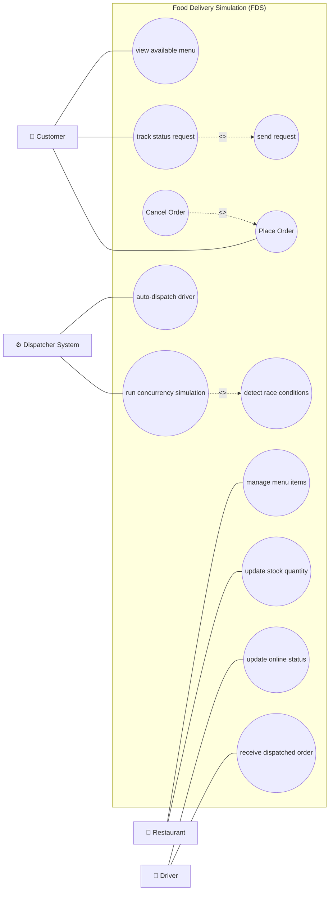

# SƠ ĐỒ VÀ MÔ TẢ USE CASE DIAGRAM (CHUẨN THEO MẪU THAM KHẢO CRS)
**LAB211 — OOP with Java | FPT University**

---

## 1. SƠ ĐỒ USE CASE DIAGRAM (ĐÚNG KIỂU DÁNG MẪU CRS THAM KHẢO)

---

## 2. BẢNG MÔ TẢ QUAN HỆ VÀ CÁC NỐI PHỤ THUỘC (RELATIONSHIPS)

| Tên Quan Hệ | Từ Use Case (Base) | Đới Use Case (Target) | Loại Quan Hệ | Mô Tả Ý Nghĩa |
| :---: | :--- | :--- | :---: | :--- |
| **1** | `track status request` | `send request` | `<<include>>` | Khi xem trạng thái đơn, hệ thống luôn phải tự động gửi request truy vấn tới server. |
| **2** | `Cancel Order` | `Place Order` | `<<extends>>` | Hủy đơn hàng là một nhánh mở rộng từ quy trình Đặt hàng (chỉ thực hiện khi cần). |
| **3** | `run concurrency simulation` | `detect race conditions` | `<<include>>` | Mô phỏng đa luồng luôn bao gồm khâu tự động hậu kiểm phát hiện lỗi race condition. |
