# 🎯 TÀI LIỆU ĐỒNG BỘ TOÀN DIỆN: PHÁT BIỂU BÀI TOÁN — USE CASE — CLASS DIAGRAM — SOURCE CODE
**Dự án:** Food Delivery Network Simulation (FDS)  
**Môn học:** LAB211 — OOP with Java | FPT University  
**Phạm vi:** Hệ thống mô phỏng đặt & giao đồ ăn trực tuyến tại TP. Quy Nhơn  
**Nguyên tắc cốt lõi:** 100% Đồng bộ 4 tầng (Phát biểu bài toán $\iff$ Use Case $\iff$ Class Diagram $\iff$ Mã nguồn)  
**Ràng buộc kỹ thuật:** 100% OOP thuần túy, 0% static ngoài `main`, 0% final/protected, 100% `this.`, lưu trữ hoàn toàn trên file CSV vật lý.

---

## 1. PHÁT BIỂU BÀI TOÁN CHÍNH THỨC (PROBLEM STATEMENT)

### 1.1. Bối cảnh Nghiệp vụ (Business Context)
Xây dựng hệ thống phần mềm mô phỏng mạng lưới giao nhận đồ ăn trực tuyến tại khu vực Thành phố Quy Nhơn, kết nối giữa 4 thực thể chính:
1. **Khách hàng (Customer):** Xem danh sách quán ăn, duyệt menu món, đặt đơn trực tuyến, hệ thống tự động tính khoảng cách và phí giao hàng theo tọa độ GPS bằng công thức **Haversine**, theo dõi trạng thái đơn hàng thời gian thực hoặc hủy đơn khi quán chưa giao.
2. **Nhà hàng Đối tác (Restaurant):** Quản lý thực đơn món ăn, cập nhật số lượng tồn kho (stock), tiếp nhận đơn hàng mới và duyệt đơn (`CONFIRMED`) hoặc từ chối đơn (`CANCELLED`).
3. **Tài xế Giao hàng (Driver):** Nộp hồ sơ ứng tuyển, bật/tắt nhận cuốc (`AVAILABLE` / `OFFLINE`), nhận cuốc xe được điều phối tự động, đến quán lấy món (`DISPATCHED`) và giao tận tay khách hàng (`DELIVERED`).
4. **Trung tâm Điều phối (Dispatcher):** Giám sát bản đồ mạng lưới ASCII (16 hàng x 50 cột), quét hàng đợi các đơn đã được quán xác nhận, tự động tìm và gán tài xế rảnh gần quán ăn nhất.

### 1.2. Thách thức Kỹ thuật & Câu hỏi Nghiên cứu Lớn (Big Research Question)
* **Ràng buộc lưu trữ:** Hệ thống không được sử dụng hệ quản trị cơ sở dữ liệu (MySQL, SQL Server, MongoDB) mà phải **đọc/ghi trực tiếp trên các tệp vật lý định dạng CSV** (`customers.csv`, `restaurants.csv`, `menu_items.csv`, `drivers.csv`, `orders.csv`, ...).
* **Vấn đề tương tranh (Concurrency):** Khi có hàng trăm khách hàng cùng đặt món và nhiều luồng điều phối cùng lúc, việc đọc/ghi đồng thời trên file CSV dễ dẫn đến **Race Condition** gây ra 3 thảm họa dữ liệu:
  1. **Double Assignment:** 1 đơn hàng bị 2 tài xế cùng nhận do 2 luồng điều phối đọc đơn cùng lúc.
  2. **Oversell Item:** Món ăn bị bán vượt quá tồn kho (kho bị âm) do 2 khách cùng bấm mua món cuối cùng tại cùng 1 nano-giây.
  3. **Driver Overload:** 1 tài xế bị gán cùng lúc nhiều hơn 1 đơn hàng active khi đang trên đường giao.
* **Câu hỏi nghiên cứu (Big Question):**
  > *"Trong điều kiện lưu trữ file vật lý (.csv), cơ chế đồng bộ hóa nào (NO_LOCK, SYNCHRONIZED, OPTIMISTIC, FILE_LOCK) tối ưu nhất để triệt tiêu 100% lỗi tương tranh (Race Condition) mà không làm suy giảm thông lượng xử lý (Throughput) quá 30%?"*

---

## 2. DANH SÁCH TÁC NHÂN (ACTORS) VÀ ÁNH XẠ NGHIỆP VỤ

| STT | Mã Actor | Tên Tác Nhân | Vai Trò Nghiệp Vụ | Phân Loại | Thực thể Tương Ứng Trong Code & Class Diagram |
| :---: | :--- | :--- | :--- | :---: | :--- |
| **1** | `ACT_CUSTOMER` | **Khách hàng** (Customer) | Tìm quán, đặt món ăn, tính phí ship GPS, hủy đơn | Human | [`Customer`](file:///d:/NHOM_01_LAB211_FoodDelivery/src/model/Customer.java), [`CustomerController`](file:///d:/NHOM_01_LAB211_FoodDelivery/src/controller/CustomerController.java) |
| **2** | `ACT_RESTAURANT` | **Quản lý Nhà hàng** (Restaurant) | Quản lý menu, cập nhật tồn kho, duyệt/từ chối đơn | Human | [`Restaurant`](file:///d:/NHOM_01_LAB211_FoodDelivery/src/model/Restaurant.java), [`MenuItem`](file:///d:/NHOM_01_LAB211_FoodDelivery/src/model/MenuItem.java), [`RestaurantController`](file:///d:/NHOM_01_LAB211_FoodDelivery/src/controller/RestaurantController.java) |
| **3** | `ACT_DRIVER` | **Tài xế Đối tác** (Driver) | Bật/tắt nhận cuốc, lấy hàng, giao hàng thành công | Human | [`Driver`](file:///d:/NHOM_01_LAB211_FoodDelivery/src/model/Driver.java), [`DriverController`](file:///d:/NHOM_01_LAB211_FoodDelivery/src/controller/DriverController.java) |
| **4** | `ACT_DISPATCHER` | **Điều phối viên** (Dispatcher) | Giám sát bản đồ ASCII, điều phối tài xế gần nhất | Human | [`MapView`](file:///d:/NHOM_01_LAB211_FoodDelivery/src/view/MapView.java), [`OrderController`](file:///d:/NHOM_01_LAB211_FoodDelivery/src/controller/OrderController.java) |
| **5** | `ACT_ADMIN` | **Quản trị viên** (Administrator) | Duyệt tài xế, quản lý người dùng, sinh dữ liệu CSV | Human | [`User`](file:///d:/NHOM_01_LAB211_FoodDelivery/src/model/User.java), [`AdminController`](file:///d:/NHOM_01_LAB211_FoodDelivery/src/controller/AdminController.java) |
| **6** | `ACT_SIMULATOR` | **Bộ Mô phỏng Đa luồng** (Simulator) | Khởi tạo nhiều luồng đồng thời, đối soát 4 cơ chế khóa | System | [`SimulatorController`](file:///d:/NHOM_01_LAB211_FoodDelivery/src/controller/SimulatorController.java), [`CustomerThread`](file:///d:/NHOM_01_LAB211_FoodDelivery/src/controller/CustomerThread.java), [`DispatchThread`](file:///d:/NHOM_01_LAB211_FoodDelivery/src/controller/DispatchThread.java) |

---

## 3. BẢNG ĐẶC TẢ CHI TIẾT 51 USE CASES ĐỒNG BỘ 100% VỚI CODE & CLASS DIAGRAM

### Phân hệ 1: Xác thực & Quản lý Truy cập (`SUB1 - Authentication & Access`)
Khớp với: [`AuthController`](file:///d:/NHOM_01_LAB211_FoodDelivery/src/controller/AuthController.java), [`UserRepository`](file:///d:/NHOM_01_LAB211_FoodDelivery/src/repository/UserRepository.java), [`AccountRepository`](file:///d:/NHOM_01_LAB211_FoodDelivery/src/repository/AccountRepository.java).

| Mã UC | Tên Use Case | Tác Nhân | Quan Hệ | Hàm Thực Hiện Cụ Thể Trong Source Code |
| :---: | :--- | :--- | :---: | :--- |
| **UC01** | Đăng ký tài khoản Khách hàng mới | Khách hàng | ─ | `AuthController.registerCustomer(fullName, phone, ward, lat, lon)` |
| **UC02** | Đăng nhập hệ thống (Customer, Restaurant, Driver, Admin, Dispatcher) | Đa tác nhân | ─ | `AuthController.login(username, password)` (Kiểm tra PBKDF2 qua `AccountRepository.authenticate`) |
| **UC03** | Gửi hồ sơ đăng ký đối tác tài xế | Khách hàng | ─ | `AuthController.submitDriverApplication(username, pass, name, phone, plate, vehicle, note)` |
| **UC04** | Xem thông tin tài khoản mẫu Demo | Khách hàng | ─ | `AuthController.getAllUsers()` & `MainView.displayLoginScreen()` |
| **UC05** | Đăng xuất khỏi hệ thống | Đa tác nhân | ─ | `AuthController.logout()` (Reset `currentUser = null`) |

---

### Phân hệ 2: Khách hàng & Đặt hàng Quy Nhơn (`SUB2 - Customer Portal & Ordering`)
Khớp với: [`CustomerController`](file:///d:/NHOM_01_LAB211_FoodDelivery/src/controller/CustomerController.java), [`OrderController`](file:///d:/NHOM_01_LAB211_FoodDelivery/src/controller/OrderController.java), [`MenuItemRepository`](file:///d:/NHOM_01_LAB211_FoodDelivery/src/repository/MenuItemRepository.java), [`GeoUtils`](file:///d:/NHOM_01_LAB211_FoodDelivery/src/model/GeoUtils.java).

| Mã UC | Tên Use Case | Tác Nhân | Quan Hệ | Hàm Thực Hiện Cụ Thể Trong Source Code |
| :---: | :--- | :--- | :---: | :--- |
| **UC06** | Xem danh sách quán ăn & thực đơn tại Quy Nhơn | Khách hàng | ─ | `RestaurantController.getAllRestaurants()`, `getMenuByRestaurant(restId)` |
| **UC07** | Đặt món ăn và khởi tạo đơn hàng mới | Khách hàng | `<<include>>` UC08, UC09<br>`<<extend>>` UC12 | `OrderController.createCustomerOrder(custId, restId, itemId, qty, mech)` |
| **UC08** | Trừ tồn kho món ăn tức thời (tránh Oversell) | Hệ thống | `<<include>>` UC07 | `MenuItemRepository.deductStock(itemId, qty, mech)` (Ném `OversellException` nếu thiếu hàng) |
| **UC09** | Tính phí giao hàng khoảng cách Haversine | Hệ thống | `<<include>>` UC07, UC10 | `GeoUtils.haversineDistance(lat1, lon1, lat2, lon2)` & `calculateDeliveryFee(dist)` |
| **UC10** | Xác thực tọa độ GPS khách hàng phạm vi Quy Nhơn | Hệ thống | `<<include>>` UC09 | `GeoUtils` validation toạ độ (`lat: 13.75 - 13.79, lon: 109.20 - 109.24`) |
| **UC11** | Theo dõi trạng thái đơn hàng thời gian thực | Khách hàng | ─ | `CustomerController.getOrderHistory(customerId)` |
| **UC12** | Hủy đơn hàng khi quán chưa giao | Khách hàng | `<<extend>>` UC07<br>`<<include>>` UC13 | `OrderController.cancelOrderByCustomer(orderId, custId)` |
| **UC13** | Hoàn trả số lượng tồn kho khi đơn bị hủy/từ chối | Hệ thống | `<<include>>` UC12, UC21 | `MenuItemRepository.restoreStock(menuItemId, quantity)` |
| **UC14** | Xem hồ sơ và thông tin cá nhân khách hàng | Khách hàng | ─ | `CustomerController.getCustomerById(id)` |
| **UC15** | Nhận thông báo tài xế nhận đơn & thời gian ETA | Khách hàng | ─ | `MainView.checkAndDisplayCustomerNotifications(custId)` |

---

### Phân hệ 3: Quản lý Nhà hàng & Thực đơn (`SUB3 - Restaurant Operations`)
Khớp với: [`RestaurantController`](file:///d:/NHOM_01_LAB211_FoodDelivery/src/controller/RestaurantController.java), [`MenuItemRepository`](file:///d:/NHOM_01_LAB211_FoodDelivery/src/repository/MenuItemRepository.java), [`OrderController`](file:///d:/NHOM_01_LAB211_FoodDelivery/src/controller/OrderController.java).

| Mã UC | Tên Use Case | Tác Nhân | Quan Hệ | Hàm Thực Hiện Cụ Thể Trong Source Code |
| :---: | :--- | :--- | :---: | :--- |
| **UC16** | Xem danh sách món ăn & số lượng tồn kho | Nhà hàng | ─ | `RestaurantController.getMenuByRestaurant(restaurantId)` |
| **UC17** | Cập nhật đơn giá bán & nhập thêm tồn kho | Nhà hàng | ─ | `RestaurantController.updateStock(itemId, newStock)`, `createMenuItem(...)` |
| **UC18** | Xem danh sách đơn hàng mới đặt chờ xác nhận | Nhà hàng | ─ | `OrderRepository.findAll()` lọc theo `restaurantId` và `status == PENDING` |
| **UC19** | Xác nhận chấp nhận đơn hàng (Accept Order) | Nhà hàng | `<<include>>` UC20 | `OrderController.confirmOrderByRestaurant(orderId, restId, mech)` $\rightarrow$ trạng thái `CONFIRMED` |
| **UC20** | Tự động chuyển đơn vào hàng đợi điều phối | Hệ thống | `<<include>>` UC19 | `OrderController.autoDispatchPendingOrders(mech)` |
| **UC21** | Từ chối tiếp nhận đơn hàng (Reject Order) | Nhà hàng | `<<include>>` UC13 | `OrderController.rejectOrderByRestaurant(orderId, restId, reason)` |
| **UC22** | Xem tổng doanh thu và lịch sử đơn của quán | Nhà hàng | ─ | `OrderRepository.findAll()` tính tổng `totalFoodAmount` các đơn `DELIVERED` |

---

### Phân hệ 4: Vận hành Tài xế & Giao nhận Đơn (`SUB4 - Driver Operations`)
Khớp với: [`DriverController`](file:///d:/NHOM_01_LAB211_FoodDelivery/src/controller/DriverController.java), [`DriverRepository`](file:///d:/NHOM_01_LAB211_FoodDelivery/src/repository/DriverRepository.java), [`OrderController`](file:///d:/NHOM_01_LAB211_FoodDelivery/src/controller/OrderController.java).

| Mã UC | Tên Use Case | Tác Nhân | Quan Hệ | Hàm Thực Hiện Cụ Thể Trong Source Code |
| :---: | :--- | :--- | :---: | :--- |
| **UC23** | Xem thông tin tài xế, biển số & số cuốc đã giao | Tài xế | ─ | `DriverController.getAllDrivers()` / `Driver.getActiveOrderCount()` |
| **UC24** | Bật hoặc tắt trạng thái nhận cuốc | Tài xế | ─ | `DriverController.updateDriverStatus(driverId, DriverStatus.AVAILABLE / OFFLINE)` |
| **UC25** | Xem thông tin chi tiết đơn hàng được gán | Tài xế | ─ | `OrderRepository.findAll()` lọc theo `driverId` và `status == DISPATCHED` |
| **UC26** | Xác nhận đã lấy món ăn tại quán (Picked Up) | Tài xế | ─ | `OrderController.markOrderPickedUp(orderId, driverId)` |
| **UC27** | Xác nhận hoàn tất giao hàng tới khách (Delivered)| Tài xế | `<<include>>` UC28 | `OrderController.markOrderDelivered(orderId, driverId, mech)` |
| **UC28** | Tự động giải phóng tài xế về trạng thái AVAILABLE | Hệ thống | `<<include>>` UC27 | `DriverRepository.markAvailable(driverId)` (Reset `currentOrderId = null`) |

---

### Phân hệ 5: Điều phối Trung tâm & Bản đồ Grid (`SUB5 - Central Dispatching & Map`)
Khớp với: [`OrderController`](file:///d:/NHOM_01_LAB211_FoodDelivery/src/controller/OrderController.java), [`DriverRepository`](file:///d:/NHOM_01_LAB211_FoodDelivery/src/repository/DriverRepository.java), [`MapView`](file:///d:/NHOM_01_LAB211_FoodDelivery/src/view/MapView.java), [`GeoUtils`](file:///d:/NHOM_01_LAB211_FoodDelivery/src/model/GeoUtils.java).

| Mã UC | Tên Use Case | Tác Nhân | Quan Hệ | Hàm Thực Hiện Cụ Thể Trong Source Code |
| :---: | :--- | :--- | :---: | :--- |
| **UC29** | Xem danh sách đơn hàng chờ ghép tài xế | Điều phối viên | ─ | `OrderRepository.findAll()` lọc các đơn có `status == CONFIRMED` |
| **UC30** | Kích hoạt tự động ghép nối tất cả đơn chờ | Điều phối viên | `<<include>>` UC31, UC32, UC33 | `MainController.autoDispatchAllPending(mech)` / `OrderController.autoDispatchPendingOrders(mech)` |
| **UC31** | Tìm tài xế AVAILABLE gần nhất theo Haversine | Hệ thống | `<<include>>` UC30 | `DriverRepository.findNearestAvailable(lat, lon)` dùng `GeoUtils.haversineDistance` |
| **UC32** | Tính toán thời gian dự kiến ETA lấy hàng & giao | Hệ thống | `<<include>>` UC30 | `GeoUtils.calculatePickupMinutes(dist)` & `calculateDeliveryMinutes(pDist, dDist)` |
| **UC33** | Gán đơn & khóa tài xế sang BUSY (Chống Double Assign) | Hệ thống | `<<include>>` UC30 | `OrderRepository.assignDriver(orderId, driverId, mech)` & `DriverRepository.markBusy(...)` |
| **UC34** | Giám sát vị trí và số lượng tài xế rảnh / bận | Điều phối viên | ─ | `DriverController.getAvailableDrivers()` / `DriverController.getAllDrivers()` |
| **UC35** | Vẽ bản đồ trực quan ASCII Grid Map Quy Nhơn (16x50) | Điều phối viên | ─ | `MapView.renderAsciiMap(restaurants, customers, drivers, orders)` |

---

### Phân hệ 6: Quản trị Hệ thống Toàn diện (`SUB6 - System Administration`)
Khớp với: [`AdminController`](file:///d:/NHOM_01_LAB211_FoodDelivery/src/controller/AdminController.java), [`ReportView`](file:///d:/NHOM_01_LAB211_FoodDelivery/src/view/ReportView.java), `DataGenerator`.

| Mã UC | Tên Use Case | Tác Nhân | Quan Hệ | Hàm Thực Hiện Cụ Thể Trong Source Code |
| :---: | :--- | :--- | :---: | :--- |
| **UC36** | Xem danh sách hồ sơ xin làm tài xế đang chờ duyệt | Quản trị viên | `<<extend>>` UC37, UC38 | `AdminController.getPendingDriverApplications()` |
| **UC37** | Phê duyệt hồ sơ & tự động cấp mã Driver + User | Quản trị viên | `<<extend>>` UC36 | `AdminController.approveDriverApplication(applicationId)` |
| **UC38** | Từ chối hồ sơ đăng ký tài xế kèm lý do | Quản trị viên | `<<extend>>` UC36 | `AdminController.rejectDriverApplication(applicationId, reason)` |
| **UC39** | Quản lý danh sách tài khoản, mật khẩu & quyền hạn | Quản trị viên | ─ | `AuthController.getAllUsers()` & `AccountRepository` |
| **UC40** | Thêm nhà hàng mới, sửa menu và bổ sung tồn kho | Quản trị viên | ─ | `AdminController.addRestaurant(...)`, `AdminController.restockMenuItem(...)` |
| **UC41** | Xem và quản lý thông tin khách hàng Quy Nhơn | Quản trị viên | ─ | `CustomerController.getAllCustomers()` |
| **UC42** | Giám sát toàn bộ đơn hàng trên toàn hệ thống | Quản trị viên | ─ | `OrderRepository.findAll()` |
| **UC43** | Sinh dữ liệu mô phỏng lớn (>= 18,000 dòng CSV) | Quản trị viên | ─ | `util.DataGenerator.generateAllCsvFiles()` / `DataGenerator.main()` |
| **UC44** | Xem báo cáo tổng kết và kết luận Big Question | Quản trị viên | ─ | `ReportView.printResearchConclusion(runs)` |

---

### Phân hệ 7: Mô phỏng Đa luồng & Kiểm định Tương tranh (`SUB7 - Concurrency Benchmark Simulator`)
Khớp với: [`SimulatorController`](file:///d:/NHOM_01_LAB211_FoodDelivery/src/controller/SimulatorController.java), [`CustomerThread`](file:///d:/NHOM_01_LAB211_FoodDelivery/src/controller/CustomerThread.java), [`DispatchThread`](file:///d:/NHOM_01_LAB211_FoodDelivery/src/controller/DispatchThread.java), [`SimulatorView`](file:///d:/NHOM_01_LAB211_FoodDelivery/src/view/SimulatorView.java).

| Mã UC | Tên Use Case | Tác Nhân | Quan Hệ | Hàm Thực Hiện Cụ Thể Trong Source Code |
| :---: | :--- | :--- | :---: | :--- |
| **UC45** | Chọn số lượng đơn hàng (500-10,000) & cơ chế khóa | Quản trị viên | ─ | `SimulatorController` tiếp nhận tham số cấu hình |
| **UC46** | Khởi chạy kịch bản mô phỏng tương tranh đa luồng | Quản trị viên, Bộ mô phỏng | `<<include>>` UC47, UC48, UC49 | `SimulatorController.runSimulation(numOrders, mechanism)` |
| **UC47** | Mô phỏng nhiều khách hàng tranh mua đồng thời | Hệ thống | `<<include>>` UC46 | `CustomerThread.run()` / `CustomerSimTask.run()` qua `CountDownLatch` |
| **UC48** | Mô phỏng nhiều luồng điều phối tranh gán tài xế | Hệ thống | `<<include>>` UC46 | `DispatchThread.run()` / `DispatchSimTask.run()` qua `CountDownLatch` |
| **UC49** | Tự động phát hiện lỗi Race Condition trên CSV | Bộ mô phỏng | `<<include>>` UC46<br>`<<extend>>` UC51 | `SimulatorController.detectDoubleAssignments()`, `detectOversellItems()`, `detectDriverOverload()` |
| **UC50** | So chuẩn 4 cơ chế (NO_LOCK, SYNCHRONIZED, OPTIMISTIC, FILE_LOCK) | Bộ mô phỏng | ─ | `SimulatorController.runExperiment(mechanism, numOrders, baseline)` |
| **UC51** | Hiển thị bảng so sánh thông lượng và tỷ lệ sụt giảm | Hệ thống | `<<extend>>` UC49 | `SimulatorView.printBenchmarkTable(runs)` & `renderComparisonTable(runs)` |

---

## 4. MA TRẬN TRUY VẾT 4 CHIỀU (TRACEABILITY MATRIX)
Bảng chứng minh sự **đồng bộ 100% không kẽ hở** giữa Phát biểu bài toán, Use Case, Class Diagram và Source Code:

```
┌──────────────────────────────┐
│  1. PHÁT BIỂU BÀI TOÁN       │  (Nghiệp vụ thực tế: Đặt món, Điều phối Haversine, Concurrency CSV)
└──────────────┬───────────────┘
               │ ánh xạ 1-1
┌──────────────▼───────────────┐
│  2. ĐẶC TẢ USE CASE (51 UC)  │  (7 Phân hệ, 6 Actors: ACT_CUSTOMER, ACT_DRIVER, ACT_SIMULATOR...)
└──────────────┬───────────────┘
               │ hiện thực hóa bởi
┌──────────────▼───────────────┐
│  3. CLASS DIAGRAM (60 Classes)│ (BaseEntity, 11 Repositories, 13 Controllers, 8 Exceptions, 7 Views)
└──────────────┬───────────────┘
               │ mã nguồn 100%
┌──────────────▼───────────────┐
│  4. MÃ NGUỒN JAVA (.java)    │  (src/model/, src/repository/, src/controller/, src/view/, src/exception/)
└──────────────────────────────┘
```

| Mục Tiêu Bài Toán | Mã Use Case | Lớp trong Class Diagram | File Mã Nguồn Java Cụ Thể |
| :--- | :--- | :--- | :--- |
| **1. Đặt món ăn & Trừ kho an toàn** | UC07, UC08 | `Order`, `MenuItem`, `OrderController`, `MenuItemRepository`, `OversellException` | [`src/controller/OrderController.java`](file:///d:/NHOM_01_LAB211_FoodDelivery/src/controller/OrderController.java)<br>[`src/repository/MenuItemRepository.java`](file:///d:/NHOM_01_LAB211_FoodDelivery/src/repository/MenuItemRepository.java) |
| **2. Định vị Haversine & Phí ship** | UC09, UC10, UC31 | `GeoUtils`, `DriverRepository`, `DeliveryRoute` | [`src/model/GeoUtils.java`](file:///d:/NHOM_01_LAB211_FoodDelivery/src/model/GeoUtils.java)<br>[`src/repository/DriverRepository.java`](file:///d:/NHOM_01_LAB211_FoodDelivery/src/repository/DriverRepository.java) |
| **3. Nhà hàng duyệt & Từ chối đơn** | UC18, UC19, UC21 | `Restaurant`, `Order`, `RestaurantController`, `OrderController` | [`src/controller/RestaurantController.java`](file:///d:/NHOM_01_LAB211_FoodDelivery/src/controller/RestaurantController.java)<br>[`src/controller/OrderController.java`](file:///d:/NHOM_01_LAB211_FoodDelivery/src/controller/OrderController.java) |
| **4. Điều phối tự động & Chống Double Assign** | UC29, UC30, UC33 | `OrderController`, `DriverRepository`, `DoubleAssignmentException`, `LockMechanism` | [`src/controller/OrderController.java`](file:///d:/NHOM_01_LAB211_FoodDelivery/src/controller/OrderController.java)<br>[`src/repository/OrderRepository.java`](file:///d:/NHOM_01_LAB211_FoodDelivery/src/repository/OrderRepository.java) |
| **5. Tài xế nhận cuốc, lấy & giao món** | UC24, UC26, UC27, UC28 | `Driver`, `DriverController`, `OrderController`, `DriverStatus` | [`src/controller/DriverController.java`](file:///d:/NHOM_01_LAB211_FoodDelivery/src/controller/DriverController.java)<br>[`src/controller/OrderController.java`](file:///d:/NHOM_01_LAB211_FoodDelivery/src/controller/OrderController.java) |
| **6. Giám sát bản đồ ASCII Quy Nhơn** | UC35 | `MapView`, `GeoUtils`, `MainController` | [`src/view/MapView.java`](file:///d:/NHOM_01_LAB211_FoodDelivery/src/view/MapView.java) |
| **7. Quản trị hệ thống & Duyệt tài xế** | UC36, UC37, UC38, UC43 | `DriverApplication`, `AdminController`, `DataGenerator` | [`src/controller/AdminController.java`](file:///d:/NHOM_01_LAB211_FoodDelivery/src/controller/AdminController.java)<br>[`src/util/DataGenerator.java`](file:///d:/NHOM_01_LAB211_FoodDelivery/src/util/DataGenerator.java) |
| **8. Đo kiểm Concurrency & Trả lời Big Question** | UC45, UC46, UC49, UC50, UC51 | `SimulatorController`, `CustomerThread`, `DispatchThread`, `SimulationRun`, `SimulatorView` | [`src/controller/SimulatorController.java`](file:///d:/NHOM_01_LAB211_FoodDelivery/src/controller/SimulatorController.java)<br>[`src/view/SimulatorView.java`](file:///d:/NHOM_01_LAB211_FoodDelivery/src/view/SimulatorView.java) |

---

## 5. SƠ ĐỒ USE CASE MERMAID TỔNG HỢP

```mermaid
graph LR
    subgraph FDS ["HỆ THỐNG ĐẶT VÀ GIAO ĐỒ ĂN TRỰC TUYẾN (FOOD DELIVERY SIMULATION SYSTEM)"]
        subgraph SUB1 ["Phân hệ 1: Xác thực & Quản lý Truy cập"]
            UC01(("UC01: Đăng ký khách hàng"))
            UC02(("UC02: Đăng nhập hệ thống"))
            UC03(("UC03: Nộp hồ sơ tài xế"))
            UC04(("UC04: Xem tài khoản demo"))
            UC05(("UC05: Đăng xuất"))
        end
        subgraph SUB2 ["Phân hệ 2: Khách hàng & Đặt hàng Quy Nhơn"]
            UC06(("UC06: Xem danh sách quán & menu"))
            UC07(("UC07: Đặt món ăn & Tạo đơn"))
            UC08(("UC08: Trừ tồn kho tức thời"))
            UC09(("UC09: Tính phí ship Haversine"))
            UC10(("UC10: Xác thực GPS Quy Nhơn"))
            UC11(("UC11: Theo dõi đơn hàng của tôi"))
            UC12(("UC12: Hủy đơn hàng PENDING"))
            UC13(("UC13: Hoàn trả tồn kho"))
            UC14(("UC14: Xem hồ sơ cá nhân"))
            UC15(("UC15: Nhận thông báo tài xế & ETA"))
        end
        subgraph SUB3 ["Phân hệ 3: Quản lý Nhà hàng & Thực đơn"]
            UC16(("UC16: Xem menu & Tồn kho"))
            UC17(("UC17: Cập nhật giá & Nhập kho"))
            UC18(("UC18: Xem đơn mới chờ duyệt"))
            UC19(("UC19: Xác nhận đơn (Accept)"))
            UC20(("UC20: Chuyển điều phối tự động"))
            UC21(("UC21: Từ chối đơn (Reject)"))
            UC22(("UC22: Thống kê doanh thu quán"))
        end
        subgraph SUB4 ["Phân hệ 4: Vận hành Tài xế & Giao nhận"]
            UC23(("UC23: Xem hồ sơ & Số cuốc xe"))
            UC24(("UC24: Chuyển AVAILABLE / OFFLINE"))
            UC25(("UC25: Xem đơn được phân công"))
            UC26(("UC26: Xác nhận lấy hàng quán"))
            UC27(("UC27: Xác nhận giao thành công"))
            UC28(("UC28: Tự động về AVAILABLE"))
        end
        subgraph SUB5 ["Phân hệ 5: Điều phối Trung tâm & Bản đồ Grid"]
            UC29(("UC29: Xem đơn chờ ghép tài xế"))
            UC30(("UC30: Tự động điều phối toàn bộ"))
            UC31(("UC31: Tìm tài xế gần nhất"))
            UC32(("UC32: Tính ETA lấy & giao hàng"))
            UC33(("UC33: Gán đơn & Khóa tài xế BUSY"))
            UC34(("UC34: Giám sát đội ngũ tài xế"))
            UC35(("UC35: Vẽ bản đồ ASCII Grid Map"))
        end
        subgraph SUB6 ["Phân hệ 6: Quản trị Hệ thống Toàn diện"]
            UC36(("UC36: Xem hồ sơ tài xế chờ duyệt"))
            UC37(("UC37: Phê duyệt cấp mã Driver"))
            UC38(("UC38: Từ chối hồ sơ kèm lý do"))
            UC39(("UC39: Quản lý tài khoản & phân quyền"))
            UC40(("UC40: Quản lý nhà hàng & menu"))
            UC41(("UC41: Quản lý khách hàng"))
            UC42(("UC42: Giám sát toàn bộ đơn hàng"))
            UC43(("UC43: Sinh dữ liệu mẫu CSV >= 18k dòng"))
            UC44(("UC44: Báo cáo kết luận Big Question"))
        end
        subgraph SUB7 ["Phân hệ 7: Mô phỏng Đa luồng & Kiểm định"]
            UC45(("UC45: Cấu hình đơn & cơ chế khóa"))
            UC46(("UC46: Khởi chạy mô phỏng tải cao"))
            UC47(("UC47: Luồng khách đặt (CustomerThread)"))
            UC48(("UC48: Luồng điều phối (DispatchThread)"))
            UC49(("UC49: Phát hiện lỗi Race Conditions"))
            UC50(("UC50: So chuẩn 4 cơ chế khóa"))
            UC51(("UC51: Xuất bảng đối soát hiệu năng"))
        end
    end

    ACT_CUSTOMER["👤 Khách hàng"]
    ACT_RESTAURANT["👤 Quản lý Nhà hàng"]
    ACT_DRIVER["👤 Tài xế Đối tác"]
    ACT_DISPATCHER["👤 Điều phối viên"]
    ACT_ADMIN["👤 Quản trị viên"]
    ACT_SIMULATOR["⚙️ Bộ Mô phỏng Đa luồng"]

    ACT_CUSTOMER --- UC01
    ACT_CUSTOMER --- UC02
    ACT_CUSTOMER --- UC03
    ACT_CUSTOMER --- UC04
    ACT_CUSTOMER --- UC05
    ACT_CUSTOMER --- UC06
    ACT_CUSTOMER --- UC07
    ACT_CUSTOMER --- UC11
    ACT_CUSTOMER --- UC12
    ACT_CUSTOMER --- UC14
    ACT_CUSTOMER --- UC15

    ACT_RESTAURANT --- UC02
    ACT_RESTAURANT --- UC05
    ACT_RESTAURANT --- UC16
    ACT_RESTAURANT --- UC17
    ACT_RESTAURANT --- UC18
    ACT_RESTAURANT --- UC19
    ACT_RESTAURANT --- UC21
    ACT_RESTAURANT --- UC22

    ACT_DRIVER --- UC02
    ACT_DRIVER --- UC05
    ACT_DRIVER --- UC23
    ACT_DRIVER --- UC24
    ACT_DRIVER --- UC25
    ACT_DRIVER --- UC26
    ACT_DRIVER --- UC27

    ACT_DISPATCHER --- UC02
    ACT_DISPATCHER --- UC05
    ACT_DISPATCHER --- UC29
    ACT_DISPATCHER --- UC30
    ACT_DISPATCHER --- UC34
    ACT_DISPATCHER --- UC35

    ACT_ADMIN --- UC02
    ACT_ADMIN --- UC05
    ACT_ADMIN --- UC36
    ACT_ADMIN --- UC39
    ACT_ADMIN --- UC40
    ACT_ADMIN --- UC41
    ACT_ADMIN --- UC42
    ACT_ADMIN --- UC43
    ACT_ADMIN --- UC44

    ACT_SIMULATOR --- UC46
    ACT_SIMULATOR --- UC49
    ACT_SIMULATOR --- UC50

    UC07 -.->|<<include>>| UC08
    UC07 -.->|<<include>>| UC09
    UC09 -.->|<<include>>| UC10
    UC12 -.->|<<extend>>| UC07
    UC12 -.->|<<include>>| UC13
    UC21 -.->|<<include>>| UC13
    UC19 -.->|<<include>>| UC20
    UC27 -.->|<<include>>| UC28
    UC30 -.->|<<include>>| UC31
    UC30 -.->|<<include>>| UC32
    UC30 -.->|<<include>>| UC33
    UC37 -.->|<<extend>>| UC36
    UC38 -.->|<<extend>>| UC36
    UC46 -.->|<<include>>| UC47
    UC46 -.->|<<include>>| UC48
    UC46 -.->|<<include>>| UC49
    UC51 -.->|<<extend>>| UC49
```


