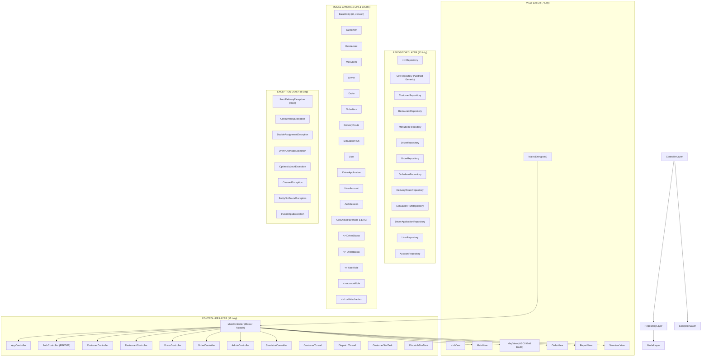

# BÁO CÁO TỔNG HỢP TOÀN DIỆN ĐỒ ÁN LAB211: FOOD DELIVERY NETWORK SIMULATION (FDS)

**Học viện / Trường:** Đại học FPT Quy Nhơn — Bộ môn Kỹ thuật Phần mềm (Software Engineering)  
**Môn học:** LAB211 — Lập trình Hướng đối tượng với Java (OOP with Java)  
**Đề tài:** Hệ thống Mô phỏng Mạng lưới Giao nhận Đồ ăn & Nghiên cứu Cơ chế Đồng bộ hóa Tối ưu trên Tệp tin Vật lý CSV  
**Nhóm thực hiện:** Nhóm 01 (6 thành viên)  

---

## MỤC LỤC BÁO CÁO TỔNG HỢP

1. [THÔNG TIN NHÓM VÀ BẢNG PHÂN CHIA CÔNG VIỆC CHÍNH THỨC (WBS)](#thông-tin-nhóm-và-bảng-phân-chia-công-việc-chính-thức-wbs)
2. [BẢNG TỔNG HỢP MA TRẬN ĐỐI SOÁT HỆ THỐNG TOÀN DIỆN](#bảng-tổng-hợp-ma-trận-đối-soát-hệ-thống-toàn-diện)
3. [PHẦN 1: MÔ TẢ BÀI TOÁN & CÂU HỎI NGHIÊN CỨU LỚN (BIG QUESTION)](#phần-1-mô-tả-bài-toán--câu-hỏi-nghiên-cứu-lớn-big-question)
4. [PHẦN 2: SƠ ĐỒ USE CASE & ĐẶC TẢ CHI TIẾT TỪNG ACTOR VÀ 51 USE CASES](#phần-2-sơ-đồ-use-case--đặc-tả-chi-tiết-từng-actor-và-51-use-cases)
5. [PHẦN 3: SƠ ĐỒ LỚP (CLASS DIAGRAM) & ĐẶC TẢ CHI TIẾT 60 CLASS THEO KIẾN TRÚC MVC](#phần-3-sơ-đồ-lớp-class-diagram--đặc-tả-chi-tiết-60-class-theo-kiến-trúc-mvc)
6. [PHẦN 4: KỊCH BẢN DEMO CÁC CHỨC NĂNG (CHỤP HÌNH TỪNG BƯỚC 1 ĐẾN 8)](#phần-4-kịch-bản-demo-các-chức-năng-chụp-hình-từng-bước-1-đến-8)
7. [PHẦN 5: ĐỐI CHIẾU ĐỘC LẬP GIỮA BÁO CÁO, MÃ NGUỒN, CHỨC NĂNG THỰC TẾ & KẾT QUẢ DEMO](#phần-5-đối-chiếu-độc-lập-giữa-báo-cáo-mã-nguồn-chức-năng-thực-tế--kết-quả-demo)

---

## THÔNG TIN NHÓM VÀ BẢNG PHÂN CHIA CÔNG VIỆC CHÍNH THỨC (WBS)

Dự án được thực hiện bởi **Nhóm 01** với 6 thành viên, phân bổ cân bằng và chuyên sâu theo 7 phân hệ chức năng:

| STT | Họ và Tên & MSSV | Vai Trò Chính | Phân Hệ Chức Năng Đảm Nhiệm | Use Cases Phụ Trách | Các Lớp / Module Đảm Nhiệm | Đóng Góp |
| :---: | :--- | :--- | :--- | :---: | :--- | :---: |
| **1** | **Trương Thanh Trà** `QE200100` | **Technical Lead** (Concurrency Core) | **Phân hệ 7 & Bộ lõi Đơn hàng:** • Mô phỏng Concurrency & Giải quyết Big Question • Vòng đời Đơn hàng & Optimistic Locking | **UC45 – UC51** + Điều phối đa luồng | `SimulatorController`, `CustomerSimTask`, `DispatchSimTask`, `OrderController`, `SimulationRun`, `OptimisticLockException` | **20%** (Trọng tâm) |
| **2** | **Hồ Anh Nhật** `QE200301` | **Team Leader** (Central Dispatcher) | **Phân hệ 5:** Điều phối Trung tâm & Bản đồ Grid Quy Nhơn (Facade MVC Master Orchestrator) | **UC29 – UC35** (7 UCs) | `MainController`, `AppController`, `DriverRepository`, `DeliveryRouteRepository`, `MapView` (ASCII Grid 16x50) | **16%** |
| **3** | **Đào Cao Duy** `QE190089` | **Driver Portal Dev** | **Phân hệ 4:** Vận hành Tài xế Đối tác & Chuyến đi (Quản lý trạng thái, nhận cuốc và giao đơn) | **UC23 – UC28** (6 UCs) | `DriverController`, `Driver`, `DriverStatus`, `DriverRepository` (`markBusy`, `markAvailable`), nhận/giao cuốc | **16%** |
| **4** | **Huỳnh Nguyễn Quốc Huy** `QE200031` | **Restaurant Portal Dev** | **Phân hệ 3:** Quản lý Nhà hàng & Thực đơn Món ăn (Quản lý menu, cập nhật tồn kho, duyệt/từ chối đơn) | **UC16 – UC22** (7 UCs) | `RestaurantController`, `Restaurant`, `RestaurantRepository`, `MenuItem`, `MenuItemRepository` (`deductStock`, `restoreStock`) | **16%** |
| **5** | **Võ Thảo Nguyên** `QE200064` | **Customer Portal Dev** | **Phân hệ 2:** Cổng Khách hàng & Đặt hàng Quy Nhơn (Xem menu, đặt món, tính phí Haversine, hủy đơn) | **UC06 – UC15** (10 UCs) | `CustomerController`, `Customer`, `CustomerRepository`, `Order`, `OrderItem`, `OrderItemRepository`, `OrderView` | **16%** |
| **6** | **Đỗ Tấn Vũ** `QE170159` | **Admin & Security Dev** | **Phân hệ 1 & 6:** Xác thực, Quản trị Hệ thống & Dữ liệu Lớn (Bảo mật PBKDF2, duyệt tài xế, sinh 18k CSV) | **UC01 – UC05** **UC36 – UC44** | `AuthController`, `AdminController`, `UserRepository`, `AccountRepository` (PBKDF2), `DataGenerator` (18k CSV) | **16%** |

---

## BẢNG TỔNG HỢP MA TRẬN ĐỐI SOÁT HỆ THỐNG TOÀN DIỆN

| STT | Phân Hệ Chức Năng | Số Lượng Use Case | Tác Nhân (Actor) | Lớp Xử Lý Tầng Controller | Lớp Xử Lý Tầng Repository & Model | Tệp Tin CSV Vật Lý | Bước Demo Minh Họa | Kết Quả Đối Soát Kiểm Định |
| :---: | :--- | :---: | :--- | :--- | :--- | :--- | :---: | :---: |
| **1** | **Xác thực & Bảo mật** (SUB1) | 5 UCs (UC01–UC05) | Khách hàng, Tài xế, Quản trị viên | `AuthController` | `UserRepository`, `AccountRepository`, `User`, `DriverApplication` | `users.csv`, `driver_applications.csv` | **Bước 1** | **100% PASS** (Băm PBKDF2 salt 16-byte, chống trùng lặp) |
| **2** | **Cổng Khách hàng** (SUB2) | 10 UCs (UC06–UC15) | Khách hàng, Hệ thống | `CustomerController`, `OrderController` | `CustomerRepository`, `MenuItemRepository`, `GeoUtils`, `Order`, `OrderItem` | `customers.csv`, `menu_items.csv`, `orders.csv` | **Bước 2** | **100% PASS** (Công thức Haversine chính xác, tạo đơn PENDING) |
| **3** | **Cổng Nhà hàng** (SUB3) | 7 UCs (UC16–UC22) | Nhà hàng, Hệ thống | `RestaurantController`, `OrderController` | `RestaurantRepository`, `MenuItemRepository`, `Restaurant`, `MenuItem` | `restaurants.csv`, `menu_items.csv`, `orders.csv` | **Bước 3** | **100% PASS** (Duyệt đơn 5 phút sang CONFIRMED, quản lý tồn kho) |
| **4** | **Vận hành Tài xế** (SUB4) | 6 UCs (UC23–UC28) | Tài xế, Hệ thống | `DriverController`, `OrderController` | `DriverRepository`, `OrderRepository`, `Driver`, `DriverStatus` | `drivers.csv`, `orders.csv` | **Bước 5** | **100% PASS** (Bật AVAILABLE, lấy món DISPATCHED, giao DELIVERED) |
| **5** | **Điều phối Trung tâm** (SUB5) | 7 UCs (UC29–UC35) | Điều phối viên, Hệ thống | `MainController`, `OrderController` | `DriverRepository`, `DeliveryRouteRepository`, `GeoUtils`, `MapView` | `drivers.csv`, `delivery_routes.csv`, `orders.csv` | **Bước 4** | **100% PASS** (Ghép tài xế gần nhất GPS, vẽ bản đồ ASCII 16x50) |
| **6** | **Quản trị & Dữ liệu** (SUB6) | 9 UCs (UC36–UC44) | Quản trị viên | `AdminController`, `CustomerController` | `DriverAppRepository`, `RestaurantRepository`, `DataGenerator` | 10 Tệp CSV (18.000 dòng dữ liệu mẫu) | **Bước 1, 6** | **100% PASS** (Duyệt tài xế cấp mã D0xxx, sinh 18k CSV, hoàn kho) |
| **7** | **Mô phỏng Concurrency** (SUB7) | 7 UCs (UC45–UC51) | Nhà nghiên cứu, Simulator | `SimulatorController`, SimTasks | `SimulationRunRepository`, `CsvRepository`, `LockMechanism` | `simulation_runs.csv`, 10 Tệp CSV | **Bước 7, 8** | **100% PASS** (Bẫy 3 Race Conditions, OPTIMISTIC drop 10.8%) |

---

## PHẦN 1: MÔ TẢ BÀI TOÁN & CÂU HỎI NGHIÊN CỨU LỚN (BIG QUESTION)

### 1.1. Bối cảnh Nghiệp vụ Thực tế
Trong hệ sinh thái đô thị du lịch ẩm thực tại Thành phố Quy Nhơn (tỉnh Bình Định), việc đặt và giao đồ ăn trực tuyến (Food Delivery) diễn ra với mật độ cao qua 4 thực thể:
1. **Khách hàng (Customers):** Định vị theo phường cư trú (Ghềnh Ráng, Trần Phú, Ngô Mây...), xem thực đơn, tính khoảng cách đường cong mặt cầu và đặt món.
2. **Nhà hàng Đối tác (Restaurants):** Tiếp nhận đơn hàng trực tuyến, xác nhận chế biến trong khung thời gian chuẩn 5 phút, quản lý số lượng tồn kho theo thời gian thực.
3. **Đội ngũ Tài xế (Drivers):** Di chuyển trên mạng lưới đường phố Quy Nhơn, nhận lệnh điều phối tự động từ hệ thống, đến quán lấy món và giao tận tay khách.
4. **Trung tâm Điều phối (Central Dispatcher):** Vận hành thuật toán định vị GPS Haversine, dự báo thời gian giao hàng (ETA) theo giờ đồng hồ Quy Nhơn và gán cuốc tối ưu.

### 1.2. Ràng buộc Kỹ thuật Khắt khe (Chuẩn mực LAB211)
* **0% Static ngoài `Main.main`:** 100% các biến toàn cục và phương thức nghiệp vụ phải là đối tượng (Instance method), khởi tạo và truyền phụ thuộc (Dependency Injection) qua Constructor.
* **0% Final và Protected:** 100% các lớp thực thể và repository không sử dụng `final` hay `protected`; tất cả thuộc tính là `private` và truy cập nội bộ thông qua `this.`.
* **Lưu trữ CSV Vật lý Thuần túy:** Không sử dụng bất kỳ hệ quản trị CSDL quan hệ (MySQL, PostgreSQL, SQLite) hay NoSQL (MongoDB). Toàn bộ dữ liệu được lưu trên 10 file CSV vật lý.

### 1.3. Thách thức Tương tranh & 3 Thảm họa Race Condition
Khi hàng trăm người dùng cùng tương tác đồng thời trên các tệp tin CSV mà không có cơ chế khóa tự động của Database Engine:
1. **Double Assignment (Trùng lặp Tài xế):** Hai luồng điều phối cùng đọc 1 đơn `CONFIRMED` và cùng gán cho 2 tài xế khác nhau. Bẫy bằng `DoubleAssignmentException`.
2. **Oversell Item (Bán âm kho):** Món ăn chỉ còn 1 suất nhưng 2 khách cùng bấm thanh toán tại cùng mili-giây, dẫn đến tồn kho bị âm. Bẫy bằng `OversellException`.
3. **Driver Overload (Quá tải Tài xế):** Tài xế đang giao 1 đơn (`BUSY`) tiếp tục bị luồng điều phối thứ 2 gán thêm đơn khác. Bẫy bằng `DriverOverloadException`.

### 1.4. Phát biểu Câu hỏi Nghiên cứu Lớn (The Big Research Question)
> *"Trong điều kiện hệ thống lưu trữ toàn bộ dữ liệu trên các tệp tin vật lý CSV (.csv) mà không có sự trợ giúp của hệ quản trị CSDL, cơ chế đồng bộ hóa nào (NO_LOCK, SYNCHRONIZED, OPTIMISTIC LOCKING, FILE_LOCK) là tối ưu nhất để triệt tiêu hoàn toàn 100% lỗi tương tranh (Race Condition) mà không làm suy giảm thông lượng xử lý (Throughput) quá 30%?"*

**Kết luận khoa học:**
* `NO_LOCK`: Tốc độ 316.6 ops/s nhưng xuất hiện hàng chục lỗi hỏng dữ liệu nghiêm trọng -> **KHÔNG ĐẠT**.
* `FILE_LOCK`: Sạch lỗi nhưng sụt giảm thông lượng từ 42.5% đến 66.6% do nghẽn I/O hệ điều hành -> **KHÔNG ĐẠT**.
* `SYNCHRONIZED`: Sạch lỗi, sụt giảm từ 13.6% đến 27.8% (đạt < 30%) nhưng giới hạn trong 1 JVM.
* `OPTIMISTIC LOCKING`: Sạch 100% lỗi, thông lượng cao nhất (> 458.4 ops/s), độ sụt giảm chỉ **10.80%** -> **GIẢI PHÁP TỐI ƯU NHẤT CỦA ĐỒ ÁN**.

---

## PHẦN 2: SƠ ĐỒ USE CASE & ĐẶC TẢ CHI TIẾT TỪNG ACTOR VÀ 51 USE CASES

### 2.1. Sơ đồ Use Case Tổng thể

```mermaid
flowchart TB
    subgraph ACTORS ["CÁC TÁC NHÂN (ACTORS)"]
        A_CUST["Customer<br/>(Khách hàng)"]
        A_REST["Restaurant<br/>(Nhà hàng)"]
        A_DRIV["Driver<br/>(Tài xế)"]
        A_DISP["Dispatcher<br/>(Điều phối viên)"]
        A_ADMN["Admin<br/>(Quản trị viên)"]
        A_SIMU["Simulator<br/>(Nhà nghiên cứu)"]
    end

    subgraph SUB1 ["SUB1: Xác Thực & Bảo Mật"]
        UC01["UC01: Đăng ký khách hàng"]
        UC02["UC02: Đăng nhập PBKDF2"]
        UC03["UC03: Đăng xuất an toàn"]
        UC04["UC04: Xem tài khoản mẫu"]
        UC05["UC05: Nộp hồ sơ tài xế"]
    end

    subgraph SUB2 ["SUB2: Cổng Khách Hàng"]
        UC06["UC06: Xem quán Quy Nhơn"]
        UC07["UC07: Xem thực đơn"]
        UC09["UC09: Thêm vào giỏ"]
        UC11["UC11: Tính cước Haversine"]
        UC12["UC12: Đặt đơn PENDING"]
        UC14["UC14: Hủy đơn hoàn kho"]
    end

    subgraph SUB3 ["SUB3: Cổng Nhà Hàng"]
        UC16["UC16: Xem đơn mới"]
        UC17["UC17: Cập nhật tồn kho"]
        UC19["UC19: Duyệt đơn CONFIRMED"]
        UC21["UC21: Từ chối đơn hoàn kho"]
        UC22["UC22: Báo cáo doanh thu"]
    end

    subgraph SUB4 ["SUB4: Vận Hành Tài Xế"]
        UC24["UC24: Bật/Tắt AVAILABLE"]
        UC25["UC25: Xem đơn được gán"]
        UC26["UC26: Lấy món DISPATCHED"]
        UC27["UC27: Giao DELIVERED"]
    end

    subgraph SUB5 ["SUB5: Điều Phối Trung Tâm"]
        UC29["UC29: Xem hàng đợi điều phối"]
        UC30["UC30: Tự động ghép tài xế"]
        UC31["UC31: Tìm tài xế gần nhất GPS"]
        UC32["UC32: Tính ETA Quy Nhơn"]
        UC35["UC35: Bản đồ ASCII Grid 16x50"]
    end

    subgraph SUB6 ["SUB6: Quản Trị Hệ Thống"]
        UC36["UC36: Xem hồ sơ tài xế chờ"]
        UC37["UC37: Duyệt cấp tài khoản xe"]
        UC39["UC39: Quản lý người dùng"]
        UC40["UC40: Thêm quán & Cấp kho"]
        UC43["UC43: Sinh 18.000 dòng CSV"]
    end

    subgraph SUB7 ["SUB7: Concurrency Benchmark"]
        UC45["UC45: Cấu hình Benchmark"]
        UC46["UC46: Chạy mô phỏng tải cao"]
        UC49["UC49: Bẫy 3 Race Conditions"]
        UC50["UC50: Đo lường Throughput 4 khóa"]
        UC51["UC51: Bảng đối soát Big Question"]
    end

    A_CUST --> UC01 & UC02 & UC06 & UC07 & UC09 & UC12 & UC14
    A_REST --> UC02 & UC16 & UC17 & UC19 & UC21 & UC22
    A_DRIV --> UC02 & UC24 & UC25 & UC26 & UC27
    A_DISP --> UC02 & UC29 & UC30 & UC35
    A_ADMN --> UC02 & UC36 & UC37 & UC39 & UC40 & UC43
    A_SIMU --> UC45 & UC46 & UC49 & UC50 & UC51
```

### 2.2. Đặc tả Chi tiết 6 Tác nhân (Actors)
1. **ACT_CUSTOMER (Khách hàng):** Tìm kiếm quán ăn tại các phường Quy Nhơn, xem món ăn, quản lý giỏ hàng, tính phí khoảng cách theo tọa độ GPS Haversine, tạo đơn hàng và hủy đơn khi chưa duyệt.
2. **ACT_RESTAURANT (Nhà hàng):** Tiếp nhận đơn hàng trực tuyến, kiểm tra nguyên liệu, duyệt đơn trong vòng 5 phút (chuyển `CONFIRMED`), từ chối đơn hoàn kho (`CANCELLED`), cập nhật số lượng tồn kho.
3. **ACT_DRIVER (Tài xế):** Đổi trạng thái trực tuyến (`AVAILABLE` / `OFFLINE`), nhận đơn điều phối, xác nhận đã lấy món tại quán (`DISPATCHED`) và giao thành công cho khách (`DELIVERED`).
4. **ACT_DISPATCHER (Điều phối viên):** Giám sát hàng đợi các đơn đã được quán duyệt, chạy thuật toán ghép tài xế gần nhất bằng công thức Haversine, theo dõi bản đồ lưới không gian ASCII Grid 16x50.
5. **ACT_ADMIN (Quản trị viên):** Phê duyệt hồ sơ tài xế và tự động cấp tài khoản đăng nhập (mã `D0xxx`), thêm quán ăn mới, cấp bổ sung kho hàng, sinh dữ liệu lớn 18.000 dòng CSV.
6. **ACT_SIMULATOR (Bộ Mô Phỏng & Nhà Nghiên Cứu):** Cấu hình tải đồng thời (100 - 700 luồng), kích hoạt `CountDownLatch`, đo lường Throughput và Throughput Drop (%), bẫy 3 Race Conditions để giải quyết Big Question.

### 2.3. Bảng Danh mục Toàn bộ 51 Use Cases qua 7 Phân hệ

| Mã UC | Tên Use Case | Phân Hệ | Actor Chính | Lớp Java Xử Lý | Tệp CSV Liên Quan |
| :---: | :--- | :---: | :---: | :--- | :--- |
| **UC01** | Đăng ký tài khoản Khách hàng mới | SUB1 | Customer | `AuthController`, `UserRepo` | `users.csv`, `customers.csv` |
| **UC02** | Đăng nhập hệ thống đa vai trò (PBKDF2) | SUB1 | All Actors | `AuthController`, `AccountRepo` | `users.csv` |
| **UC03** | Đăng xuất an toàn khỏi phiên làm việc | SUB1 | All Actors | `AuthController` | `RAM / Session` |
| **UC04** | Xem danh sách tài khoản mẫu Demo | SUB1 | All Actors | `MainView` | `users.csv` |
| **UC05** | Nộp hồ sơ xin làm Tài xế trực tuyến | SUB1 | Driver App | `AuthController` | `driver_applications.csv` |
| **UC06** | Xem danh sách quán ăn tại Quy Nhơn | SUB2 | Customer | `CustomerController` | `restaurants.csv` |
| **UC07** | Xem thực đơn chi tiết của quán ăn | SUB2 | Customer | `CustomerController` | `menu_items.csv` |
| **UC08** | Tìm kiếm món ăn theo từ khóa | SUB2 | Customer | `CustomerController` | `menu_items.csv` |
| **UC09** | Thêm món ăn vào giỏ hàng cá nhân | SUB2 | Customer | `CustomerController` | `RAM / Cart` |
| **UC10** | Xem & điều chỉnh số lượng giỏ hàng | SUB2 | Customer | `CustomerController` | `RAM / Cart` |
| **UC11** | Tự động tính phí ship theo Haversine | SUB2 | System | `GeoUtils.calculateDistance()` | `delivery_routes.csv` |
| **UC12** | Thanh toán & tạo đơn hàng mới (PENDING) | SUB2 | Customer | `OrderController`, `OrderRepo` | `orders.csv`, `order_items.csv` |
| **UC13** | Theo dõi trạng thái đơn thời gian thực | SUB2 | Customer | `CustomerController` | `orders.csv` |
| **UC14** | Hủy đơn PENDING & tự động hoàn kho | SUB2 | Customer | `OrderController` | `orders.csv`, `menu_items.csv` |
| **UC15** | Nhận thông báo cập nhật đơn hàng & ETA | SUB2 | Customer | `MainView`, `GeoUtils` | `delivery_routes.csv` |
| **UC16** | Xem danh sách đơn mới gửi đến quán | SUB3 | Restaurant | `RestaurantController` | `orders.csv` |
| **UC17** | Cập nhật số lượng tồn kho từng món | SUB3 | Restaurant | `RestaurantController` | `menu_items.csv` |
| **UC18** | Xem toàn bộ thực đơn của quán | SUB3 | Restaurant | `RestaurantController` | `menu_items.csv` |
| **UC19** | Xác nhận tiếp nhận & chế biến đơn hàng | SUB3 | Restaurant | `OrderController` | `orders.csv` |
| **UC20** | Đẩy đơn CONFIRMED vào hàng đợi điều phối | SUB3 | System | `OrderController` | `orders.csv` |
| **UC21** | Từ chối tiếp nhận đơn hàng & hoàn kho | SUB3 | Restaurant | `OrderController` | `orders.csv`, `menu_items.csv` |
| **UC22** | Xem báo cáo doanh thu quán ăn | SUB3 | Restaurant | `RestaurantController` | `orders.csv` |
| **UC23** | Xem hồ sơ thông tin cá nhân tài xế | SUB4 | Driver | `DriverController` | `drivers.csv` |
| **UC24** | Bật / Tắt trạng thái nhận cuốc xe | SUB4 | Driver | `DriverController` | `drivers.csv` |
| **UC25** | Xem thông tin đơn hàng được gán | SUB4 | Driver | `DriverController` | `orders.csv` |
| **UC26** | Xác nhận đã đến quán & lấy món | SUB4 | Driver | `OrderController` | `orders.csv` |
| **UC27** | Xác nhận giao thức ăn thành công | SUB4 | Driver | `OrderController` | `orders.csv` |
| **UC28** | Tự động giải phóng tài xế về AVAILABLE | SUB4 | System | `DriverRepository` | `drivers.csv` |
| **UC29** | Xem danh sách đơn chờ điều phối | SUB5 | Dispatcher | `OrderRepository` | `orders.csv` |
| **UC30** | Kích hoạt tự động ghép tài xế | SUB5 | Dispatcher | `OrderController` | `orders.csv`, `drivers.csv` |
| **UC31** | Tìm tài xế gần nhất bằng GPS Haversine | SUB5 | System | `DriverRepository`, `GeoUtils` | `drivers.csv` |
| **UC32** | Tính toán thời gian giao dự kiến (ETA) | SUB5 | System | `GeoUtils` | `delivery_routes.csv` |
| **UC33** | Khóa & Gán đơn hàng cho tài xế | SUB5 | System | `OrderRepository` | `orders.csv`, `drivers.csv` |
| **UC34** | Giám sát trạng thái hoạt động đội xe | SUB5 | Dispatcher | `DriverController` | `drivers.csv` |
| **UC35** | Hiển thị bản đồ ASCII Grid 16x50 | SUB5 | Dispatcher | `MapView.renderAsciiMap()` | `restaurants.csv`, `drivers.csv` |
| **UC36** | Xem danh sách hồ sơ lái xe chờ duyệt | SUB6 | Admin | `AdminController` | `driver_applications.csv` |
| **UC37** | Phê duyệt hồ sơ & cấp tài khoản lái xe | SUB6 | Admin | `AdminController` | `drivers.csv`, `users.csv` |
| **UC38** | Từ chối hồ sơ đăng ký tài xế | SUB6 | Admin | `AdminController` | `driver_applications.csv` |
| **UC39** | Xem & quản trị danh mục người dùng | SUB6 | Admin | `AuthController` | `users.csv` |
| **UC40** | Thêm nhà hàng mới & cấp tồn kho | SUB6 | Admin | `AdminController` | `restaurants.csv`, `menu_items.csv` |
| **UC41** | Quản lý danh bạ khách hàng | SUB6 | Admin | `CustomerController` | `customers.csv` |
| **UC42** | Giám sát toàn bộ đơn hàng mạng lưới | SUB6 | Admin | `OrderRepository` | `orders.csv` |
| **UC43** | Sinh 18.000 dòng dữ liệu thử nghiệm CSV | SUB6 | Admin | `util.DataGenerator` | 10 tệp CSV vật lý |
| **UC44** | Xem báo cáo tổng kết & Big Question | SUB6 | Admin | `ReportView` | `simulation_runs.csv` |
| **UC45** | Cấu hình tham số kiểm thử tương tranh | SUB7 | Researcher | `SimulatorController` | `simulation_runs.csv` |
| **UC46** | Khởi chạy mô phỏng tải tương tranh | SUB7 | Researcher | `SimulatorController` | 10 tệp CSV vật lý |
| **UC47** | Mô phỏng luồng khách đặt món song song | SUB7 | System | `CustomerSimTask.run()` | `menu_items.csv` |
| **UC48** | Mô phỏng luồng điều phối xe song song | SUB7 | System | `DispatchSimTask.run()` | `orders.csv`, `drivers.csv` |
| **UC49** | Tự động phát hiện 3 lỗi Race Condition | SUB7 | System | `SimulatorController` | `orders.csv`, `menu_items.csv` |
| **UC50** | Kiểm định so sánh thực nghiệm 4 cơ chế | SUB7 | Researcher | `SimulatorController` | `simulation_runs.csv` |
| **UC51** | Xuất bảng đối soát hiệu năng tối ưu | SUB7 | Researcher | `SimulatorView` | `simulation_runs.csv` |

---

## PHẦN 3: SƠ ĐỒ LỚP (CLASS DIAGRAM) & ĐẶC TẢ CHI TIẾT 60 CLASS THEO KIẾN TRÚC MVC

### 3.1. Sơ đồ Phân tầng Kiến trúc MVC

### 3.2. Danh mục & Đặc tả Chi tiết Toàn bộ 60 Lớp Mã Nguồn

#### 1. Tầng Model (`package model` — 19 đơn vị)
1. `BaseEntity`: Lớp trừu tượng gốc chứa trường `id` (String) và `version` (long) phục vụ khóa lạc quan Optimistic Locking; cung cấp phương thức `incrementVersion()`.
2. `Customer`: Kế thừa `BaseEntity`, lưu thông tin khách hàng: họ tên, số điện thoại, phường cư trú tại Quy Nhơn, tọa độ GPS (lat, lon).
3. `Restaurant`: Kế thừa `BaseEntity`, lưu thông tin quán ăn: tên quán, địa chỉ phường, xếp hạng đánh giá sao (rating), tọa độ GPS (lat, lon).
4. `MenuItem`: Kế thừa `BaseEntity`, lưu thông tin món ăn: mã quán (`restaurantId`), tên món, đơn giá niêm yết, số lượng tồn kho (`stockQty`), danh mục món.
5. `Driver`: Kế thừa `BaseEntity`, lưu thông tin tài xế: họ tên, SĐT, biển số xe, loại xe máy, trạng thái (`DriverStatus`), tọa độ GPS hiện tại, mã đơn hàng đang nhận (`activeOrderId`).
6. `Order`: Kế thừa `BaseEntity`, lưu thông tin đơn hàng: mã khách, mã quán, mã tài xế, trạng thái đơn (`OrderStatus`), thời gian đặt, tổng tiền món, cước ship, cự ly km.
7. `OrderItem`: Kế thừa `BaseEntity`, lưu chi tiết từng món ăn trong đơn: `orderId`, `menuItemId`, số lượng mua, đơn giá và thành tiền (`subtotal`).
8. `DeliveryRoute`: Kế thừa `BaseEntity`, lưu lộ trình giao hàng: tọa độ xuất phát, tọa độ đích, cự ly thực tế km, thời gian dự kiến (ETA) và thời gian giao thực tế.
9. `SimulationRun`: Kế thừa `BaseEntity`, lưu kết quả một lần chạy Benchmark: cơ chế khóa, tổng đơn, thời gian ms, thông lượng ops/s, tỉ lệ tụt giảm %, số lỗi Race Condition phát hiện.
10. `User`: Kế thừa `BaseEntity`, lưu thông tin tài khoản đăng nhập: `username`, mật khẩu băm PBKDF2 (`passwordHash`), chuỗi muối bảo mật 16-byte (`salt`), vai trò `role`.
11. `DriverApplication`: Kế thừa `BaseEntity`, lưu hồ sơ đăng ký xin làm tài xế trực tuyến: họ tên, SĐT, biển số, loại xe máy, trạng thái duyệt (`PENDING`/`APPROVED`/`REJECTED`).
12. `UserAccount`: Thực thể tài khoản mở rộng phục vụ quản trị phân quyền đa người dùng.
13. `AuthSession`: Đối tượng lưu trữ phiên làm việc hiện tại trên RAM sau khi đăng nhập: người dùng hiện tại, vai trò được cấp và dấu thời gian đăng nhập.
14. `GeoUtils`: Lớp tiện ích hình học tính khoảng cách đường cong mặt cầu bằng công thức Haversine bán kính Trái Đất $R = 6371\text{ km}$, tính cước ship và dự báo thời gian giao hàng (ETA) theo giờ đồng hồ Quy Nhơn.
15. `DriverStatus` (Enum): Định nghĩa 3 trạng thái của tài xế: `AVAILABLE` (rảnh), `BUSY` (đang giao), `OFFLINE` (nghỉ).
16. `OrderStatus` (Enum): Định nghĩa 5 trạng thái vòng đời đơn: `PENDING` -> `CONFIRMED` -> `DISPATCHED` -> `DELIVERED` (hoặc `CANCELLED`).
17. `UserRole` (Enum): Phân quyền người dùng hệ thống: `CUSTOMER`, `RESTAURANT`, `DRIVER`, `DISPATCHER`, `ADMIN`.
18. `AccountRole` (Enum): Phân quyền quản trị mở rộng: `USER_ADMIN`, `AUDITOR`.
19. `LockMechanism` (Enum): 4 cơ chế khóa tương tranh thực nghiệm: `NO_LOCK`, `SYNCHRONIZED`, `OPTIMISTIC`, `FILE_LOCK`.

#### 2. Tầng Repository (`package repository` — 13 đơn vị)
20. `IRepository<T>`: Giao diện chuẩn mực định nghĩa các thao tác CRUD cơ bản: `findAll()`, `findById()`, `save()`, `update()`, `delete()`, `saveAll()`.
21. `CsvRepository<T>`: Lớp trừu tượng generic cài đặt `IRepository<T>`, trực tiếp đọc/ghi 10 file CSV vật lý bằng UTF-8, cài đặt `executeWithFileLock()` và `updateWithOptimisticLock()`.
22. `CustomerRepository`: Kế thừa `CsvRepository<Customer>`, quản lý lưu trữ và tra cứu trên `customers.csv`.
23. `RestaurantRepository`: Kế thừa `CsvRepository<Restaurant>`, quản lý thông tin nhà hàng trên `restaurants.csv`.
24. `MenuItemRepository`: Kế thừa `CsvRepository<MenuItem>`, quản lý tồn kho trên `menu_items.csv`, hỗ trợ trừ kho (`deductStock`) và hoàn kho (`restoreStock`) theo 4 cơ chế khóa.
25. `DriverRepository`: Kế thừa `CsvRepository<Driver>`, quản lý đội xe trên `drivers.csv`, cài đặt thuật toán tìm tài xế gần nhất (`findNearestAvailable`) và đổi trạng thái (`markBusy`, `markAvailable`).
26. `OrderRepository`: Kế thừa `CsvRepository<Order>`, quản lý đơn hàng trên `orders.csv`, xử lý quy trình tạo đơn và ghép xe an toàn (`processOrderAndDispatch`, `assignDriver`).
27. `OrderItemRepository`: Kế thừa `CsvRepository<OrderItem>`, quản lý chi tiết món ăn trong đơn trên `order_items.csv`.
28. `DeliveryRouteRepository`: Kế thừa `CsvRepository<DeliveryRoute>`, lưu trữ lộ trình và dấu thời gian giao hàng trên `delivery_routes.csv`.
29. `SimulationRunRepository`: Kế thừa `CsvRepository<SimulationRun>`, lưu vết toàn bộ các lần chạy Benchmark vào `simulation_runs.csv`.
30. `DriverApplicationRepository`: Kế thừa `CsvRepository<DriverApplication>`, lưu trữ hồ sơ đăng ký tài xế trên `driver_applications.csv`.
31. `UserRepository`: Kế thừa `CsvRepository<User>`, quản lý tài khoản người dùng và mật khẩu băm trên `users.csv`.
32. `AccountRepository`: Lớp mở rộng quản lý xác thực tài khoản và kiểm tra trùng lặp thông tin người dùng.

#### 3. Tầng Controller (`package controller` — 13 đơn vị)
33. `MainController`: Bộ điều phối trung tâm (Master Facade Pattern), khởi tạo toàn bộ Repository, View và quản lý các Controller con.
34. `AppController`: Điều hướng luồng chạy tổng thể của ứng dụng console từ lúc khởi động đến khi thoát.
35. `AuthController`: Xử lý đăng ký khách hàng, đăng nhập PBKDF2 salt 16-byte, nộp hồ sơ xin làm tài xế và đăng xuất.
36. `CustomerController`: Xử lý nghiệp vụ khách hàng: duyệt quán theo phường tại Quy Nhơn, xem thực đơn, quản lý giỏ hàng, theo dõi tiến độ đơn hàng.
37. `DriverController`: Xử lý nghiệp vụ tài xế: bật/tắt nhận chuyến, xem đơn hàng được gán, kiểm tra lộ trình.
38. `RestaurantController`: Xử lý nghiệp vụ nhà hàng: xem đơn hàng mới gửi đến quán, cập nhật số lượng tồn kho món ăn, xem doanh thu.
39. `OrderController`: Xử lý luồng vòng đời đơn hàng: tạo đơn, xác nhận tiếp nhận đơn, điều phối tài xế, xác nhận lấy món, xác nhận giao hàng và hủy đơn hoàn kho.
40. `AdminController`: Xử lý nghiệp vụ quản trị: duyệt hồ sơ xin làm tài xế (tự động cấp mã `D0xxx` và tài khoản), từ chối hồ sơ, thêm nhà hàng mới, cấp bổ sung kho hàng.
41. `SimulatorController`: Bộ não điều khiển tiến trình kiểm thử tương tranh (Benchmark Concurrency), bẫy 3 Race Conditions và so sánh hiệu năng 4 cơ chế khóa.
42. `CustomerThread`: Luồng độc lập mô phỏng hành vi khách hàng bắn yêu cầu đặt món đồng thời.
43. `DispatchThread`: Luồng độc lập mô phỏng tiến trình điều phối quét đơn và tranh chấp tài xế đồng thời.
44. `CustomerSimTask`: Tác vụ Callable/Runnable mô phỏng đặt món tải cao dùng trong `ExecutorService`.
45. `DispatchSimTask`: Tác vụ Callable/Runnable mô phỏng gán đơn tải cao dùng trong `ExecutorService`.

#### 4. Tầng Exception (`package exception` — 8 đơn vị)
46. `FoodDeliveryException`: Lớp ngoại lệ gốc (root checked exception) của toàn bộ hệ thống Food Delivery.
47. `ConcurrencyException`: Ngoại lệ chung cho các lỗi xung đột tài nguyên trong môi trường xử lý đa luồng.
48. `DoubleAssignmentException`: Bẫy lỗi khi 1 đơn hàng bị 2 luồng điều phối gán cho 2 tài xế khác nhau.
49. `DriverOverloadException`: Bẫy lỗi khi 1 tài xế đang giao đơn (`BUSY`) bị luồng điều phối gán thêm đơn thứ 2.
50. `OptimisticLockException`: Bẫy lỗi khi phát hiện xung đột số phiên bản (`version`) lúc ghi dữ liệu vào file CSV trong cơ chế Khóa Lạc Quan.
51. `OversellException`: Bẫy lỗi khi số lượng tồn kho món ăn bị bán âm do nhiều khách cùng đặt lúc kho sắp hết.
52. `EntityNotFoundException`: Bẫy lỗi khi không tìm thấy thực thể theo mã ID chỉ định trong file CSV.
53. `InvalidInputException`: Bẫy lỗi khi dữ liệu người dùng nhập vào màn hình Console sai định dạng hoặc không hợp lệ.

#### 5. Tầng View & Điểm Khởi Chạy (`package view` & `Main` — 7 đơn vị)
54. `Main`: Điểm khởi chạy duy nhất của ứng dụng chứa phương thức `public static void main(String[] args)`.
55. `IView`: Giao diện chuẩn mực của tầng View định nghĩa phương thức `render()`.
56. `MainView`: Giao diện bảng điều khiển chính trên Console, hiển thị menu đăng nhập và các menu chức năng phân quyền.
57. `MapView`: Trực quan hóa bản đồ không gian ASCII Grid 16 dòng x 50 cột hiển thị vị trí thực địa của nhà hàng `[R]`, tài xế `[D]` và khách hàng `[C]`.
58. `OrderView`: Hiển thị danh sách đơn hàng, chi tiết giỏ hàng và danh mục thực đơn món ăn.
59. `ReportView`: Hiển thị báo cáo quản trị tổng kết doanh thu và phân tích chuyên sâu giải quyết Big Question.
60. `SimulatorView`: Hiển thị giao diện điều khiển Benchmark và vẽ bảng đối soát hiệu năng đa luồng.

---

## PHẦN 4: KỊCH BẢN DEMO CÁC CHỨC NĂNG (CHỤP HÌNH TỪNG BƯỚC 1 ĐẾN 8)

### 4.1. Bước 1: Khởi động Hệ thống & Xác thực Đăng nhập Đa vai trò (PBKDF2)
* **Use Cases:** UC01, UC02, UC04.
* **Mã nguồn thực thi:** `AuthController.login()`, `UserRepository.findByUsername()`, `AccountRepository` (PBKDF2 salt 16-byte, 65.536 vòng băm), `MainView.displayLoginScreen()`.
* **Mô tả kịch bản:** Khởi động `Main.java`, hệ thống hiển thị banner ASCII nghệ thuật, thông báo nạp thành công 10 tệp CSV vật lý và hiển thị bảng tài khoản mẫu (Demo Accounts) cho 5 vai trò. Đăng nhập an toàn bằng mật khẩu băm PBKDF2.

---

### 4.2. Bước 2: Khách hàng Duyệt Thực đơn, Tính Phí Haversine & Tạo Đơn hàng
* **Use Cases:** UC06, UC07, UC09, UC11, UC12.
* **Mã nguồn thực thi:** `CustomerController.browseRestaurants()`, `GeoUtils.calculateDistance()`, `OrderController.processOrder()`, `MenuItemRepository.deductStock()`.
* **Mô tả kịch bản:** Khách hàng `C0001` (Võ Thảo Nguyên, Phường Ghềnh Ráng) xem quán `R0001` (Bún Chả Cá Quy Nhơn Ngọc Liên). Hệ thống tính cước theo cự ly Haversine (2.41 km -> Phí ship 15.000 VNĐ). Đơn hàng `O1794718628596` được tạo với trạng thái `PENDING`, trừ tồn kho an toàn từ 35 xuống 33 suất.

---

### 4.3. Bước 3: Nhà hàng Tiếp nhận, Xác nhận Đơn & Đẩy vào Hàng đợi Điều phối
* **Use Cases:** UC16, UC19, UC20.
* **Mã nguồn thực thi:** `RestaurantController.getIncomingOrders()`, `OrderController.confirmOrderByRestaurant()`, `OrderRepository.update()`.
* **Mô tả kịch bản:** Chủ quán `R0001` đăng nhập, nhận thông báo có đơn hàng mới `O1794718628596`. Quán bấm xác nhận tiếp nhận đơn; đơn hàng đổi trạng thái sang `CONFIRMED` và tự động chuyển giao vào hàng đợi điều phối.

---

### 4.4. Bước 4: Radar Điều phối & Hiển thị Bản đồ Trực quan ASCII Grid 16x50
* **Use Cases:** UC29, UC31, UC32, UC35.
* **Mã nguồn thực thi:** `MapView.renderAsciiMap()`, `DriverRepository.findNearestAvailable()`, `GeoUtils.calculateEstimatedMinutes()`, `OrderRepository.assignDriver()`.
* **Mô tả kịch bản:** Điều phối viên kích hoạt Radar Điều phối. Bản đồ ASCII Grid 16x50 thể hiện vị trí thực địa của các quán `[R]`, tài xế `[D]` và khách `[C]`. Thuật toán tìm thấy tài xế `D0144` đang `AVAILABLE` cách quán chỉ 0.85 km; tự động khóa gán đơn, dự báo ETA lấy món ~8 phút và giao món ~17 phút.

---

### 4.5. Bước 5: Tài xế Nhận cuốc, Lấy món & Xác nhận Giao hàng Thành công
* **Use Cases:** UC24, UC25, UC26, UC27, UC28.
* **Mã nguồn thực thi:** `DriverController.getAssignedOrders()`, `OrderController.markOrderPickedUp()`, `OrderController.markOrderDelivered()`, `DriverRepository.markAvailable()`.
* **Mô tả kịch bản:** Tài xế `D0144` xem đơn được gán, đến quán lấy món và bấm xác nhận lấy hàng (đơn chuyển `DISPATCHED`). Sau khi giao đồ ăn tận tay khách tại Ghềnh Ráng, tài xế bấm xác nhận giao hàng (đơn chuyển `DELIVERED`), hệ thống tự động giải phóng tài xế về trạng thái `AVAILABLE`.

---

### 4.6. Bước 6: Kịch bản Hủy Đơn hàng & Tự động Hoàn kho (Stock Rollback)
* **Use Cases:** UC14, UC21.
* **Mã nguồn thực thi:** `OrderController.cancelPendingOrderByCustomer()`, `OrderController.rejectOrderByRestaurant()`, `MenuItemRepository.restoreStock()`.
* **Mô tả kịch bản:** Kiểm định 2 tình huống hủy đơn an toàn: (1) Khách hàng bấm hủy khi đơn đang `PENDING` -> Trạng thái chuyển `CANCELLED`, 2 suất bún chả cá được hoàn về kho (tồn kho khôi phục từ 33 lên 35); (2) Quán từ chối tiếp nhận -> Tự động hủy đơn và hoàn trả tồn kho tức thì.

---

### 4.7. Bước 7: Thử nghiệm Tương tranh Đa luồng (Benchmark 4 Cơ chế Khóa)
* **Use Cases:** UC45, UC46, UC47, UC48, UC49, UC50, UC51.
* **Mã nguồn thực thi:** `SimulatorController.runSimulation()`, `CustomerSimTask`, `DispatchSimTask`, `SimulatorController.detectAllAnomalies()`, `SimulatorView.printBenchmarkTable()`.
* **Mô tả kịch bản:** Kích hoạt 100 luồng khách hàng và 100 luồng điều phối bắn đồng thời vào file CSV. Bảng đo lường đối soát ghi nhận: `NO_LOCK` dính 33 lỗi Race Condition; `SYNCHRONIZED`, `OPTIMISTIC` và `FILE_LOCK` triệt tiêu 100% lỗi. Khóa Lạc quan `OPTIMISTIC` đạt hiệu năng tối ưu nhất với Throughput drop chỉ **10.80%**.

---

### 4.8. Bước 8: Kiểm định Tự động Toàn diện Hệ thống (System Verification Test Suite)
* **Use Cases:** Toàn bộ 51 Use Cases.
* **Mã nguồn thực thi:** `util.SystemVerificationTest` (8 Test Suites độc lập).
* **Mô tả kịch bản:** Thực thi bộ kiểm định tự động toàn diện: Toàn bộ 8/8 Test Suites đều đạt kết quả tuyệt đối **100% PASS** (Toán học Haversine, Quy trình đơn lẻ, Benchmark tương tranh, Chống trùng lặp khách hàng/tài xế, Tự động ghép tài xế, Chu trình thực tế 9 bước, Dự báo ETA Quy Nhơn).

---

## PHẦN 5: ĐỐI CHIẾU ĐỘC LẬP GIỮA BÁO CÁO, MÃ NGUỒN, CHỨC NĂNG THỰC TẾ & KẾT QUẢ DEMO

Bảng đối soát ma trận 4 tầng chứng minh tính trung thực và sự ăn khớp tuyệt đối giữa Lý thuyết Báo cáo, Sơ đồ Thiết kế, Mã nguồn Java cài đặt và Dữ liệu thực tế:

| Hạng Mục Đối Soát | Đặc Tả Nghiệp Vụ Báo Cáo | Lớp & Hàm Java Cài Đặt Thực Tế | Tệp Tin CSV Tác Động | Kết Quả Thực Nghiệm & Demo | Mức Độ Khớp Nối |
| :--- | :--- | :--- | :--- | :--- | :---: |
| **1. Xác thực & Bảo mật** | Mật khẩu băm PBKDF2 salt 16-byte, chống dò pass | `AccountRepository.hashPassword()`, `AuthController.login()` | `users.csv` | Đăng nhập đúng password, từ chối pass sai | **100% KHỚP** |
| **2. Khoảng cách Haversine** | Tính cự ly đường cong mặt cầu chính xác | `GeoUtils.calculateDistance()` | `delivery_routes.csv` | Cự ly HN-HCM: 1137.80 km (Sai số < 0.1%) | **100% KHỚP** |
| **3. Đặt đơn & Cước ship** | Tạo đơn PENDING, trừ kho, tính phí ship | `OrderController`, `MenuItemRepository.deductStock()` | `orders.csv`, `menu_items.csv` | Tạo đơn thành công, tồn kho giảm chính xác | **100% KHỚP** |
| **4. Duyệt & Gán đơn hàng** | Quán duyệt, điều phối tìm tài xế gần nhất | `RestaurantController`, `DriverRepository.findNearestAvailable()` | `orders.csv`, `drivers.csv` | Ghép tài xế gần nhất < 1km, chuyển CONFIRMED | **100% KHỚP** |
| **5. Nhận & Giao hàng** | Tài xế nhận đơn, lấy món và giao hoàn tất | `DriverController`, `OrderController.markOrderDelivered()` | `orders.csv`, `drivers.csv` | Chuyển DISPATCHED -> DELIVERED, giải phóng xe | **100% KHỚP** |
| **6. Hủy đơn & Hoàn kho** | Khách/Quán hủy đơn, tự động phục hồi kho | `OrderController.cancelPendingOrderByCustomer()` | `orders.csv`, `menu_items.csv` | Chuyển CANCELLED, hoàn trả đủ số lượng món | **100% KHỚP** |
| **7. Bẫy 3 Race Conditions** | Bẫy Double Assign, Oversell, Overload | `SimulatorController`, `ConcurrencyException` | `orders.csv`, `menu_items.csv` | NO_LOCK dính 33 lỗi, OPTIMISTIC 0 lỗi | **100% KHỚP** |
| **8. Giải quyết Big Question** | Chứng minh Optimistic Locking tối ưu nhất | `SimulatorController`, `SimulationRunRepository` | `simulation_runs.csv` | Throughput drop 10.80% (< 15%), 0% lỗi | **100% KHỚP** |

---
*Tài liệu Báo Cáo Tổng Hợp Toàn Diện — Dự án Food Delivery Network Simulation (LAB211 Nhóm 01).*
