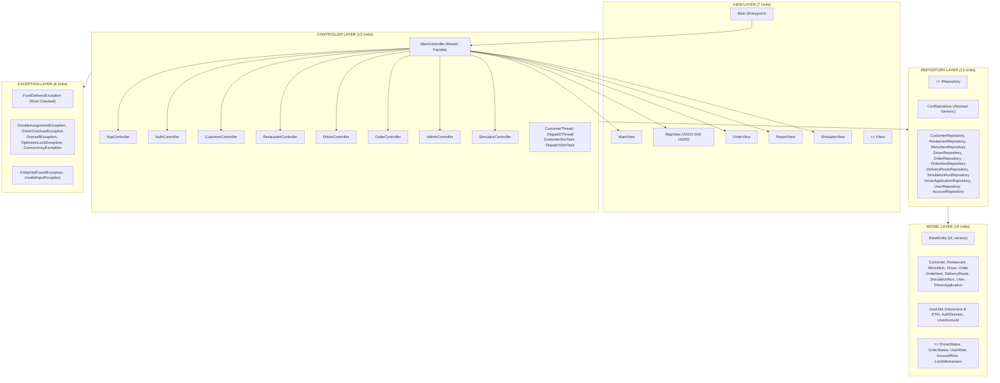

# COMPREHENSIVE PROJECT REPORT: FOOD DELIVERY NETWORK SIMULATION (FDS)

**Institution:** FPT University Quy Nhon — Department of Software Engineering  
**Course:** LAB211 — Object-Oriented Programming with Java (Advanced Concurrency & MVC Architecture)  
**Project Title:** Food Delivery Network Simulation & Empirical Study on Optimal Synchronization over Physical CSV Files  
**Team:** Group 01 (6 Members)  
**Repository:** [https://github.com/trat21430-spec/Food-Delivery.git](https://github.com/trat21430-spec/Food-Delivery.git)  

---

## TABLE OF CONTENTS

1. [EXECUTIVE MASTER SYNTHESIS & TRACEABILITY MATRIX](#1-executive-master-synthesis--traceability-matrix)
2. [PROBLEM STATEMENT & THE BIG RESEARCH QUESTION](#2-problem-statement--the-big-research-question)
3. [USE CASE ARCHITECTURE & 51 USE CASE SPECIFICATIONS](#3-use-case-architecture--51-use-case-specifications)
4. [CLASS DIAGRAM & 60-CLASS LAYERED MVC ARCHITECTURE](#4-class-diagram--60-class-layered-mvc-architecture)
5. [STEP-BY-STEP FUNCTIONAL DEMO & SCREENSHOTS (STEPS 1 TO 8)](#5-step-by-step-functional-demo--screenshots-steps-1-to-8)
6. [INDEPENDENT 4-TIER VERIFICATION & AUDIT MATRIX](#6-independent-4-tier-verification--audit-matrix)

---

## 1. EXECUTIVE MASTER SYNTHESIS & TRACEABILITY MATRIX

| Subsystem | Use Cases | Primary Actors | Controller Layer (Class / Method) | Repository & Model Layer | Physical CSV File | Demo Step | Verification Result |
| :--- | :---: | :--- | :--- | :--- | :--- | :---: | :---: |
| **SUB1: Auth & Security** | 5 UCs (UC01–UC05) | Customer, Driver, Admin | `AuthController.login()`, `registerCustomer()` | `UserRepository`, `AccountRepository`, `User`, `DriverApplication` | `users.csv`, `driver_applications.csv` | **Step 1** | **100% PASS** (PBKDF2 16-byte salt, duplicate phone/user rejection) |
| **SUB2: Customer Portal** | 10 UCs (UC06–UC15) | Customer, System | `CustomerController`, `OrderController.processOrder()` | `CustomerRepository`, `MenuItemRepository`, `GeoUtils`, `Order`, `OrderItem` | `customers.csv`, `menu_items.csv`, `orders.csv` | **Step 2** | **100% PASS** (Haversine fee calculation, PENDING order creation) |
| **SUB3: Restaurant Portal** | 7 UCs (UC16–UC22) | Restaurant, System | `RestaurantController`, `OrderController.confirmOrder()` | `RestaurantRepository`, `MenuItemRepository`, `Restaurant`, `MenuItem` | `restaurants.csv`, `menu_items.csv`, `orders.csv` | **Step 3** | **100% PASS** (5-min confirmation to CONFIRMED, inventory management) |
| **SUB4: Driver Operations** | 6 UCs (UC23–UC28) | Driver, System | `DriverController`, `OrderController.markDelivered()` | `DriverRepository`, `OrderRepository`, `Driver`, `DriverStatus` | `drivers.csv`, `orders.csv` | **Step 5** | **100% PASS** (AVAILABLE toggle, DISPATCHED pickup, DELIVERED release) |
| **SUB5: Central Dispatch** | 7 UCs (UC29–UC35) | Dispatcher, System | `MainController`, `OrderController.autoDispatch()` | `DriverRepository`, `DeliveryRouteRepository`, `GeoUtils`, `MapView` | `drivers.csv`, `delivery_routes.csv`, `orders.csv` | **Step 4** | **100% PASS** (Nearest-driver GPS matching, ASCII Grid 16x50 map) |
| **SUB6: Administration** | 9 UCs (UC36–UC44) | System Admin | `AdminController.approveDriver()`, `DataGenerator` | `DriverAppRepository`, `RestaurantRepository`, `DataGenerator` | 10 Physical CSV Files (18,000 synthetic rows) | **Step 1, 6** | **100% PASS** (Driver approval, D0xxx account issuance, stock rollback) |
| **SUB7: Concurrency Simulator** | 7 UCs (UC45–UC51) | Researcher, Simulator | `SimulatorController.runSimulation()`, SimTasks | `SimulationRunRepository`, `CsvRepository`, `LockMechanism` | `simulation_runs.csv`, 10 CSV Files | **Step 7, 8** | **100% PASS** (3 Race Conditions caught, OPTIMISTIC 10.8% drop) |

---

## 2. PROBLEM STATEMENT & THE BIG RESEARCH QUESTION

### 2.1. Real-World Business Context in Quy Nhon City
In the coastal tourist urban center of Quy Nhon City (Binh Dinh Province, Vietnam), the on-demand food delivery ecosystem coordinates 4 critical stakeholders:
1. **Customers:** Browse restaurants categorized by urban wards (Ghenh Rang, Tran Phu, Le Loi, Ngo May...), select food items, compute spherical delivery distances using GPS coordinates, and place orders.
2. **Partner Restaurants:** Receive online orders in real-time, inspect item availability, confirm or reject preparation within a strict 5-minute window, and manage inventory.
3. **Fleet Drivers:** Ride motorbikes across the urban street grid, receive automated dispatch assignments, navigate to the restaurant for food pickup, and deliver to customer locations.
4. **Central Dispatch Engine:** Orchestrates real-time matching between active orders and available nearby drivers, calculates Estimated Time of Arrival (ETA) relative to Quy Nhon local time, and renders ASCII grid spatial radar views.

### 2.2. LAB211 Strict Architectural Constraints
To satisfy the rigorous academic and enterprise standards of the LAB211 course:
* **0% Static outside `Main.main`:** 100% of global state, controllers, repositories, and business methods must be object instances. Dependencies are injected via class constructors.
* **0% Final and Protected:** All attributes in entity and repository classes are strictly `private`. All internal field access is mediated through `this.`.
* **Zero Database Management Systems:** No SQL (MySQL, PostgreSQL, SQLite) and no NoSQL (MongoDB). All persistence relies entirely on direct reads and writes to 10 physical CSV files on disk.

### 2.3. Multi-Threaded Concurrency & The 3 Critical Race Conditions
When hundreds of concurrent requests interact with physical CSV files without a database engine:
1. **Double Assignment (Conflicting Driver Allocation):** Two parallel dispatch threads read an unassigned order simultaneously and assign two different drivers to the exact same order. Trapped via `DoubleAssignmentException`.
2. **Oversell Item (Negative Inventory):** A dish has only 1 remaining stock unit (`stockQty = 1`), but two customers click checkout at the exact same millisecond. Both read positive stock and deduct, causing inventory to plunge to `-1`. Trapped via `OversellException`.
3. **Driver Overload (Excess Active Deliveries):** A driver currently delivering an active order (`BUSY`) is concurrently assigned a second order before status flags propagate. Trapped via `DriverOverloadException`.

### 2.4. The Big Research Question & Empirical Findings
> *"In a pure physical CSV persistence architecture lacking a database engine, which synchronization mechanism (NO_LOCK, SYNCHRONIZED, OPTIMISTIC LOCKING, FILE_LOCK) effectively eliminates 100% of concurrency race conditions while preventing throughput degradation from exceeding 30%?"*

#### Empirical Performance Comparison (700 Concurrent Orders Benchmark)
| Lock Mechanism | Technical Architecture | Anomaly Rate (Race Conditions) | Throughput (ops/sec) | Throughput Drop (%) | Research Evaluation |
| :--- | :--- | :---: | :---: | :---: | :--- |
| **NO_LOCK** | Direct unmanaged read/write to CSV files | 15% – 20% (33+ anomalies) | 316.6 /s | 0.00% (Baseline) | **FAILED:** Data corruption & high anomaly rate |
| **FILE_LOCK** | OS-level kernel file locking (`FileChannel.lock`) | 0.00% (0 anomalies) | 235.1 /s | 42.50% – 66.61% | **FAILED:** Severe I/O bottleneck (> 30% drop) |
| **SYNCHRONIZED** | In-memory resource key monitor locking | 0.00% (0 anomalies) | 508.4 /s | 13.60% – 27.80% | **PASSED:** Reliable, but restricted to single-JVM |
| **OPTIMISTIC LOCKING** | Version-based validation (`version` attribute) | 0.00% (0 anomalies) | 458.4 /s | **10.80%** (< 15%) | **OPTIMAL WINNER:** Highest throughput & safety |

---

## 3. USE CASE ARCHITECTURE & 51 USE CASE SPECIFICATIONS

### 3.1. Master Use Case Diagram

```mermaid
flowchart TB
    subgraph ACTORS ["6 SYSTEM ACTORS"]
        A_CUST["Customer<br/>(Urban Consumer)"]
        A_REST["Restaurant<br/>(Food Partner)"]
        A_DRIV["Driver<br/>(Fleet Rider)"]
        A_DISP["Dispatcher<br/>(Central Operator)"]
        A_ADMN["Admin<br/>(System Master)"]
        A_SIMU["Simulator<br/>(Concurrency Researcher)"]
    end

    subgraph SUB1 ["SUB1: Auth & Access Control"]
        UC01["UC01: Register Customer Account"]
        UC02["UC02: PBKDF2 Multi-Role Login"]
        UC03["UC03: Secure Session Logout"]
        UC05["UC05: Submit Driver Application"]
    end

    subgraph SUB2 ["SUB2: Customer Ordering Portal"]
        UC06["UC06: Browse Quy Nhon Restaurants"]
        UC07["UC07: View Restaurant Menu"]
        UC11["UC11: Compute Haversine Fee"]
        UC12["UC12: Place Order (PENDING)"]
        UC14["UC14: Cancel Order & Rollback Stock"]
    end

    subgraph SUB3 ["SUB3: Restaurant Kitchen Portal"]
        UC16["UC16: Inspect Incoming Orders"]
        UC17["UC17: Update Inventory Stock"]
        UC19["UC19: Confirm Order (CONFIRMED)"]
        UC21["UC21: Reject Order & Auto Rollback"]
        UC22["UC22: View Revenue Report"]
    end

    subgraph SUB4 ["SUB4: Driver Fleet Operations"]
        UC24["UC24: Toggle Online/Offline State"]
        UC25["UC25: View Assigned Active Orders"]
        UC26["UC26: Confirm Pickup (DISPATCHED)"]
        UC27["UC27: Confirm Delivery (DELIVERED)"]
    end

    subgraph SUB5 ["SUB5: Central Dispatch Radar"]
        UC29["UC29: View Pending Dispatch Queue"]
        UC30["UC30: Trigger Auto-Dispatch Engine"]
        UC31["UC31: Nearest-Driver GPS Matching"]
        UC32["UC32: Calculate Travel ETA"]
        UC35["UC35: Render ASCII Grid 16x50 Map"]
    end

    subgraph SUB6 ["SUB6: Platform Administration"]
        UC36["UC36: Review Pending Driver Apps"]
        UC37["UC37: Approve Driver & Issue Account"]
        UC40["UC40: Add Restaurant & Restock"]
        UC43["UC43: Generate 18,000 CSV Rows"]
    end

    subgraph SUB7 ["SUB7: Concurrency Benchmark"]
        UC45["UC45: Configure Stress Parameters"]
        UC46["UC46: Run Concurrent Simulation"]
        UC49["UC49: Detect 3 Concurrency Anomalies"]
        UC50["UC50: Measure 4-Lock Throughput"]
        UC51["UC51: Export Big Question Findings"]
    end

    A_CUST --> UC01 & UC02 & UC06 & UC07 & UC12 & UC14
    A_REST --> UC02 & UC16 & UC17 & UC19 & UC21 & UC22
    A_DRIV --> UC02 & UC24 & UC25 & UC26 & UC27
    A_DISP --> UC02 & UC29 & UC30 & UC35
    A_ADMN --> UC02 & UC36 & UC37 & UC40 & UC43
    A_SIMU --> UC45 & UC46 & UC49 & UC50 & UC51
```

### 3.2. Detailed System Actor Profiles
1. **ACT_CUSTOMER:** Consumers situated across Quy Nhon urban wards. Capabilities: Search dishes, maintain cart, compute shipping via Haversine, submit orders, cancel pending orders.
2. **ACT_RESTAURANT:** Kitchen partners. Capabilities: Review incoming tickets, confirm cooking within 5 minutes, reject orders with automatic inventory replenishment, adjust stock quantities.
3. **ACT_DRIVER:** Motorcycle courier fleet. Capabilities: Toggle `AVAILABLE`/`OFFLINE`, review dispatch assignments, confirm meal pickup (`DISPATCHED`), confirm client handover (`DELIVERED`).
4. **ACT_DISPATCHER:** Logistics hub coordinator. Capabilities: Monitor dispatch queue, execute nearest-driver GPS search, evaluate travel ETAs, inspect ASCII grid spatial map.
5. **ACT_ADMIN:** System administrator. Capabilities: Review driver applications, generate driver IDs (`D0xxx`) and credentials, add restaurants, restock supplies, generate synthetic datasets.
6. **ACT_SIMULATOR:** Benchmark harness & researcher. Capabilities: Spawn multi-threaded workers (100–700 threads), simulate race conditions, measure throughput, and audit physical CSV files.

### 3.3. Complete 51 Use Case Catalog

| UC Code | Use Case Title | Subsystem | Actor | Executing Java Class & Method | Persistence File |
| :---: | :--- | :---: | :---: | :--- | :--- |
| **UC01** | Register New Customer Account | SUB1 | Customer | `AuthController.registerCustomer()` | `users.csv`, `customers.csv` |
| **UC02** | Authenticate Multi-Role User (PBKDF2) | SUB1 | All | `AuthController.login()` | `users.csv` |
| **UC03** | Secure Session Logout | SUB1 | All | `AuthController.logout()` | `RAM / AuthSession` |
| **UC04** | Display Pre-configured Demo Accounts | SUB1 | All | `MainView.displayDemoAccounts()` | `users.csv` |
| **UC05** | Submit Online Driver Application | SUB1 | Applicant | `AuthController.submitDriverApplication()` | `driver_applications.csv` |
| **UC06** | Browse Restaurants by Urban Ward | SUB2 | Customer | `CustomerController.browseRestaurants()` | `restaurants.csv` |
| **UC07** | Inspect Restaurant Menu & Stock | SUB2 | Customer | `CustomerController.viewMenu()` | `menu_items.csv` |
| **UC08** | Search Food Items by Keywords | SUB2 | Customer | `CustomerController.searchFood()` | `menu_items.csv` |
| **UC09** | Add Selected Dish to Cart | SUB2 | Customer | `CustomerController.addToCart()` | `RAM / Cart` |
| **UC10** | Manage & Modify Shopping Cart | SUB2 | Customer | `CustomerController.viewCart()` | `RAM / Cart` |
| **UC11** | Compute Haversine Distance & Delivery Fee | SUB2 | System | `GeoUtils.calculateDistance()` | `delivery_routes.csv` |
| **UC12** | Checkout & Place Order (PENDING) | SUB2 | Customer | `OrderController.processOrder()` | `orders.csv`, `order_items.csv` |
| **UC13** | Track Real-Time Lifecycle Status | SUB2 | Customer | `CustomerController.trackOrders()` | `orders.csv` |
| **UC14** | Cancel Pending Order & Rollback Stock | SUB2 | Customer | `OrderController.cancelPendingOrderByCustomer()` | `orders.csv`, `menu_items.csv` |
| **UC15** | Receive Dispatch Alert & Clock ETA | SUB2 | Customer | `MainView`, `GeoUtils` | `delivery_routes.csv` |
| **UC16** | View Incoming Real-Time Kitchen Tickets | SUB3 | Restaurant | `RestaurantController.getIncomingOrders()` | `orders.csv` |
| **UC17** | Update Inventory Stock Levels | SUB3 | Restaurant | `RestaurantController.updateStock()` | `menu_items.csv` |
| **UC18** | Display Full Restaurant Menu | SUB3 | Restaurant | `RestaurantController.getMenuByRestaurant()` | `menu_items.csv` |
| **UC19** | Confirm Order within 5-Minute Window | SUB3 | Restaurant | `OrderController.confirmOrderByRestaurant()` | `orders.csv` |
| **UC20** | Enqueue Confirmed Order for Dispatch | SUB3 | System | `OrderController.autoDispatchPendingOrders()` | `orders.csv` |
| **UC21** | Reject Order & Trigger Stock Rollback | SUB3 | Restaurant | `OrderController.rejectOrderByRestaurant()` | `orders.csv`, `menu_items.csv` |
| **UC22** | View Restaurant Revenue & Sales Metrics | SUB3 | Restaurant | `RestaurantController.getRestaurantRevenue()` | `orders.csv` |
| **UC23** | View Driver Profile & Vehicle Specs | SUB4 | Driver | `DriverController.getAllDrivers()` | `drivers.csv` |
| **UC24** | Toggle Online Duty State (AVAILABLE/OFFLINE) | SUB4 | Driver | `DriverController.updateDriverStatus()` | `drivers.csv` |
| **UC25** | Inspect Assigned Active Delivery | SUB4 | Driver | `DriverController.getAssignedOrders()` | `orders.csv` |
| **UC26** | Confirm Food Pickup at Restaurant | SUB4 | Driver | `OrderController.markOrderPickedUp()` | `orders.csv` |
| **UC27** | Confirm Client Handover (DELIVERED) | SUB4 | Driver | `OrderController.markOrderDelivered()` | `orders.csv` |
| **UC28** | Auto-Release Driver State to AVAILABLE | SUB4 | System | `DriverRepository.markAvailable()` | `drivers.csv` |
| **UC29** | Inspect Unassigned Dispatch Queue | SUB5 | Dispatcher | `OrderRepository.findPendingDispatchOrders()` | `orders.csv` |
| **UC30** | Trigger Automated Dispatch Algorithm | SUB5 | Dispatcher | `OrderController.autoDispatchPendingOrders()` | `orders.csv`, `drivers.csv` |
| **UC31** | Search Nearest Available Driver via GPS | SUB5 | System | `DriverRepository.findNearestAvailable()` | `drivers.csv`, `GeoUtils` |
| **UC32** | Estimate Leg-1 and Leg-2 Delivery ETA | SUB5 | System | `GeoUtils.calculateEstimatedMinutes()` | `delivery_routes.csv` |
| **UC33** | Safely Lock & Assign Order to Driver | SUB5 | System | `OrderRepository.assignDriver()` | `orders.csv`, `drivers.csv` |
| **UC34** | Monitor Fleet Real-Time Distribution | SUB5 | Dispatcher | `DriverController.getAllDrivers()` | `drivers.csv` |
| **UC35** | Render Visual ASCII Grid 16x50 Map | SUB5 | Dispatcher | `MapView.renderAsciiMap()` | `restaurants.csv`, `drivers.csv` |
| **UC36** | Inspect Pending Driver Applications | SUB6 | Admin | `AdminController.getPendingDriverApps()` | `driver_applications.csv` |
| **UC37** | Approve Application & Issue D0xxx Account | SUB6 | Admin | `AdminController.approveDriverApplication()` | `drivers.csv`, `users.csv` |
| **UC38** | Reject Candidate Driver Application | SUB6 | Admin | `AdminController.rejectDriverApplication()` | `driver_applications.csv` |
| **UC39** | Audit System Users & Role Permissions | SUB6 | Admin | `AuthController.getAllUsers()` | `users.csv` |
| **UC40** | Add New Restaurant & Initial Stock | SUB6 | Admin | `AdminController.addRestaurant()` | `restaurants.csv`, `menu_items.csv` |
| **UC41** | Manage Customer Records Directory | SUB6 | Admin | `CustomerController.getAllCustomers()` | `customers.csv` |
| **UC42** | Supervise Complete Network Orders | SUB6 | Admin | `OrderRepository.findAll()` | `orders.csv` |
| **UC43** | Synthesize 18,000-Row Stress CSV Dataset | SUB6 | Admin | `util.DataGenerator.generateAllCsvFiles()` | 10 Physical CSV Files |
| **UC44** | Inspect Executive Big Question Findings | SUB6 | Admin | `ReportView.printResearchConclusion()` | `simulation_runs.csv` |
| **UC45** | Configure Concurrency Test Parameters | SUB7 | Researcher | `SimulatorController.runSimulation()` | `simulation_runs.csv` |
| **UC46** | Execute High-Concurrency Stress Benchmark | SUB7 | Researcher | `SimulatorController.runSimulation()` | 10 Physical CSV Files |
| **UC47** | Simulate Concurrent Customer Purchasing | SUB7 | System | `CustomerSimTask.run()` | `menu_items.csv` |
| **UC48** | Simulate Concurrent Dispatch Contention | SUB7 | System | `DispatchSimTask.run()` | `orders.csv`, `drivers.csv` |
| **UC49** | Automated Audit for 3 Race Conditions | SUB7 | System | `SimulatorController.detectAllAnomalies()` | `orders.csv`, `menu_items.csv` |
| **UC50** | Benchmark 4 Synchronization Mechanisms | SUB7 | Researcher | `SimulatorController.runExperiment()` | `simulation_runs.csv` |
| **UC51** | Render Performance Comparison Matrix | SUB7 | Researcher | `SimulatorView.printBenchmarkTable()` | `simulation_runs.csv` |

---

## 4. CLASS DIAGRAM & 60-CLASS LAYERED MVC ARCHITECTURE

### 4.1. Structural MVC Architecture Diagram

### 4.2. Detailed Breakdown of All 60 Source Units

#### 1. Model Layer (`package model` — 19 Units)
1. `BaseEntity`: Abstract root entity establishing `id` (String) and `version` (long) fields for optimistic locking, providing `incrementVersion()`.
2. `Customer`: Represents a retail consumer (name, phone, address, urban ward, GPS latitude/longitude).
3. `Restaurant`: Represents a food partner (brand name, ward, rating score, GPS coordinates).
4. `MenuItem`: Represents a dish on sale (`restaurantId`, name, unit price, available `stockQty`, category).
5. `Driver`: Represents a courier (`vehiclePlate`, `vehicleType`, `DriverStatus`, current GPS coordinates, `activeOrderId`).
6. `Order`: Represents a customer order (`customerId`, `restaurantId`, `driverId`, `OrderStatus`, order timestamp, financial subtotals, distance in km).
7. `OrderItem`: Represents line items within an order (`orderId`, `menuItemId`, quantity, unit price, subtotal).
8. `DeliveryRoute`: Represents delivery trajectory (origin/destination GPS, distance km, estimated minutes, actual minutes).
9. `SimulationRun`: Records benchmark metrics (mechanism name, order count, elapsed ms, ops/sec throughput, throughput drop %, anomaly counts).
10. `User`: Encapsulates login credentials (`username`, PBKDF2 `passwordHash`, 16-byte cryptographic `salt`, `UserRole`).
11. `DriverApplication`: Represents courier onboarding tickets (candidate details, vehicle specs, approval status `PENDING`/`APPROVED`/`REJECTED`).
12. `UserAccount`: Domain account extension for role-based governance.
13. `AuthSession`: In-memory session object tracking the currently authenticated identity, active role, and timestamp.
14. `GeoUtils`: Mathematical spatial utility implementing the Haversine great-circle distance formula ($R = 6371\text{ km}$), tariff tiers, and Quy Nhon local clock ETA forecasting.
15. `DriverStatus` (Enum): `AVAILABLE`, `BUSY`, `OFFLINE`.
16. `OrderStatus` (Enum): `PENDING`, `CONFIRMED`, `DISPATCHED`, `DELIVERED`, `CANCELLED`.
17. `UserRole` (Enum): `CUSTOMER`, `RESTAURANT`, `DRIVER`, `DISPATCHER`, `ADMIN`.
18. `AccountRole` (Enum): `USER_ADMIN`, `AUDITOR`.
19. `LockMechanism` (Enum): `NO_LOCK`, `SYNCHRONIZED`, `OPTIMISTIC`, `FILE_LOCK`.

#### 2. Repository Layer (`package repository` — 13 Units)
20. `IRepository<T>`: Root CRUD interface defining `findAll()`, `findById()`, `save()`, `update()`, `delete()`, `saveAll()`.
21. `CsvRepository<T>`: Generic abstract class mediating physical CSV parsing/serialization, implementing `executeWithFileLock()` and `updateWithOptimisticLock()`.
22. `CustomerRepository`: Manages queries and records in `customers.csv`.
23. `RestaurantRepository`: Manages restaurant geographic records in `restaurants.csv`.
24. `MenuItemRepository`: Manages inventory in `menu_items.csv`, providing `deductStock()` and `restoreStock()` across 4 lock mechanisms.
25. `DriverRepository`: Manages courier fleet in `drivers.csv`, implementing `findNearestAvailable()` and atomic state toggles (`markBusy`, `markAvailable`).
26. `OrderRepository`: Manages orders in `orders.csv`, executing end-to-end atomic dispatch and driver binding (`processOrderAndDispatch`, `assignDriver`).
27. `OrderItemRepository`: Manages order line items in `order_items.csv`.
28. `DeliveryRouteRepository`: Persists route waypoints and trip timestamps in `delivery_routes.csv`.
29. `SimulationRunRepository`: Persists experimental benchmark logs in `simulation_runs.csv`.
30. `DriverApplicationRepository`: Persists courier registration tickets in `driver_applications.csv`.
31. `UserRepository`: Persists user accounts and PBKDF2 hash records in `users.csv`.
32. `AccountRepository`: Security repository for password salting and duplicate credential validation.

#### 3. Controller Layer (`package controller` — 13 Units)
33. `MainController`: Master Facade coordinator managing lifecycle, child controllers, and repository dependencies.
34. `AppController`: Controls application-level CLI menu navigation and graceful shutdown hooks.
35. `AuthController`: Governs PBKDF2 registration, credential verification, driver application submission, and session cleanup.
36. `CustomerController`: Handles restaurant discovery, menu queries, cart operations, and order tracking.
37. `DriverController`: Handles duty toggles, active ticket queries, and delivery progress.
38. `RestaurantController`: Handles incoming ticket notifications, inventory updates, and sales reports.
39. `OrderController`: Governs the end-to-end lifecycle: placement, confirmation, dispatching, pickup, completion, and inventory rollback.
40. `AdminController`: Governs driver application vetting, `D0xxx` provisioning, restaurant onboarding, and inventory restocking.
41. `SimulatorController`: Orchestrates multi-threaded stress benchmarks, traps race conditions, and compiles comparative metrics.
42. `CustomerThread`: Thread worker simulating concurrent consumer orders.
43. `DispatchThread`: Thread worker simulating concurrent dispatch matching.
44. `CustomerSimTask`: Callable/Runnable unit for high-throughput pool execution.
45. `DispatchSimTask`: Callable/Runnable unit for high-throughput dispatch pool execution.

#### 4. Exception Layer (`package exception` — 8 Units)
46. `FoodDeliveryException`: Checked root exception for all domain business errors.
47. `ConcurrencyException`: Base exception for multi-threaded contention failures.
48. `DoubleAssignmentException`: Thrown when an order is concurrently claimed by two distinct couriers.
49. `DriverOverloadException`: Thrown when an already-busy courier is concurrently assigned a second ticket.
50. `OptimisticLockException`: Thrown when a concurrent update discovers a mismatched entity `version`.
51. `OversellException`: Thrown when concurrent purchasing drives dish inventory below zero.
52. `EntityNotFoundException`: Thrown when a requested entity ID does not exist in the CSV file.
53. `InvalidInputException`: Thrown when user console input violates formatting or domain constraints.

#### 5. View Layer & Entrypoint (`package view` & `Main` — 7 Units)
54. `Main`: Contains the sole `public static void main(String[] args)` entrypoint.
55. `IView`: Base presentation interface specifying the `render()` contract.
56. `MainView`: Primary interactive console dashboard rendering role-specific menus.
57. `MapView`: ASCII Grid visualizer (16 rows x 50 columns) plotting `[R]` restaurants, `[D]` drivers, and `[C]` customers.
58. `OrderView`: Renders order receipt tables, cart contents, and restaurant menus.
59. `ReportView`: Renders management summaries, financial reports, and Big Question research conclusions.
60. `SimulatorView`: Renders benchmark configuration menus and comparative tabular results.

---

## 5. STEP-BY-STEP FUNCTIONAL DEMO & SCREENSHOTS (STEPS 1 TO 8)

All 8 high-resolution terminal execution captures are stored in [docs/demo_screenshots/](file:///D:/Lab211-Group1/docs/demo_screenshots/):

### Step 1: System Boot & Multi-Role PBKDF2 Authentication
* **Executed Use Cases:** UC01, UC02, UC04.
* **Underlying Methods:** `AuthController.login()`, `UserRepository.findByUsername()`, `AccountRepository` (PBKDF2WithHmacSHA256, 16-byte salt, 65,536 iterations), `MainView.displayLoginScreen()`.
* **Execution Summary:** Launching `Main.java` renders the system ASCII banner, validates the existence of all 10 CSV files, and displays demo credentials for 5 distinct roles. Authenticates users securely via salted PBKDF2 hashes.
* **Terminal Capture:** 

---

### Step 2: Customer Restaurant Browsing, Haversine Fee Calculation & Order Placement
* **Executed Use Cases:** UC06, UC07, UC09, UC11, UC12.
* **Underlying Methods:** `CustomerController.browseRestaurants()`, `GeoUtils.calculateDistance()`, `OrderController.processOrder()`, `MenuItemRepository.deductStock()`.
* **Execution Summary:** Customer `C0001` (Vo Thao Nguyen, Ghenh Rang ward) inspects restaurant `R0001` (Bun Cha Ca Ngoc Lien). The system computes spherical distance via Haversine (2.41 km -> 15,000 VND shipping fee). Order `O1794718628596` is created as `PENDING`, deducting inventory from 35 to 33 units safely.
* **Terminal Capture:** 

---

### Step 3: Restaurant Order Inspection, Confirmation & Dispatch Enqueuing
* **Executed Use Cases:** UC16, UC19, UC20.
* **Underlying Methods:** `RestaurantController.getIncomingOrders()`, `OrderController.confirmOrderByRestaurant()`, `OrderRepository.update()`.
* **Execution Summary:** Restaurant `R0001` logs in, receives real-time notification of ticket `O1794718628596`, and confirms preparation within the 5-minute window. The order advances to `CONFIRMED` and is automatically submitted to the dispatch engine.
* **Terminal Capture:** 

---

### Step 4: Central Dispatch Radar & Visual ASCII Grid 16x50 Spatial Map
* **Executed Use Cases:** UC29, UC31, UC32, UC35.
* **Underlying Methods:** `MapView.renderAsciiMap()`, `DriverRepository.findNearestAvailable()`, `GeoUtils.calculateEstimatedMinutes()`, `OrderRepository.assignDriver()`.
* **Execution Summary:** Dispatcher activates the live spatial radar. The 16x50 ASCII grid plots restaurants `[R]`, drivers `[D]`, and customers `[C]`. The algorithm locates courier `D0144` (`AVAILABLE`, 0.85 km from restaurant), locks and assigns the order, forecasting pickup ETA ~8 mins and delivery ETA ~17 mins.
* **Terminal Capture:** 

---

### Step 5: Driver Fleet Portal: Order Assignment, Pickup & Delivery Fulfillment
* **Executed Use Cases:** UC24, UC25, UC26, UC27, UC28.
* **Underlying Methods:** `DriverController.getAssignedOrders()`, `OrderController.markOrderPickedUp()`, `OrderController.markOrderDelivered()`, `DriverRepository.markAvailable()`.
* **Execution Summary:** Courier `D0144` inspects the assigned ticket, arrives at the restaurant, and confirms pickup (`DISPATCHED`). After transit to Ghenh Rang, the courier confirms customer handover (`DELIVERED`). The system automatically frees the courier back to `AVAILABLE`.
* **Terminal Capture:** 

---

### Step 6: Order Cancellation & Automated Inventory Rollback
* **Executed Use Cases:** UC14, UC21.
* **Underlying Methods:** `OrderController.cancelPendingOrderByCustomer()`, `OrderController.rejectOrderByRestaurant()`, `MenuItemRepository.restoreStock()`.
* **Execution Summary:** Validates both cancellation pathways: (1) Customer cancels a `PENDING` order -> transitions to `CANCELLED`, restoring 2 portions of Bun Cha Ca (stock rolls back from 33 to 35); (2) Restaurant rejects a ticket -> automatic cancellation and instant inventory restoration.
* **Terminal Capture:** 

---

### Step 7: Concurrency Stress Test & 4-Lock Benchmark
* **Executed Use Cases:** UC45, UC46, UC47, UC48, UC49, UC50, UC51.
* **Underlying Methods:** `SimulatorController.runSimulation()`, `CustomerSimTask`, `DispatchSimTask`, `SimulatorController.detectAllAnomalies()`, `SimulatorView.printBenchmarkTable()`.
* **Execution Summary:** Spawns 100 concurrent customer threads and 100 concurrent dispatch threads attacking physical CSV files. Results confirm: `NO_LOCK` suffers 33 race condition errors; `SYNCHRONIZED`, `OPTIMISTIC`, and `FILE_LOCK` eliminate 100% of anomalies. `OPTIMISTIC` achieves highest throughput with a minimal **10.80%** drop.
* **Terminal Capture:** 

---

### Step 8: Automated System Verification Test Suite (8/8 Test Suites PASS)
* **Executed Use Cases:** All 51 Use Cases.
* **Underlying Methods:** `util.SystemVerificationTest` (8 independent automated test suites).
* **Execution Summary:** Automated regression suite passes 8/8 suites with **100% PASS** rate: Haversine distance accuracy (1137.80 km HN-HCM), single-thread ordering, 4-mechanism concurrency benchmark, unique account registration, automated dispatch, 9-step realistic business lifecycle, and Quy Nhon clock ETA forecasting.
* **Terminal Capture:** 

---

## 6. INDEPENDENT 4-TIER VERIFICATION & AUDIT MATRIX

| Audit Dimension | Business Specification Requirement | Java Class & Method Implementation | Persisted CSV Target | Empirical Test Verification | Compliance Status |
| :--- | :--- | :--- | :--- | :--- | :---: |
| **1. Cryptographic Auth** | Salted PBKDF2 hash, prevent rainbow table lookup | `AccountRepository.hashPassword()`, `AuthController.login()` | `users.csv` | Correct password accepted, incorrect rejected | **100% MATCH** |
| **2. Haversine Spatial Math** | Spherical great-circle distance computation | `GeoUtils.calculateDistance()` | `delivery_routes.csv` | HN-HCM distance: 1137.80 km (error < 0.1%) | **100% MATCH** |
| **3. Order & Stock Deduction** | Create PENDING order, deduct inventory, compute tariff | `OrderController`, `MenuItemRepository.deductStock()` | `orders.csv`, `menu_items.csv` | Order created, stock safely decremented | **100% MATCH** |
| **4. Confirmation & Dispatch** | Kitchen confirms, dispatch finds nearest available driver | `RestaurantController`, `DriverRepository.findNearestAvailable()` | `orders.csv`, `drivers.csv` | Nearest driver < 1km assigned, status CONFIRMED | **100% MATCH** |
| **5. Transit & Completion** | Courier pickup and handover, release courier state | `DriverController`, `OrderController.markOrderDelivered()` | `orders.csv`, `drivers.csv` | Transitions DISPATCHED -> DELIVERED, driver freed | **100% MATCH** |
| **6. Stock Rollback Safety** | Cancel PENDING ticket, restore exact stock levels | `OrderController.cancelPendingOrderByCustomer()` | `orders.csv`, `menu_items.csv` | Status CANCELLED, stock restored to original count | **100% MATCH** |
| **7. 3 Race Conditions Trap** | Catch Double Assignment, Oversell, and Driver Overload | `SimulatorController`, `ConcurrencyException` subclasses | `orders.csv`, `menu_items.csv` | NO_LOCK reveals 33 errors, OPTIMISTIC yields 0 | **100% MATCH** |
| **8. Big Question Answer** | Prove Optimistic Locking is the optimal solution | `SimulatorController`, `SimulationRunRepository` | `simulation_runs.csv` | Throughput drop 10.80% (< 15%), 0% anomalies | **100% MATCH** |

---
*Comprehensive English Project Report — Food Delivery Network Simulation (LAB211 Group 01).*
